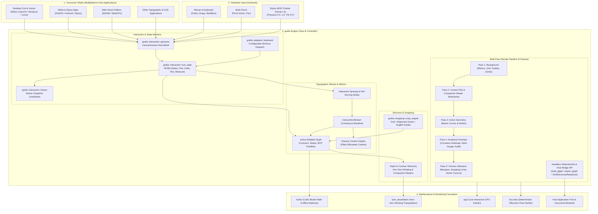

# `grafia`: Architecture Overview

`grafia` is a high-performance, modular, multiplatform Rust 2D cubic Bézier contour, glyph, and vector canvas engine for typographic and vector design applications.

It serves as the **View & Controller** layer in typography software, wrapping Linebender and Google Fonts libraries (`kurbo`, `lyon_tessellation`, `egui`, `tiny-skia`) with deterministic, invariant-checked interaction handling.

---

## Architecture Diagram

---

## Specifications

The formal normative specifications live in:
- [`SPEC-001-GLIFO-UNIVERSAL-GLYPH-CANVAS-ENGINE.md`](./SPEC-001-GLIFO-UNIVERSAL-GLYPH-CANVAS-ENGINE.md)
- [`SPEC-002-V0.1-CANVAS-INTERACTION-AND-RENDERING.md`](./SPEC-002-V0.1-CANVAS-INTERACTION-AND-RENDERING.md)
- [`SPEC-003-V0.2-TRANSFORMS-LASSO-AND-PATH-OPS.md`](./SPEC-003-V0.2-TRANSFORMS-LASSO-AND-PATH-OPS.md)
- [`SPEC-004-V0.3-GUIDES-SNAP-ENGINE-AND-ALIGNMENT-ZONES.md`](./SPEC-004-V0.3-GUIDES-SNAP-ENGINE-AND-ALIGNMENT-ZONES.md)
- [`SPEC-005-V0.4-EDIT-TOOLS-AND-ANNOTATIONS.md`](./SPEC-005-V0.4-EDIT-TOOLS-AND-ANNOTATIONS.md)
- [`SPEC-006-V0.5-TEXT-STREAM-AND-KERNING.md`](./SPEC-006-V0.5-TEXT-STREAM-AND-KERNING.md)
- [`SPEC-007-V0.6-PREVIEW-BLUR-AND-SELECTION-INFO.md`](./SPEC-007-V0.6-PREVIEW-BLUR-AND-SELECTION-INFO.md)
- [`SPEC-008-V0.7-BACKGROUND-ANCHORS-COMPONENTS-STROKE.md`](./SPEC-008-V0.7-BACKGROUND-ANCHORS-COMPONENTS-STROKE.md)
- [`SPEC-009-V0.8-CURVE-HARMONIZATION-TUNNI-AND-OUTLINE-AUDIT.md`](./SPEC-009-V0.8-CURVE-HARMONIZATION-TUNNI-AND-OUTLINE-AUDIT.md)
- [`SPEC-010-V0.9-SMART-CORNERS-CALLIGRAPHIC-BRUSH-AND-STEM-GAUGE.md`](./SPEC-010-V0.9-SMART-CORNERS-CALLIGRAPHIC-BRUSH-AND-STEM-GAUGE.md)
