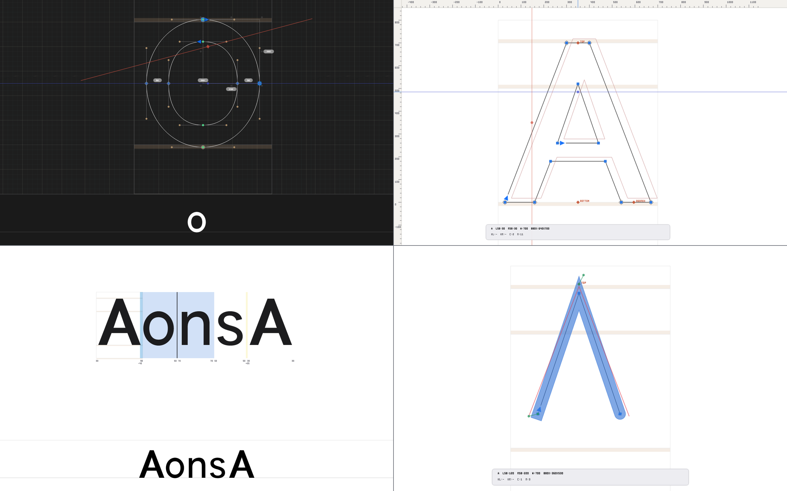
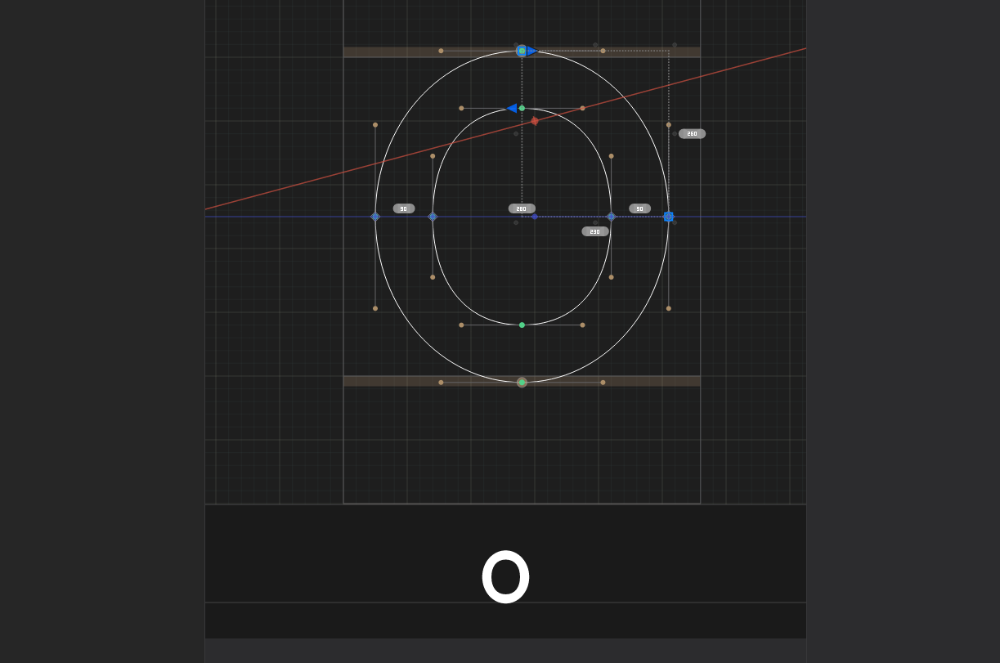
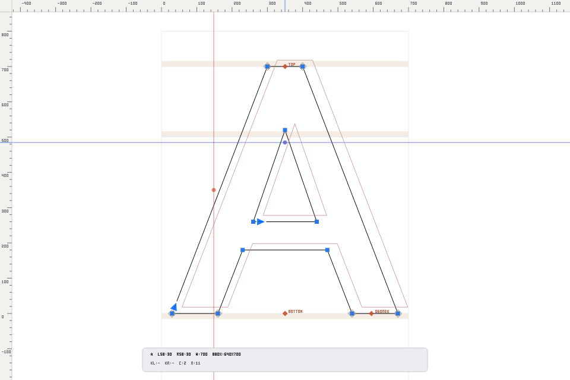
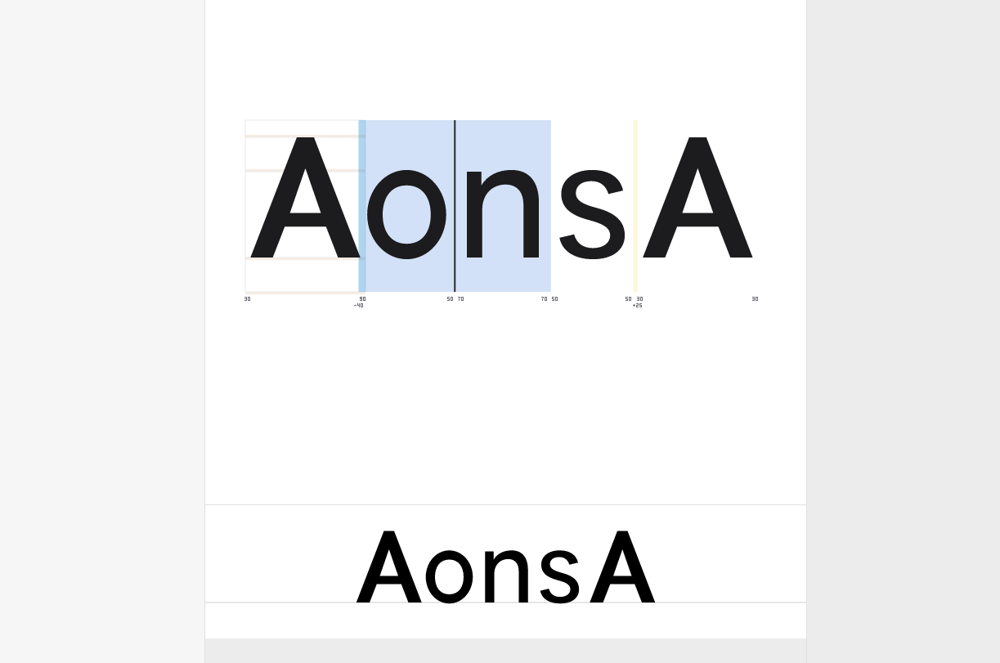
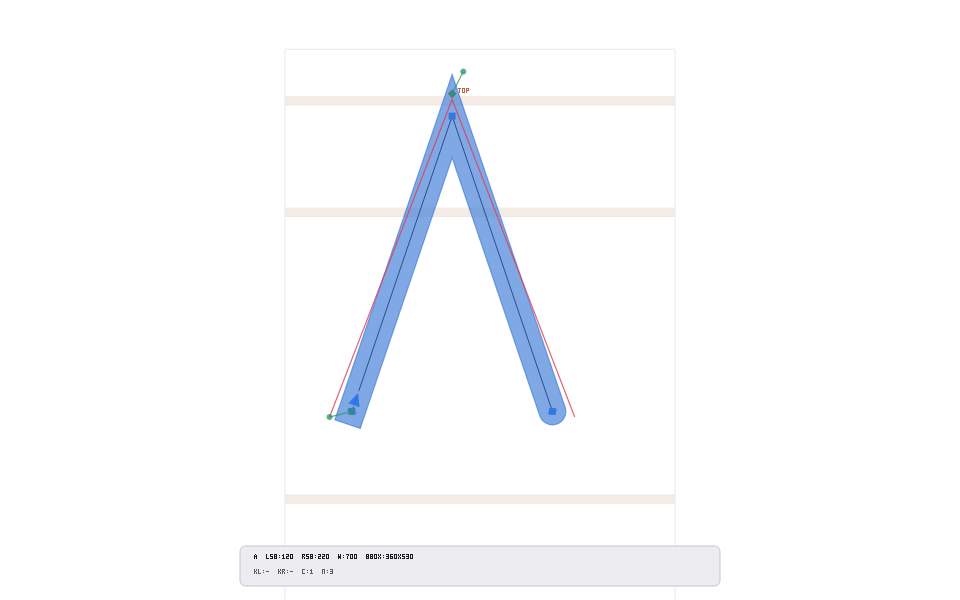
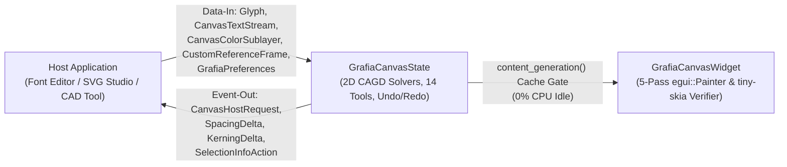

# grafia

**Interactive 2D Cubic Bézier, Spline, Vector & Typography Canvas Widget for `egui`**

[](https://crates.io/crates/grafia)
[](https://docs.rs/grafia)
[](https://github.com/emilk/egui)
[](https://github.com/oversluizen/grafia)
[](https://github.com/oversluizen/grafia)



> **Try the live interactive desktop showcase in one command:**
> ```sh
> cargo run --example vector_canvas_demo
> ```

---

## 1. Why `grafia`?

`grafia` is a zero-`unsafe`, battery-efficient, drop-in 2D vector and spline canvas widget for [`egui`](https://github.com/emilk/egui), built on the Linebender geometry stack (`kurbo`), `lyon_tessellation`, and `tiny-skia`.

Rather than locking your application into a rigid document format or monolithic editor shell, `grafia` operates as a **Hexagonal Data-In / Event-Out View & Controller**: your host application feeds pure 2D scene geometry into [`GrafiaCanvasState`], renders [`GrafiaCanvasWidget`] inside any `egui::Ui`, and drains strongly-typed semantic events and mutations from the host-port queues.

### Built for Four Core Domains

1. **Vector Illustration & SVG Editors**
   - Persistent cubic Bézier pen & select state machines, tension-controlled **Hobby splines** (`NodeType::HobbyStar`) and $G^2$ **Euler/Spiro spirals** (`NodeType::EulerSpiro`).
   - Exact **Boolean Pathfinder** operations (`remove_overlap_in_contours`, `subtract_contours`, `intersect_contours`), recursive De Casteljau **Knife** slicing, geometric **Primitives** (rectangles, ellipses), freehand **Pencil** curve fitting, and **Multi-Layer Vector Color/Gradients** (`Solid`, `LinearGradient`, `RadialGradient`, `SweepGradient`, `Bitmap`, `ClippingMask`) with interactive on-canvas gradient stop handles.
2. **Typeface & Font Engineering**
   - Native UPM (`FontUnit` / `FontPoint`) coordinate space, foreground/background layers, **2D Anchors** with diacritic mark-cloud overlays (`GhostMarkPath`), and pre-resolved **Components** with parametric **Smart Handles** (`CanvasSmartHandle`).
   - Interactive **Multi-Glyph Text Streams** (`WritingDirection::LeftToRight` horizontal and `WritingDirection::TopToBottom` vertical CJK layout) with live in-canvas spacing (`LSB`/`RSB`/`TSB`/`BSB`) and pair kerning deltas.
   - Variable-font **Companion Master Compatibility** diagnostics, **Higher-Order Interpolation (`HOI`)** control-polygon overlays, and **PostScript / TrueType Hinting** visual instructors.
3. **2D CAD, CAM, Plotter & Profile Editors**
   - Type-safe bijective coordinate transforms (`FontPoint` $\leftrightarrow$ `ScreenPoint`), domain-agnostic **Custom Reference Frames** (`CustomReferenceFrame` with outer/inner bounds, $N_x \times N_y$ grids, keyline circles, and zoom-scaling band lines), top/left UPM rulers, magnetic **SnapEngine**, and live **Measurement Rays** with typographic angle and span readouts.
4. **Bitmap-to-Vector Digitization**
   - Built-in deterministic **7-stage Bitmap & Camera Auto-Trace** (`trace_background_image`) featuring Sauvola integral-image adaptive thresholding, $3\times 3$ homography perspective deskew, marching squares, Ramer-Douglas-Peucker simplification, and Schneider least-squares cubic Bézier fitting.

---

## 2. Quick Start

Add `grafia` to your `Cargo.toml` and drop [`GrafiaCanvasWidget`] into any `egui::Ui`:

```rust
use grafia::{
    CanvasHostRequest, ContourId, Glyph, GlyphContour, GlyphMetrics,
    GrafiaCanvasState, GrafiaCanvasWidget, GrafiaTheme, Node, NodeId, NodeType,
};

// 1. Initialize the theme and canvas state once in your application struct:
let theme = GrafiaTheme::sonoma_default();
let mut state = GrafiaCanvasState::new(theme.clone());

// 2. Load a 2D vector shape or glyph into the hexagonal Data-In port:
let contour = GlyphContour::new(
    ContourId(0),
    vec![
        Node::new(NodeId(1), 100.0, 0.0, NodeType::Corner),
        Node::new(NodeId(2), 350.0, 700.0, NodeType::Corner),
        Node::new(NodeId(3), 600.0, 0.0, NodeType::Corner),
    ],
);
let glyph = Glyph {
    name: "A".to_string(),
    upm: 1000,
    width: 700.0,
    height: 700.0,
    contours: vec![contour],
    ..Glyph::default()
};
state.load_glyph(glyph, GlyphMetrics::default());

// 3. Inside your egui update loop, render the widget and poll Event-Out requests:
fn update_canvas(ui: &mut egui::Ui, state: &mut GrafiaCanvasState, theme: &GrafiaTheme) {
    let _response = GrafiaCanvasWidget::new(state, theme).show(ui);

    for request in state.drain_host_requests() {
        if let CanvasHostRequest::OpenComponentSource { id, component_name } = request {
            let _ = (id, component_name);
        }
    }
}
```

---

## 3. Visual Feature Showcase

| Dark Mode Cubic Bézier & Measurement Guides | Light Mode Rulers, Background Layer & 2D Anchors |
| :---: | :---: |
|  |  |
| Full dark-mode wireframe editing with cubic off-curve handles, angled measurement guide with live span/angle telemetry pills, alignment zone badges, and bottom filled preview strip. | Precision top/left UPM rulers with cursor hairlines, rose background reference layer, named 2D anchors (`top`, `bottom`, `ogonek`), and live glyph metrics HUD. |
| **Multi-Glyph Text Stream & Live Kerning** | **Live Contour Stroke & Master Compatibility** |
|  |  |
| Interactive multi-glyph text run (`AonsA`) with caret navigation, text range selection, beneath-slot LSB/RSB/kerning readouts, and synchronized separable-blur bottom preview strip. | Non-destructive calligraphic stroke expansion (`ContourStrokeStyle` with round caps/joins) alongside variable-font companion master compatibility diagnostics. |

---

## 4. Hexagonal Host-Port Architecture (Data-In / Event-Out)

`grafia` never couples your application to a specific disk format (such as UFO, OTF/TTF, SVG, or DXF). All communication flows through deterministic, serializable Rust value types:



---

## 5. Feature Matrix

| Capability Pillar | Highlights |
| :--- | :--- |
| **Curve & Spline Mathematics** | Cubic Béziers (`Corner`, `Smooth`, `OffCurve`), Romer/Henestrosa $G^2$ & $G^3$ clothoid **Curve Harmonization** (`harmonize_selected_nodes` `[Ctrl+Shift+H]`, `harmonize_handles_keep_node`, live `set_node_genius` / `set_node_g3_lock`, `classify_node_continuity`), interactive **Tangent Balance (Tunni) Lines** (`compute_tunni_overlays`, `balance_segment_tunni`), **Proportional Handle Servo** (`servo_translate_on_curve_node`), **Interpolated Neighbour Nudge** (`power_nudge_translate_selected` `[C]`), live 120 fps **Curvature Comb & Heatmap Envelope** (`compute_curvature_comb_spines`, `compute_curvature_heatmap_envelopes`, `find_cubic_inflection_points`), non-destructive **Smart Corners & Ink Traps** (`SmartCornerSpec`, `compute_smart_corner_preview_contours`, `bake_smart_corners`), **Pressure & Tilt Calligraphic Brush** (`fit_calligraphic_brush_stroke`, `apply_calligraphic_brush_stroke`), **Non-Linear Curved Master Trajectories** (`CurvedTrajectoryLink`, `evaluate_curved_master_point`, `evaluate_curved_master_contour`), **Local `Trowel` & `Cleaner` Brushes** (`apply_trowel_brush_at_upm`, `apply_cleaner_brush_at_upm`), **Lamé Superellipse / Squircle Generator** (`build_superellipse_contour_nodes`), tension-controlled **Hobby splines** (`NodeType::HobbyStar`), $G^2$ **Euler/Spiro spirals** (`NodeType::EulerSpiro`), 4-mode inverse-Bernstein belly dragging (`apply_cubic_segment_belly_drag`), curve-healing deletion (`heal_delete_nodes`), and 8-step `apply_fit_curve_ratio_to_contours`. |
| **19 Interactive Canvas Tools** | `Select` (`V`), `Lasso` (`Shift+V`), `Pen` (`P`), `Rotate` (`R`), `Scale` (`S`), `Zoom` (`Z`), `Knife` (`E`), `Primitives` (`F`), `Measurement` (`L`), `Annotation` (`A`), `Pencil` (`B`), `Pixel` (`X`), `Text` (`T`), `TrueTypeInstructor`, `Hoi`, `Stem`, `CurvedTrajectory`, `Trowel`, and `Cleaner`. |
| **Boolean Pathfinder, Outline Audit & Topology** | Exact cubic-cubic intersection graph solver for Union (`remove_overlap_in_contours`), Subtract (`subtract_contours`), and Intersect (`intersect_contours`), **Interactive Structural `Stem` Tool & Measurement Rainbow** (`detect_structural_stems`, `adjust_structural_stem`, `set_show_measurement_rainbow`, `CanvasHostRequest::PropagateStemDelta`), **Proactive Vector Outline Audit** (`audit_layer_outlines` detecting `MissingExtremum`, `QuasiOrthogonalStem`, `CrossedHandles`, `CollinearCubic`), **Orthogonal Stem Thickness Gauge** (`measure_orthogonal_stem_thickness`, `StemGaugeMatch`), **Green's Theorem Counter Area & Visual Centroid** (`compute_contour_area_and_centroid`, `compute_layer_counter_balance`), **Live Optical Symmetry Ghost Overlays & 1-Axis Live Mirror** (`SymmetryOverlayMode`, `ActiveMirrorAxis`, `add_contour_with_active_mirror`), **Scanline Optical Rhythm Integrals** (`compute_pair_optical_whitespace`, `set_show_optical_rhythm_fill`), **`QuickPreviewOnDrag` & Overshoot Ribbons** (`set_quick_preview_on_drag`, `set_round_overshoot_upm`), off-axis handle warnings (`compute_angled_handle_warnings`), handle-ratio HUD (`compute_segment_handle_ratios`), diagonal virtual apex snapping (`compute_tangent_extension_snaps`), and cross-master auto-matching (`auto_match_master_compatibility`). |
| **Snapping, Rulers & Reference Frames** | Magnetic `SnapEngine` across metric lines, alignment zones, local/global guides (`GuideThickness::ScreenDp` and zoom-scaling `GuideThickness::FontUnits`), nodes, 2D anchors, background contours, and `CustomReferenceFrame` grids/keyline circles. |
| **Multi-Glyph Text & Typography** | Horizontal (`LeftToRight`) and vertical CJK (`TopToBottom`) multi-glyph streams (`CanvasTextStream`), double-click slot activation, keyboard spacing (`LSB`/`RSB`/`TSB`/`BSB`) & pair kerning adjustments, 2D `CanvasAnchor`s with `GhostMarkPath` clouds, `CanvasComponent`s with parametric `CanvasSmartHandle`s, PostScript stem/ghost hints, and TrueType visual instructions. |
| **Color Layers & Bitmap Auto-Trace** | Multi-layer vector paint (`Solid`, `LinearGradient`, `RadialGradient`, `SweepGradient`, `Bitmap`, `ClippingMask`) with Porter-Duff `SrcOver` compositing and on-canvas gradient handles; 7-stage deterministic bitmap & camera auto-trace (`trace_background_image`). |
| **Performance & Safety Guarantees** | `#![forbid(unsafe_code)]`, `#![forbid(dead_code)]`, zero `.unwrap()` / `.expect()` in production code, monotonic `content_generation()` cache gating for **0% CPU idle frames**, and 1:1 visual parity between `egui::Painter` and headless `tiny_skia::Pixmap`. |

---

## 6. Architecture, Module Map & Developer Guides (`src/`)

Each module includes an in-depth mathematical and conceptual guide rendered on `docs.rs` (with KaTeX formula support):

| Module | `docs.rs` Developer Guide | Responsibility |
| :--- | :--- | :--- |
| [`core`] | [Core Math, Splines, Topology & Auto-Trace](https://github.com/oversluizen/grafia/blob/main/docs/guide/core_math_and_topology.md) | Type-safe coordinates (`FontUnit`, `FontPoint`, `ScreenDp`, `ScreenPoint`, `ViewportTransform`), cubic Bézier & Hobby/Euler-Spiro spline math, 4-case inverse-Bernstein belly dragging, boolean pathfinder, knife, primitives, measurement rays, color layers, hinting/HOI models, and 7-stage Sauvola/Schneider bitmap auto-trace. |
| [`interaction`] | [Tool State Machines & Transactional Undo/Redo](https://github.com/oversluizen/grafia/blob/main/docs/guide/interaction_and_undo.md) | Deterministic finite state machines (`SelectToolState`, `PenToolState`, `CanvasGesture`), keyboard modifiers, and atomic `CommandHistory` (`GlyphSnapshot` undo/redo). |
| [`snapping`] | [Magnetic Snapping, Guides & Reference Frames](https://github.com/oversluizen/grafia/blob/main/docs/guide/snapping_and_reference_frames.md) | Priority-based magnetic `SnapEngine`, local and global `Guide` management (`ScreenDp` vs. zoom-scaling `FontUnits`), `AlignmentZone` overshoot badges, `CustomReferenceFrame`, and `GlyphMetrics`. |
| [`render`] | [5-Pass Pipeline, Tessellation & Zero-CPU Caching](https://github.com/oversluizen/grafia/blob/main/docs/guide/rendering_and_caching.md) | GPU tessellation (`tessellate_contours_nonzero`, `tessellate_contours_even_odd`), view-mode projections (`EditWireframe`, `PreviewFilled`, `ShapeThumbnail`), separable Gaussian blur `GrafiaPreviewWidget` (`PreviewStripCache`), and `content_generation()` cache gating. |
| [`locator`] | Minimap Projections | `ShapeLocatorRenderer` & `ShapeLocatorWidget` 2-layer vector minimap with Non-Zero Winding counter reconstruction and `CCW`/`CW` winding indicators. |
| [`adapters`] | [Hexagonal Host-Port & Headless Verification](https://github.com/oversluizen/grafia/blob/main/docs/guide/adapters_and_host_port.md) & [Hardware & Controller Ports (`SPEC-015`)](https://github.com/oversluizen/grafia/blob/main/docs/guide/hardware_and_controller_ports.md) | `GrafiaCanvasState` (with `load_glyph`, `export_glyph`, `load_document_scene`, hexagonal host ports, and the 5 universal controller/rotary/telemetry/haptic/stylus ports), `GrafiaCanvasWidget`, 5-pass `CanvasPainter`, `InputDispatcher`, `validate_invariants`, and `tiny-skia` headless offscreen verifier. |
| [`tokens`] | Theme, Keymap & Preference Tokens | Data-driven theme, color, metric, cursor, keymap (`GrafiaKeymap`), and preference (`GrafiaPreferences`) tokens (`Light`, `Dark`, and `System` appearance modes). |

---

## 7. Verification & Development Commands

```sh
# Launch the interactive desktop vector canvas demo:
cargo run --example vector_canvas_demo

# Run the full test suite (unit, integration, property-based & headless visual parity):
cargo test

# Run architectural & clean-room guardrails:
cargo test --test architecture_guard_tests

# Run rustdoc doctests & verify documentation links:
cargo test --doc
cargo doc --no-deps

# Run strict static analysis (zero warnings):
cargo clippy --all-targets -- -D warnings
```

---

## License

Licensed under either of:

- Apache License, Version 2.0 (<https://www.apache.org/licenses/LICENSE-2.0>)
- MIT license (<https://opensource.org/licenses/MIT>)

at your option.
