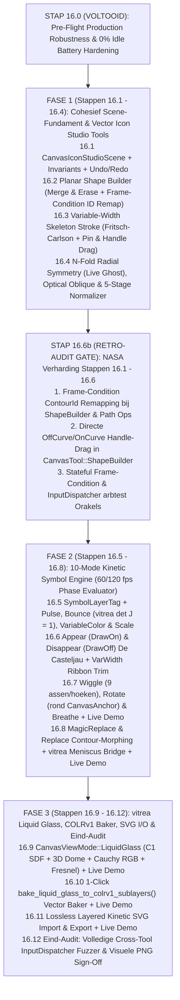

# Master Roadmap `grafia v0.14.0` (`SPEC-016`) — Sequentiële Micro-Stappen volgens NASA JPL / IBM Production-Level Normen

> **Doel van deze Roadmap:**
> De bouw en verharding van `SPEC-016` (`grafia v0.14.0`) uitvoeren in **strikt gecontroleerde, sequentiële micro-stappen (`Stap 16.0` t/m `Stap 16.12`, inclusief Retro-Audit Gate `Stap 16.6b`)**. Elke micro-stap — zowel de reeds gebouwde stappen `16.1`–`16.6` als de volgende stappen `16.7`–`16.12` — moet voldoen aan **alle 4 NASA Productie-Pijlers**:
> 1. **Ongeclipte `arbtest` Fuzzing** (`NaN`, `±Inf`, subnormals `f64::MIN_POSITIVE`, degeneratieve 0/1/2-node contouren),
> 2. **Frame-Condition & Foreign-Key Behoud** (*wat NIET mag veranderen*: ongewijzigde contouren behouden altijd hun gekoppelde `VariableWidthStrokeSpec`, `ContourStrokeStyle`, `SymbolLayerTag` en `SmartCornerSpec` bij index-verschuivingen),
> 3. **End-to-End `InputDispatcher` UI-Toestandsmachine Verificatie** (echte pointer-, tablet-touch- en stylus-drags op `OffCurve` Bézier-handles, `OnCurve` knopen en tool-handles over alle actieve `CanvasTool`-modi heen),
> 4. **Shift-Left Multi-Pass Rendering & Live Demo/WASM Pariteit per Stap** (`EditWireframe`, `PreviewFilled`, onderste `PreviewPanel`, `render_colored_thumbnail`, en directe bedienbaarheid in de Demo Host Shell / WASM WebApp).

---

## 1. De 8 IJzeren NASA / IBM / Google / Apple / Microsoft Productie-Bouwregels (Zero Vibe-Coding, Zero Weak Oracles)

1. **Één Micro-Stap per Keer (`Max 1–3 bestanden`, `< 398 eSLOC` voor `src/*.rs`, `< 300 eSLOC` voor `examples/*.rs`):**
   Elke micro-stap levert precies één afgebakend deelsysteem op met een eigen COTS-test (`TC-V0140-001` t/m `TC-V0140-012`) in `tests/v0140_complete_tests.rs`.
2. **Pijler A (NASA / Google Fuzzing) — Ongeclipte Numerieke & Topologische `arbtest` Fuzzing:**
   Geen enkele `arbtest` mag alleen "happy-path" waarden testen; elke fuzzer injecteert ongefilterde `f64::NAN`, `±f64::INFINITY`, `f64::MIN_POSITIVE` en willekeurige contour-topologieën en eist 100% eindige coördinaten zonder panics.
3. **Pijler B (NASA IV&V / IBM Cleanroom) — Formele Frame-Conditions & Volledige Relationele Integriteit (`ContourId` / `NodeId` Lineage):**
   Wanneer een operatie (`apply_shape_builder_operation`, `bake_variable_width_strokes`, `bake_radial_symmetry`, `apply_optical_oblique`, `normalize_icon_contours`, `remove_overlap`, boolean path ops) een deelverzameling van contouren muteert of samenvoegt en de contourlijst hernummert (`ContourId(0..N)`), **MOET**:
   - elke ongemoeide / open contour haar exacte `closed`-vlag en bestaande `NodeId`s behouden (en mogen `apply_optical_oblique` en `normalize_icon_contours` bij 1-op-1 contourtransformaties niet onnodig nieuwe `NodeId`s uitdelen waardoor `smart_corners`, `genius_nodes` en `g3_nodes` verloren gaan);
   - een deterministische `old_id -> new_id` mapping (op basis van `NodeId`-lineage van overlevende contouren) alle gekoppelde tabellen (`variable_width_strokes`, `contour_strokes`, `symbol_layer_tags`) hernummeren. Het blind weggooien of op een verkeerde contour laten landen van eigenschappen via alleen `.retain(|vw| cids.contains(&vw.contour_id))` is **verboden**.
4. **Pijler C (Apple ProMotion / Microsoft Input) — End-to-End `InputDispatcher` Handle-Prioriteit & Pointer-Capture Invariant (Mouse, Tablet Touch `1.6x`, Stylus):**
   Geen enkele feature wordt alleen op `core`-niveau getest. Elke stap verifieert via gesimuleerde `InputDispatcher`-frames (`PointerButton`, `PointerMoved`, `Event::Touch` Start/Move/End/Cancel) dat:
   - een deterministische **Z-Order Hit-Test Prioriteit** geldt (`OffCurve Bézier-Handle > VariableWidthHandlePin > GradientHandle > SmartCorner/Tunni > OnCurve Node > CanvasAnchor > SegmentBelly > PlanarRegion`), zodat een `OffCurve` Bézier-handle altijd wint, zelfs als een `VariableWidthHandlePin` met breedte `0 UPM` of een `ShapeBuilderRegion` eronder ligt;
   - eenmaal gestarte drags 100% vergrendeld blijven op hun actieve drag-target (*Pointer Capture Invariant*) tot `Release` of `Cancel`;
   - `handle_select_double_click` nooit een `OffCurve` Bézier-handle onderschept;
   - 2-vinger pinch/pan en toolbar-taps buiten `canvas_rect` nooit `primary_press_active` of `contacts` vervuilen.
5. **Pijler D (Google / Apple Cross-Target Parity) — Shift-Left Multi-Pass Rendering, `wasm32` Compile-Gate & Live WASM Demo-Integratie per Stap:**
   Elke micro-stap werkt direct zowel `EditWireframe`, `PreviewFilled`, het onderste `PreviewPanel` als de live **Icon Studio & Kinetische Tijdlijn-balk** in `examples/demo_host_shell/icon_studio_showcase.rs` bij, en doorloopt verplicht `cargo check --target wasm32-unknown-unknown --example vector_canvas_demo` + live WASM deployment naar GitHub Pages.
6. **Pijler E (IBM Cleanroom Algebraic Inversion) — Volledige Undo/Redo Inversie-Wet (`Undo(Do(S)) == S` & `Redo(Undo(Do(S))) == Do(S)`):**
   Elke muterende operatie $M$ (inclusief `ShapeBuilder` met `old_cid -> new_cid` remapping, `VariableWidthHandlePin`-drags, `bake_*`, `optical_oblique`, `normalize_icon_contours`, `COLRv1` baking en `SVG` import) MOET in `arbtest` bewijzen dat `undo()` en `redo()` exact bit-identieke snapshots herstellen voor zowel `glyph.contours` (`closed`, `nodes`, `NodeId`s) als `icon_studio` (`variable_width_strokes`, `symbol_layer_tags`, `radial_symmetry`, `liquid_glass`), `color_sublayers`, `contour_strokes` en `curve_harmony`.
7. **Pijler F (Microsoft State-Machine Clean-Slate) — Atomair Afbreken & Terugdraaien van In-Flight Drags (`cancel_in_flight_interaction_and_rollback()`):**
   Wanneer een lopende drag (`DraggingNodes`, `DraggingSegment`, `active_width_pin_drag`, `active_gradient_drag`, `active_smart_handle_drag`, `ShapeBuilder`, `Pen`, `Knife`, `Primitives`, `Pencil`, `Pixel`, `BBoxDragging`) wordt onderbroken door `Key::Escape`, `TouchPhase::Cancel`, `activate_tool(...)` of een 2e vinger (`two_finger_peak`), MOET `cancel_in_flight_interaction_and_rollback()` eventuele ongecommitte deel-mutaties atomair terugzetten naar `active_drag_before_snapshot` én alle tijdelijke drag- en touch-vlaggen schoonvegen zonder "ghost state".
8. **Pijler G (Google Chrome / Apple 60–120fps Budget) — Zero-Waste Caching & Active Bounding-Box Culling:**
   Alle zware evaluaties (`compute_shape_builder_regions`, `expand_variable_width_contour`, `evaluate_active_kinetic_*`, en in `Stap 16.9` `render_liquid_glass_pixmap` met SDF/Cauchy-refractie) MOETEN gecachet zijn op `content_generation` en bij pixel-shaders uitsluitend evalueren binnen de geëxpandeerde contour-bounding-box (*Active BBox Culling*) + `MAX_INTERACTIVE_DRAG_PIXMAP_DIM` tijdens actieve drags.

---

## 2. Fase 1 — Cohesief Scene-Fundament & Vector Icon Studio Tools (`Stappen 16.1` – `16.4`)

| Micro-Stap | Exacte Scope & NASA Productie-Eisen (`Max 1–3 bestanden`) | SSOT in `SPEC-016` | NASA COTS & `arbtest` Test-Orakel (`RED -> GREEN`) |
| :---: | :--- | :---: | :--- |
| **`Stap 16.1`** *(Voltooid)* | **Cohesief Fundament: `vitrea v0.1.0` Koppeling, `CanvasIconStudioScene`, `validate_invariants()` & Undo/Redo Snapshot** 1. `src/core/icon_studio.rs` met `CanvasIconStudioScene`, `SymbolLayerTag`, `KineticTimelineState`, `KineticSymbolEffect`, `LiquidGlassRenderConfig`, `RadialSymmetrySpec` en `VariableWidthStrokeSpec`. 2. Volledige integratie in `GrafiaCanvasState`, `CanvasDocumentScene`, `GlyphSnapshot` (`Undo/Redo`) en `validate_invariants(&self)`. | `§2.1`–`§2.3` | - **`TC-V0140-012`**: Bit-exacte `State_0 -> Mutatie -> State_1 -> Undo == State_0 -> Redo == State_1` roundtrip op `icon_studio`, `CanvasDocumentScene` JSON-roundtrip, `validate_invariants()` foutdetectie, `0%` idle repaint bij `playing == false`, en ongeclipte `arbtest` op `sanitized()`. |
| **`Stap 16.2`** *(Basis voltooid $\rightarrow$ Verharding in `16.6b`)* | **Interactive Planar Shape Builder (`CanvasTool::ShapeBuilder`)** 1. `src/core/shape_builder.rs`: `compute_shape_builder_regions` & `apply_shape_builder_regions_to_contours` (`Merge` & `Erase`). 2. **Frame-Condition & ID-Lineage (`16.6b`):** Niet-geraakte contouren (zoals open curves of losstaande vormen) behouden via `old_id -> new_id` remapping al hun gekoppelde `variable_width_strokes`, `contour_strokes` en `symbol_layer_tags`. 3. **Directe Handle-Drag in `ShapeBuilder` (`16.6b`):** Aanraken van een `OffCurve` Bézier-handle, `OnCurve` knoop of `VariableWidthHandlePin` terwijl `CanvasTool::ShapeBuilder` actief is, versleept direct die handle/knoop/pin; alleen drukken op een vlak-interieur start een `ShapeBuilder`-vlakselectie. | `§3.1` | - **`TC-V0140-001`**: 3 disjunkte regio's bij twee snijdende cirkels; `Merge` & `Erase` + bit-exacte `Undo/Redo`. - **Frame-Condition & `InputDispatcher` Orakel (`16.6b`)**: Samenvoegen van twee vierkanten boven een open S-curve met `VariableWidthStrokeSpec` laat het breedteprofiel én de geometrie van de S-curve 100% intact; slepen aan de `OffCurve`-handles van de S-curve via `InputDispatcher` terwijl `CanvasTool::ShapeBuilder` actief is verplaatst de `OffCurve`-handle exact. |
| **`Stap 16.3`** *(Basis voltooid $\rightarrow$ Verharding in `16.6b`)* | **Variable-Width Skeleton Stroke (*Width Tool* — Fritsch-Carlson Monotone Hermite)** 1. `src/core/variable_width_stroke.rs`: `evaluate_variable_width_at_t` (Fritsch-Carlson monotone Hermite), `expand_variable_width_contour` (met periodieke naadsluiting $w(1)=w(0)$ en zelf-intersectie-verwijdering op zowel open als gesloten contouren), `compute_variable_width_handle_pins` en `hit_test_variable_width_handle_pin`. 2. Live canvas-preview van het geëxpandeerde lint (ook als `contour_strokes` leeg is), `1.6x` touch-geschaalde pin hit-radius, rotary encoder ondersteuning, en `Undo/Redo`-behoud na `bake_variable_width_strokes()`. | `§3.2` | - **`TC-V0140-002`**: Monotone Hermite-interpolatie blijft overal binnen `[min_sample, max_sample]` (`arbtest`); zelf-intersectievrije expansie op open en gesloten contouren; directe pointer/touch/stylus drag op zowel `VariableWidthHandlePin` als de onderliggende `OffCurve` Bézier-handles via `InputDispatcher`. |
| **`Stap 16.4`** *(Voltooid)* | **$N$-Fold Radial Symmetry, Stem-Preserving Optical Oblique & 5-Stage Multi-Scale Icon Normalizer** 1. `src/core/icon_symmetry_and_clean.rs`:    - `compute_radial_symmetry_contours` ($N \in 1..=32$ + live ghost-sectoren op het canvas vóór het bakken),    - `compute_optical_oblique_contours` (gedeeld oppervlakte-gewogen laag-zwaartepunt $(C_x, C_y)$ zodat buiten- en binnencontouren hun wanddikte met $\sec\alpha$ behouden),    - `audit_and_normalize_icon_contours` (5-staps pijplijn + subnormal float overflow-guard in `round_grid_pt`). | `§3.3`, `§3.4` | - **`TC-V0140-003`** & **`TC-V0140-004`**: 6-voudige radiale symmetrie rotatie-invariantie + live ghost-preview in `EditWireframe`; optische oblique op $12^\circ$ behoudt wanddikte tussen buiten- en binnencontour binnen `< 1.5%`; normalizer herstelt zelf-overlappende contouren in 1 aanroep naar `0` audit-fouten (`arbtest` inclusief subnormals). |

---

## 3. Fase 2 — Retro-Audit Gate `16.6b` & 10-Mode Kinetic Symbol Engine (`Stappen 16.5` – `16.8`)

| Micro-Stap | Exacte Scope & NASA Productie-Eisen (`Max 1–3 bestanden`) | SSOT in `SPEC-016` | NASA COTS & `arbtest` Test-Orakel (`RED -> GREEN`) |
| :---: | :--- | :---: | :--- |
| **`Stap 16.5`** *(Voltooid)* | **Kinetic Evaluator Kern & Effecten 1–4 (`Pulse`, `Bounce` met `vitrea` $\det J = 1.0$, `VariableColor`, `Scale`)** 1. `src/core/kinetic_symbols.rs`: lokale laag-fase $\tau_g(t)$ (`WholeSymbol` vs. `ByLayer`), gedeeld groeps-draaipunt $\mathbf{c}_g$ per `layer_group`, en gesloten transferfuncties voor `Pulse`, `Bounce` (`vitrea::deform_viscous_droplet_point` $\det J = 1.0$), `VariableColor` (met $C^1$ raised-cosine cross-fade) en `Scale`. 2. Live kinetische weergave in `EditWireframe`, `PreviewFilled`, onderste `PreviewPanel` en `render_colored_thumbnail`. | `§4.1`, `§4.2` (#1–#4) | - **`TC-V0140-005`**: `Bounce` behoudt 2D oppervlakte ($\det J = 1.0$, `< 1%` afwijking); `VariableColor` $C^1$-continu; gedeeld groeps-pivot $\mathbf{c}_g$; live pixel-verandering in `EditWireframe`, `PreviewFilled` en `PreviewPanel` + ongeclipte `arbtest`. |
| **`Stap 16.6`** *(Voltooid)* | **Kinetic Effecten 5–6 (`Appear` / `DrawOn` & `Disappear` / `DrawOff` via De Casteljau Booglengte-Trimming)** 1. `src/core/kinetic_draw_trim.rs`: exacte De Casteljau kubische Bézier-subdivisie `trim_contour_by_arc_ratio` op Gauss-Legendre booglengte. 2. Wanneer een contour een actief `VariableWidthStrokeSpec`-profiel heeft, wordt het breedteprofiel tijdens `DrawOn`/`DrawOff` op het getrimde interval $[r_0, r_1]$ geherbemonsterd en tot een gesloten variabele-breedte lint geëxpandeerd. | `§4.2` (#5–#6) | - **`TC-V0140-006`**: Monotone booglengte-groei/-krimp bij `DrawOn`/`DrawOff`; getrimde `VariableWidthStrokeSpec`-contour expandeert tot gesloten lint; zichtbare stroke-pixels in zowel `PreviewFilled` als `render_colored_thumbnail` + ongeclipte `arbtest`. |
| **`Stap 16.6b`** *(Huidige Gate — Verplicht vóór `16.7`)* | **Retrospectieve NASA Productie-Verharding van `Stappen 16.1` t/m `16.6`** 1. **Frame-Condition `ContourId` Remapping (`src/core/shape_builder.rs` & `src/adapters/icon_studio_ops.rs`):** Bij `apply_shape_builder_regions_to_contours` en `finish_icon_contour_replacement` worden `variable_width_strokes`, `contour_strokes` en `symbol_layer_tags` van niet-geraakte / overlevende contouren deterministisch gemapt van hun oude `ContourId` naar hun nieuwe `ContourId` (op basis van node-ID / geometrische identiteit), zodat het samenvoegen van vlakken nooit het breedteprofiel van een onafhankelijke curve verwijdert of verschuift. 2. **Directe `OffCurve`/`OnCurve` Handle-Drag tijdens `CanvasTool::ShapeBuilder` (`src/adapters/input_dispatcher.rs` & `src/adapters/input_pointer_drag.rs`):** Wanneer in `CanvasTool::ShapeBuilder` op een `VariableWidthHandlePin` of een zichtbare knoop / `OffCurve` Bézier-handle (`hit_test_node`) wordt gedrukt, start direct de pin- of node/handle-drag (`SelectToolState::DraggingNodes`) en lopen `pointer_move` en `pointer_release` via die drag-handler. Pas als buiten pins én buiten knopen/handles op een vlak wordt gedrukt, start de `ShapeBuilder` regio-merge/erase. 3. **Preset Tweede-Klik Scheiding (`examples/demo_host_shell/icon_studio_showcase.rs`):** In `IconShapeBuilderAndVarWidth` voegt het slepen over de vierkanten (of een tweede klik) uitsluitend de overlappende vlakken samen zonder ongevraagd de variabele lijndikte van de losstaande S-curve weg te bakken. | `§3.1`, `§3.2`, `§5.4` | - **Uitbreiding `TC-V0140-001` & `TC-V0140-002` + `arbtest` (**RED $\rightarrow$ GREEN**)**:   1. *Frame-Condition Orakel*: Samenvoegen van de twee vierkanten (`ContourId(0)` & `ContourId(1)`) boven de S-curve (`ContourId(2)`) hernummert de S-curve naar haar nieuwe `ContourId` mét behoud van haar `VariableWidthStrokeSpec`, haar 3 `VariableWidthHandlePin`s én haar `OffCurve` Bézier-handles.   2. *End-to-End `InputDispatcher` Handle-Drag Orakel*: Terwijl `CanvasTool::ShapeBuilder` actief is, verplaatst een `InputDispatcher` pointer/touch/stylus drag op een `OffCurve` Bézier-handle van de S-curve die handle exact, verplaatst een drag op een `VariableWidthHandlePin` de lijndikte exact, en voegt een drag over het midden van de vierkanten de vierkanten samen.   3. *Stateful `arbtest`*: Willekeurige combinaties van `ShapeBuilder`-merges en `InputDispatcher` handle-drags behouden altijd de Frame-Condition. |
| **`Stap 16.7`** | **Kinetic Effecten 7–9 (`Wiggle` 9 Assen/Hoeken, `Rotate` rond `CanvasAnchor` & `Breathe`) + Live Demo Integratie** 1. Breid `src/core/kinetic_symbols.rs` uit met:    - **`Wiggle`**: gedempte harmonische golf $w(\tau) = \sin(4\pi\tau)e^{-2\tau}$ voor rotatie (`Clockwise`, `CounterClockwise` $\pm 18^\circ$) én lineaire oscillatie (`Left`, `Right`, `Up`, `Down`, `Forward`, `Backward`, `CustomAngle(deg)` langs $(\cos\phi, \sin\phi)$),    - **`Rotate`**: $C^2$-gladde $360^\circ$ rotatie rond het `CanvasAnchor`-draaipunt $\mathbf{c}_g$,    - **`Breathe`**: continue cosinus-schaalademhaling (`Plain` vs. `Pulse`). 2. **Shift-Left Demo & `InputDispatcher` Integratie:** Voeg `[Wiggle]`, `[Rotate]` en `[Breathe]` direct toe aan de live Kinetische Tijdlijn-balk in `examples/demo_host_shell/icon_studio_showcase.rs`, en verifieer dat het verslepen van een `CanvasAnchor` (`motion_anchor_id`) via `InputDispatcher` het draaipunt van `Rotate` en `Wiggle` live verplaatst. | `§4.2` (#7–#9), `§5.4` | - **`TC-V0140-007`** (**RED $\rightarrow$ GREEN**):   1. Tijdens een volledige `Rotate`-cyclus ($\tau \in [0, 1]$) blijft een punt op de toegewezen `CanvasAnchor` exact stil ($\|\mathbf{p}' - \mathbf{p}\| < 10^{-6}\;\text{UPM}$).   2. **Frame-Condition & `InputDispatcher` Orakel**: Verslepen van het `CanvasAnchor` via `InputDispatcher` verplaatst het rotatie-centrum $\mathbf{c}_g$ exact mee zonder ongerelateerde laaggroepen te verstoren.   3. Alle 9 `Wiggle`-richtingen (inclusief `CustomAngle(37.0)`) oscilleren langs hun exacte vector en dempen uit op $\tau = 1.0$; `Breathe` (`Plain` vs. `Pulse`) moduleert schaal en opaciteit.   4. Ongeclipte `arbtest` over alle 9 `Wiggle`-richtingen, `Rotate` en `Breathe` met willekeurige `NaN`/`±Inf` hoeken en anker-coördinaten. |
| **`Stap 16.8`** | **Kinetic Effect 10 (`MagicReplace` & `Replace` Content Transition met `vitrea` Meniscus Bridge) + Live Demo Integratie** 1. Maak `src/core/kinetic_magic_replace.rs`: koppel bron- en doelcontouren op `layer_group` / index, harmoniseer hun kubische knoop-aantallen via De Casteljau subdivisie, en interpoleer $\mathbf{P}(\tau) = (1 - s(\tau))\mathbf{P}_{\text{src}} + s(\tau)\mathbf{P}_{\text{dst}}$. 2. Voeg voor nabije morfende contouren de `vitrea::tessellate_meniscus_bridge` vloeistofbrug toe en handel niet-gepaarde sublagen af via de gekozen fallback (`DownUp`, `UpUp`, `OffUp`). 3. **Shift-Left Demo Integratie:** Voeg `[MagicReplace]` direct toe aan de Kinetische Tijdlijn-balk en `EditWireframe` / `PreviewFilled` / `PreviewPanel`. | `§4.2` (#10), `§5.4` | - **`TC-V0140-008`** (**RED $\rightarrow$ GREEN**):   1. Transitie tussen twee multi-laag symbolen (*Play* $\leftrightarrow$ *Pause*) vervormt gepaarde lagen continu op $\tau = 0.5$ (exact op $\tau = 0.0$ gelijk aan bron, op $\tau = 1.0$ gelijk aan doel) en schaalt niet-gepaarde lagen in/uit volgens `DownUp` / `UpUp` / `OffUp`.   2. **Frame-Condition Orakel**: De originele bron- en doelcontouren in `state.glyph.contours` en `target_contours` blijven 100% ongewijzigd en bewerkbaar via hun `OffCurve`/`OnCurve` handles wanneer `phase_t` wordt gescrubd.   3. Ongeclipte `arbtest` met ongelijke aantallen knopen, open/gesloten combinaties en extreme coördinaten. |

---

## 4. Fase 3 — `vitrea` Liquid Glass, `COLRv1` Baker, Kinetic SVG I/O & Eind-Audit (`Stappen 16.9` – `16.12`)

| Micro-Stap | Exacte Scope & NASA Productie-Eisen (`Max 1–3 bestanden`) | SSOT in `SPEC-016` | NASA COTS & `arbtest` Test-Orakel (`RED -> GREEN`) |
| :---: | :--- | :---: | :--- |
| **`Stap 16.9`** | **`CanvasViewMode::LiquidGlass` Fysische Renderer (`vitrea v0.1.0`) + Live Demo Integratie** 1. Voeg `CanvasViewMode::LiquidGlass` toe (ook als 4e weergaveknop `[4]` in de hoofdtoolbar van de demo) en maak `src/render/liquid_glass_pass.rs`:    - evalueert `vitrea::sdf_closed_polyline_sample` en `vitrea::sdf_smooth_union_with_grad` ($C^1$ metaball-versmelting bij afstand $< k$),    - berekent 3D koepel-normalen via `vitrea::dome_normal_3d_from_sdf`,    - berekent Cauchy 3-kanaals RGB-refractie via `vitrea::refract_chromatic_rgb` en Fresnel/Blinn-Phong hooglichten via `vitrea::evaluate_schlick_fresnel_and_blinn_phong`,    - gecachet op `(content_generation, viewport_key, phase_quantized_u16, config_hash)` binnen `MAX_INTERACTIVE_DRAG_PIXMAP_DIM`. 2. **Interactieve Handle-Edit in `LiquidGlass` Modus:** Zorg dat `InputDispatcher` in `CanvasViewMode::LiquidGlass` (net als in `EditWireframe`) het selecteren en verslepen van knopen en `OffCurve` Bézier-handles ondersteunt zodat twee glazen druppels live met muis, touch of stylus naar elkaar toe gesleept kunnen worden en hun $C^1$-meniscus live versmelt! | `§5.1`, `§5.4` | - **`TC-V0140-009`** (**RED $\rightarrow$ GREEN**):   1. Twee naderende druppel-contouren versmelten met een gladde $C^1$-hals zodra hun afstand $< k$; binnenpixels tonen $N_z > 0$, niet-nul R/B chromatische dispersie aan de rand en verhoogde Fresnel-helderheid.   2. **`InputDispatcher` Live-Versmelting Orakel**: Het verslepen van een knoop/handle van druppel B richting druppel A via `InputDispatcher` in `CanvasViewMode::LiquidGlass` ververst de gecachete Liquid-Glass pixmap en vormt de $C^1$-meniscusbrug tussen de twee druppels.   3. Ongeclipte `arbtest` op `LiquidGlassRenderConfig` en `render_liquid_glass_pixmap`. |
| **`Stap 16.10`** | **1-Klik `COLRv1` Vector Baker (`bake_liquid_glass_to_colrv1_sublayers`) + Live Demo Integratie** 1. Maak in `src/core/liquid_glass_baker.rs` de functie `bake_liquid_glass_to_colrv1_sublayers(contours, &LiquidGlassRenderConfig) -> Vec<CanvasColorSublayer>`. 2. Genereert per contourgroep 3 puur-vectoriële `COLRv1` sublagen: (1) `LinearGradient` refractieve koepel-body langs `light_dir`, (2) `RadialGradient` Schlick-Fresnel randgloed, en (3) `LinearGradient` specular crest highlight, met sleepbare verloop-handles (`GradientHandle`) en bit-exacte `Undo/Redo`. 3. Voeg de `[Bake COLRv1 Glas]`-knop en preset direct toe aan de live Demo-Shell. | `§5.2`, `§5.4` | - **`TC-V0140-010`** (**RED $\rightarrow$ GREEN**):   1. Bakken van een contourset produceert exact 3 valide `CanvasColorSublayer`-lagen per groep met eindige gradient-stops in $[0.0, 1.0]$.   2. **Frame-Condition & `InputDispatcher` Orakel**: De originele basiscontouren, hun `VariableWidthStrokeSpec` en hun `SymbolLayerTag`s blijven na het bakken intact; de gegenereerde `COLRv1` gradient-stops zijn direct versleepbaar via `InputDispatcher` (`try_begin_gradient_handle_press`); `Undo/Redo` herstelt `State_0` bit-exact.   3. Ongeclipte `arbtest` op `bake_liquid_glass_to_colrv1_sublayers`. |
| **`Stap 16.11`** | **Verliesvrije Gelaagde Kinetic SVG Import & Export (`export_kinetic_symbol_svg` / `import_kinetic_symbol_svg`) + Live Demo Integratie** 1. Maak `src/core/kinetic_svg_io.rs`:    - exporteert sublagen + `SymbolLayerTag`-attributen (`data-layer-group`, `data-motion-anchor`, `data-variable-color`, `data-draw-order`) naar W3C-compatibele SVG `<g>` en `<path d="M... L... C... Z"/>`,    - parseert gelaagde SVG-templates verliesvrij terug naar `(Vec<CanvasColorSublayer>, Vec<SymbolLayerTag>)` met behoud van `Undo/Redo`. | `§5.3`, `§5.4` | - **`TC-V0140-011`** (**RED $\rightarrow$ GREEN**):   1. Export $\rightarrow$ Import roundtrip van een 3-laags geanimeerd symbool behoudt alle laaggroepen (`1..3`), anker-pivots, `variable_color`-vlaggen, `draw_order`-richting en kubische Bézier-knopen binnen $10^{-3}\;\text{UPM}$.   2. **Frame-Condition & Malformed-Input `arbtest` Orakel**: Na SVG-import zijn alle geïmporteerde kubische Bézier-handles direct selecteerbaar en versleepbaar via `InputDispatcher`; ongeclipte `arbtest` met corrupte/willekeurige XML- en `d="..."`-strings panict nooit en laat bij een `Err` de bestaande canvas-state 100% ongewijzigd. |
| **`Stap 16.12`** | **NASA Eind-Audit: Universele Cross-Tool `InputDispatcher` State-Machine Fuzzer, Rotary/Haptic Audit & Visuele PNG Sign-Off** 1. Draai een overkoepelende, stateful **Cross-Tool `InputDispatcher` + Frame-Condition `arbtest` Fuzzer** die willekeurige sequenties van tool-wissels (`Select`, `Pen`, `ShapeBuilder`, `Primitives`, `Knife`), handle-drags (`OffCurve`, `OnCurve`, `VariableWidthHandlePin`, `GradientHandle`, `CanvasAnchor`), boolean merges, symmetrie/oblique-operaties, kinetische tijdlijn-stappen, Liquid-Glass renders en `Undo/Redo` uitvoert. 2. Verifieer alle gerenderde Golden-Master PNG-frames en publiceer de definitieve `v0.14.0` WASM WebApp. | `§3`–`§6` | - Alle 12 COTS-tests (`TC-V0140-001` t/m `TC-V0140-012`) + de overkoepelende Cross-Tool `InputDispatcher` `arbtest` + alle 16 `architecture_guard_tests` + `cargo clippy --all-targets -- -D warnings` **100% GREEN**. - Visuele inspectie van de gerenderde PNG-frames én live tablet/desktop verificatie op de WASM WebApp. |
