# Master Roadmap `grafia v0.15.0` (`SPEC-017`) — Complete W3C SVG Color Studio, Live Contour↔Sublayer Sync, Apple SF Symbols 7 Centerline Draw, 4-Mode Coloring, Knockout Masks & Motion Paths

> **Doel van deze Roadmap:**
> De bouw van `SPEC-017` (`grafia v0.15.0`) uitvoeren in **9 strikt gecontroleerde, sequentiële micro-stappen (`Stap 17.1` t/m `Stap 17.9`)** volgens exact dezelfde **8 Tier-1 NASA / IBM / Google / Apple / Microsoft Productie-Pijlers** als `v0.14.0`:
> 1. **Pijler A (Ongeclamped `arbtest` Fuzzing):** Rauwe `f64::from_bits` / `f32::from_bits` (`NaN`, `±Inf`, subnormals `f64::MIN_POSITIVE`), degeneratieve 0/1/2-node contouren en corrupte SVG/XML-bytes zonder pre-clamping in tests.
> 2. **Pijler B (Formele Frame-Conditions & `ContourId`/`NodeId` Lineage):** Elke mutatie op `glyph.contours` synchroniseert atomair met `color_sublayers`, `variable_width_strokes`, `contour_strokes`, `symbol_layer_tags` en `smart_corners`; ongemoeide contouren behouden hun exacte `closed`-vlag en `NodeId`s.
> 3. **Pijler C (`InputDispatcher` Z-Order Hit-Test Prioriteit & Pointer-Capture Lock):** Deterministic Z-Order (`OffCurve Handle > VariableWidthHandlePin > GradientHandle > SmartCornerRadiusPin > OnCurve Node > CanvasAnchor > SegmentBelly > ColorSublayerBody > PlanarRegion`) over muis, tablet-touch (`1.6x`) en stylus.
> 4. **Pijler D (Shift-Left Cross-Pass Parity & Live GitHub Pages WASM Deploy bij élke Stap):** `EditWireframe`, `PreviewFilled`, `LiquidGlass`, onderste `PreviewPanel`, `render_colored_thumbnail`, `wasm32-unknown-unknown` compile-gate en directe WASM deployment naar `https://oversluizen.github.io/grafia/`.
> 5. **Pijler E (IBM Cleanroom Algebraïsche Inversie):** Bit-exacte `Undo(Do(S)) == S` & `Redo(Undo(Do(S))) == Do(S)` over alle mutaties.
> 6. **Pijler F (Microsoft State-Machine Clean-Slate):** `cancel_in_flight_interaction_and_rollback()` op `Key::Escape`, `TouchPhase::Cancel`, `activate_tool(...)` of 2-vinger interrupt.
> 7. **Pijler G (60–120fps Budget):** Generation-keyed caching (`CanvasRenderCache`) + Active Bounding-Box Culling.
> 8. **Pijler H (Zero Magic Numbers & Modularity Ceiling):** `< 398 eSLOC` voor `src/**/*.rs`, `< 300 eSLOC` voor `examples/**/*.rs`, alle 16 `architecture_guard_tests` en `cargo clippy --all-targets -- -D warnings` **100% GREEN**.

```mermaid
flowchart TD
    S1["STAP 17.1: Volledige W3C SVG Path, Shape, Transform, Stroke & Gradient I/O<br/>(M..Z / m..z / A..a arcs, rect/circle/ellipse/polygon/polyline/line,<br/>viewBox & transform matrices, linearGradient/radialGradient, stroke <-> ContourStrokeStyle)"]
    S2["STAP 17.2: Live 1-op-1 Contour <-> ColorSublayer Sync, Click-to-Select Sublayer & Z-Order<br/>(Elke node/handle/pin/ShapeBuilder-mutatie werkt gekleurde sublagen live bij;<br/>klik op sublaag selecteert haar GradientHandles/Tag; [ en ] sturen Z-order)"]
    S3["STAP 17.3: Apple 4-Mode Color Engine (Monochrome | Hierarchical | Palette | Multicolor)<br/>+ SymbolHierarchyLevel (Primary, Secondary, Tertiary) & Live Demo Schakelaar"]
    S4["STAP 17.4: On-Canvas SmartCorner Radius Pin & 1e-Klas Niet-Destructieve Open-Stroke Lagen<br/>(Direct versleepbare Corner-Radius handle via InputDispatcher;<br/>open ContourStrokeStyle/VarWidth lijnen renderen als gevulde vectorlaag in alle modi)"]
    S5["STAP 17.5: Apple SF Symbols 7 Centerline DrawOn/DrawOff (StartToEnd | EndToStart | CenterOut)<br/>(Hartlijn-trimming vóór stroke/lint-expansie met ronde/rechte doppen)"]
    S6["STAP 17.6: Live Niet-Destructieve Knockout / Slash Halo-Maskers (knockout_margin_upm)<br/>(Slash- of badge-laag snijdt live een transparante halo uit onderliggende lagen, ook tijdens DrawOn)"]
    S7["STAP 17.7: Apple 4-Execution Modes (OneShot | Repeating | Continuous | VariableValue 0..1)<br/>+ vitrea::DualSpringMorphController, Per-Laag phase_offset & MotionPath Traject-Volging"]
    S8["STAP 17.8: Icon Keylines (Circle/Square/Rect/Diagonals), Optisch Zwaartepunt & 16px/24px Crispness Loupe"]
    S9["STAP 17.9: NASA Eind-Audit v0.15.0: Universele Cross-Tool InputDispatcher Fuzzer & Golden PNG Sign-Off"]

    S1 --> S2 --> S3 --> S4 --> S5 --> S6 --> S7 --> S8 --> S9
```

---

## Sequentiële Micro-Stappen & NASA COTS / `arbtest` Test-Orakels (`TC-V0150-001` t/m `TC-V0150-009`)

| Micro-Stap | Exacte Scope & Productie-Eisen (`Max 1–3 bestanden`) | SSOT in `SPEC-017` | NASA COTS & `arbtest` Test-Orakel (`RED -> GREEN`) |
| :---: | :--- | :---: | :--- |
| **`Stap 17.1`** | **Volledige W3C SVG Path, Shape, Transform, Stroke & Gradient I/O** 1. Maak `src/core/w3c_svg_io.rs`:    - volledige W3C `<path d="...">` parser (`M/m, L/l, H/h, V/v, C/c, S/s, Q/q, T/t, A/a, Z/z`, compacte getallen zonder spaties, meerdere `M..Z` subpaden per `<path/>`),    - `<rect rx ry>`, `<circle>`, `<ellipse>`, `<line>`, `<polyline>`, `<polygon>`,    - geneste `transform="translate/scale/rotate/matrix"` en `viewBox` Y-down $\leftrightarrow$ Y-up normalisatie,    - `<defs>` `<linearGradient>` / `<radialGradient>` (`url(#id)`) en `stroke` / `stroke-width` / `stroke-linecap` / `stroke-linejoin` $\leftrightarrow$ `ContourStrokeStyle`. 2. Integreer met `import_kinetic_symbol_from_svg` & `export_kinetic_symbol_to_svg` en voeg een echt multi-shape/arc/gradient W3C SVG-icoon toe aan de Demo. | `§2.1` | - **`TC-V0150-001`** (**RED $\rightarrow$ GREEN**):   1. Importeert een echt "in-the-wild" W3C SVG-icoon met relatieve `c`/`s`/`q`/`a`-bogen, `<circle>`, `<rect rx>`, `transform="rotate(...) translate(...)"`, `<linearGradient>` en `stroke-linecap="round"` naar exacte `CanvasColorSublayer`s + `ContourStrokeStyle`s.   2. Export $\rightarrow$ Import roundtrip behoudt alle contouren, gradients, strokes en `SymbolLayerTag`s binnen $10^{-3}\;\text{UPM}$.   3. **Pijler A/B/C/E**: Na import zijn alle Bézier-handles en gradient-handles direct versleepbaar via `InputDispatcher`; mislukte import laat `state` 100% ongewijzigd; ongeclipte `arbtest` op de W3C path/XML-parser. |
| **`Stap 17.2`** | **Live 1-op-1 `glyph.contours` $\leftrightarrow$ `color_sublayers` Koppeling, Click-to-Select Sublayer & Z-Order (`[` / `]`)** 1. Werk `src/adapters/color_layer_interaction.rs` en `src/adapters/icon_studio_ops.rs` bij met `sync_color_sublayers_from_glyph_contours`: elke mutatie aan `glyph.contours` (handle-drag, node-drag, segment-drag, `ShapeBuilder` merge/erase, `remove_overlap`, `apply_optical_oblique`, `normalize_icon_contours`) werkt atomair de gekoppelde contouren in `color_sublayers` bij via `ContourId` / `NodeId` lineage. 2. Voeg `hit_test_color_sublayer_upm` (click-to-select in `CanvasTool::Select`) en `reorder_selected_color_sublayer(delta: i32)` (`[` / `]` Z-order) toe. | `§2.2` | - **`TC-V0150-002`** (**RED $\rightarrow$ GREEN**):   1. **Live Sync Orakel**: Verslepen van een `OffCurve` Bézier-handle of `OnCurve` knoop via `InputDispatcher` op een icoon met 3 `color_sublayers` werkt zowel `state.glyph.contours` als `state.color_sublayers[i].contours` én de gerenderde `PreviewFilled`-pixels direct in hetzelfde frame bij!   2. **Click-to-Select & Z-Order Orakel**: Klikken op het binnenste van sublaag 2 via `InputDispatcher` selecteert sublaag 2; `reorder_selected_color_sublayer(-1)` wisselt de Z-order én de bijbehorende `SymbolLayerTag` met bit-exacte `Undo/Redo`.   3. Stateful `arbtest` over willekeurige node-drags, `ShapeBuilder`-merges en Z-order swaps. |
| **`Stap 17.3`** | **Apple SF Symbols 4-Mode Color Engine (`Monochrome`, `Hierarchical`, `Palette`, `Multicolor`) + `SymbolHierarchyLevel`** 1. Maak `src/core/icon_color_modes.rs` met `SymbolHierarchyLevel` (`Primary`, `Secondary`, `Tertiary`), `SymbolColorRenderingMode` (`Monochrome`, `Hierarchical`, `Palette`, `Multicolor`) en `resolve_sublayers_for_color_mode`. 2. Integreer in `CanvasRenderCache`, `EditWireframe`, `PreviewFilled`, `PreviewPanel` en `render_colored_thumbnail`, plus 1-klik modus- en hiërarchie-knoppen in de Demo-balk. | `§2.3` | - **`TC-V0150-003`** (**RED $\rightarrow$ GREEN**):   1. Een 3-laags icoon (`Primary`, `Secondary`, `Tertiary`) rendert in `Monochrome` met uniforme tint, in `Hierarchical` met exacte `100% / 50% / 25%` alfa-ratio's, in `Palette` met 3 onafhankelijke paletkleuren, en in `Multicolor` met zijn originele `LinearGradient`/`RadialGradient`s.   2. **Frame-Condition Orakel**: Schakelen tussen de 4 kleurmodi muteert nooit de onderliggende `color_sublayers[i].paint` in `Multicolor`, en ondersteunt bit-exacte `Undo/Redo` + ongeclipte `arbtest`. |
| **`Stap 17.4`** | **On-Canvas `SmartCornerSpec` Radius-Handle & 1e-Klas Niet-Destructieve Open-Stroke Lagen** 1. Breid `src/adapters/smart_corners_and_stem_ops.rs` en `InputDispatcher` uit met een zichtbare, direct versleepbare **Corner-Radius Pin** op de binnenbisectrice van geselecteerde `Corner`-knopen. 2. Zorg dat open contouren met een `ContourStrokeStyle` of `VariableWidthStrokeSpec` binnen `color_sublayers` en `PreviewFilled` niet-destructief als geëxpandeerde gevulde vectorvorm worden getekend terwijl hun 1D-hartlijn en handles live bewerkbaar blijven. | `§2.7` | - **`TC-V0150-004`** (**RED $\rightarrow$ GREEN**):   1. Slepen aan de on-canvas Corner-Radius Pin via `InputDispatcher` (muis & tablet-touch `1.6x`) vergroot/verkleint `SmartCornerSpec::radius_upm` continu en rondt de hoek live af in `EditWireframe`, `PreviewFilled` en `LiquidGlass`.   2. Een open kubische curve met `ContourStrokeStyle` (`Round` caps) in een `CanvasColorSublayer` rendert als gevulde gekleurde streek in `PreviewFilled` én verandert live van vorm zodra haar `OffCurve` Bézier-handle via `InputDispatcher` wordt versleept (`Undo/Redo` + `arbtest`). |
| **`Stap 17.5`** | **Apple SF Symbols 7 Centerline `DrawOn` / `DrawOff` (`StartToEnd`, `EndToStart`, `CenterOut`)** 1. Breid `src/core/kinetic_draw_trim.rs` en `KineticSymbolEffect::Appear` / `Disappear` uit met `DrawDirection` (`StartToEnd`, `EndToStart`, `CenterOut`). 2. Trim open contouren met `ContourStrokeStyle` of `VariableWidthStrokeSpec` (en gesloten contouren met een gekoppelde hartlijn) eerst langs hun 1D-centerline op $[r_0, r_1]$ en expandeer ze daarna live met hun cap-stijl (`Round`/`Butt`/`Square`) tot een gesloten sublaag. | `§2.4` | - **`TC-V0150-005`** (**RED $\rightarrow$ GREEN**):   1. `StartToEnd`, `EndToStart` en `CenterOut` groeien/krimpen exact monotoon langs de hartlijn met behoud van ronde uiteinden (`LineCapStyle::Round`) op elk tijdstip $\tau \in (0, 1]$.   2. Op $\tau = 0.5$ ligt het zwaartepunt van een `CenterOut`-streek exact op het midden van de curve, bij `StartToEnd` op de eerste helft en bij `EndToStart` op de tweede helft + ongeclipte `arbtest`. |
| **`Stap 17.6`** | **Live Niet-Destructieve `Knockout / Slash` Halo-Maskers (`knockout_margin_upm`)** 1. Maak `src/core/icon_knockout_mask.rs` en voeg `knockout_margin_upm: f64` toe aan `SymbolLayerTag`. 2. Wanneer sublaag $k$ een `knockout_margin_upm > 0.0` heeft, snijdt een met `knockout_margin_upm` geëxpandeerde halo-contour niet-destructief alle onderliggende sublagen $j < k$ uit — zowel statisch als live tijdens een `DrawOn`-animatie van de slash! | `§2.5` | - **`TC-V0150-006`** (**RED $\rightarrow$ GREEN**):   1. Een diagonale slash-sublaag met `knockout_margin_upm = 18.0` boven een Wi-Fi-icoon snijdt een transparante halo van `18 UPM` uit alle onderliggende golven zonder de originele contouren in `state.glyph.contours` destructief te wijzigen.   2. Tijdens `Appear (DrawOn)` van de slash van $\tau = 0.0 \rightarrow 0.5 \rightarrow 1.0$ groeit de uitgesneden halo synchroon mee; verslepen van de slash via `InputDispatcher` verplaatst de uitsnijding live (`Undo/Redo` + `arbtest`). |
| **`Stap 17.7`** | **Apple 4-Execution Modes (`OneShot`, `Repeating`, `Continuous`, `VariableValue(0..1)`), `vitrea::DualSpringMorphController`, Per-Laag `phase_offset` & `MotionPath`** 1. Breid `src/core/kinetic_symbols.rs` en `SymbolLayerTag` uit met `KineticPlaybackMode` (`OneShot`, `Repeating`, `Continuous`, `VariableValue(f64)`), `phase_offset: f64`, `motion_path_contour_id: Option<ContourId>` en `orient_along_motion_path: bool`. 2. Koppel `vitrea::DualSpringMorphController` aan veer-gedreven `OneShot`/`Bounce`/`Scale` transities en evalueer `MotionPath` met analytische raaklijn-rotatie $\theta(\tau) = \text{atan2}(y'(\tau), x'(\tau))$. | `§2.6` | - **`TC-V0150-007`** (**RED $\rightarrow$ GREEN**):   1. `VariableValue(v)` ($v \in \{0.0, 0.33, 0.66, 1.0\}$) activeert cumulatief of proportioneel exact de juiste signaallagen zonder tijdlijn-klok.   2. Een sublaag gekoppeld aan een gebogen `motion_path_contour_id` volgt exact de curve van $s=0$ naar $s=L$ en roteert mee met de raaklijn; verslepen van een `OffCurve`-handle van het `MotionPath` via `InputDispatcher` buigt het bewegingstraject live om (`arbtest`). |
| **`Stap 17.8`** | **Icon Keylines (`Circle / Square / Rect / Diagonals`), Optisch Zwaartepunt & `16px / 24px` Crispness Mini-Preview** 1. Breid `src/core/reference_frame.rs` en `src/render/reference_frame_pass.rs` uit met het Apple/Material Icon Keyline-sjabloon, `compute_icon_optical_balance` (geometrisch BBox-centrum vs. oppervlakte-gewogen optisch zwaartepunt $\mathbf{c}_{\text{opt}}$) en de live `16×16` / `24×24` pixel-crispness badge. | `§2.8` | - **`TC-V0150-008`** (**RED $\rightarrow$ GREEN**):   1. Voor een symmetrische cirkel vallen $\mathbf{c}_{\text{opt}}$ en $\mathbf{c}_{\text{bbox}}$ exact samen ($\|\Delta\mathbf{c}\| < 10^{-3}\;\text{UPM}$); voor een asymmetrische *Play*-driehoek wijst $\Delta\mathbf{c}$ exact de optische verschuiving aan en brengt `align_icon_to_optical_center()` $\|\Delta\mathbf{c}\|$ naar `< 0.5 UPM` met bit-exacte `Undo/Redo`.   2. De `16×16` en `24×24` crispness mini-previews renderen deterministisch en updaten live bij handle-drags (`arbtest`). |
| **`Stap 17.9a`** | **COTS `roxmltree` W3C SVG DOM-Parser + `viewBox` (`24×24` $\leftrightarrow$ `1000 UPM`) & Geneste `<g>`** 1. Voeg `roxmltree = "0.20"` toe aan `Cargo.toml` en herbouw `src/core/w3c_svg_io.rs` & `src/core/w3c_svg_defs.rs` op basis van een recursieve `roxmltree::Document` DOM-wandeling. 2. Ondersteun geneste `<g>`-groepen (cumulatieve `transform`-matrices & geërfde stijlen), top-level shapes zonder `<g>`, inline `style="fill:...;stroke-width:..."`, `rgb(...)`, single/double quotes, en automatische `viewBox` normalisatie. | `§2.8b` | - **`TC-V0150-009A`** (**RED $\rightarrow$ GREEN**):   1. Importeert zowel een `viewBox="0 0 24 24"` SVG met top-level shapes zonder `<g>` als een diep geneste `<g transform="..."><g style="fill:rgb(...)">` SVG met XML-commentaren en single quotes.   2. Ongeclipte `arbtest` op `import_w3c_icon_svg` met willekeurige/corrupte XML-bytes (`0` panics). |
| **`Stap 17.9b`** | **Bi-directionele `glyph.contours` $\leftrightarrow$ `color_sublayers` Levenscyclus + Concave Knockout Self-Union** 1. Laat `sync_color_sublayers_from_glyph_contours` in `src/adapters/color_layer_interaction.rs` nieuw getekende/gesplitste contouren automatisch als `CanvasColorSublayer` + `SymbolLayerTag` adopteren en gewiste contouren (`Delete`) automatisch uit `color_sublayers` snoeien. 2. Haal elke geëxpandeerde knockout-halo in `src/core/icon_knockout_mask.rs` eerst door `remove_overlap_in_contours` vóór `subtract_contours`. | `§2.8b` | - **`TC-V0150-009B`** (**RED $\rightarrow$ GREEN**):   1. Zelf een nieuwe contour tekenen op een gekleurd icoon voegt direct een zichtbare `CanvasColorSublayer` toe; wissen met `Delete` verwijdert haar sublaag met bit-exacte `Undo/Redo`.   2. Een scherp concaaf V-vormig knockout-masker met `knockout_margin_upm = 45.0` snijdt een 100% zelf-intersectievrije halo uit onderliggende lagen. |
| **`Stap 17.9c`** | **RenderCache `std::hash::Hasher`, `Solid`-Layer Fast-Path & Single-Responsibility `icon_artboard_ops.rs`** 1. Vervang de XOR-hashes in `src/render/canvas_render_cache.rs` door `std::hash::DefaultHasher` over alle gradient-coördinaten (`p0, p1, c0, c1, r0, r1, center, start_deg, end_deg`) en alle `LiquidGlassRenderConfig`-velden. 2. Voeg in `src/render/color_layers_pixmap_pass.rs` een `Solid`-paint fast-path toe zonder per-pixel `vp.to_font()` en verplaats de icon-keyline/balance/tag adapters naar `src/adapters/icon_artboard_ops.rs`. | `§2.8b` | - **`TC-V0150-009C`** (**RED $\rightarrow$ GREEN**):   1. Wijzigen van alleen gradient-eindpunt `p1` of alleen `liquid_glass.refraction_px` / `specular_intensity` invalideert en ververst direct de GPU-texture cache.   2. Alle `.rs` bestanden ruim onder `350 eSLOC`, alle 16 `architecture_guard_tests` en `clippy -D warnings` **100% GREEN**. |
| **`Stap 17.9d`** | **Cross-Pass Render Parity (`PreviewStrip`, `PreviewPanel`, `LiquidGlass`, `EditActiveFill`), On-Canvas Optical Centroid $\oplus$ Vector & `ShapeBuilder`/`Knife` Sublayer Sync** 1. Laat `preview_strip_cache.rs`, `preview_panel_pixmap.rs`, `liquid_glass_pass.rs`, `color_layers_pixmap_pass.rs`, `painter_pass.rs` en `loupe_pixmap_pass.rs` niet-destructieve open strokes, smart corners, radial symmetry, knockout halos en `VariableValue(v)` (`kinetic.is_active()`) renderen. 2. Teken de optische zwaartepunt-marker $\oplus$ en $\Delta\mathbf{c}$-vector op het Icon Keyline Grid in `reference_frame_pass.rs` en `reference_frame_pixmap_pass.rs`. 3. Synchroniseer `color_sublayers` en `symbol_layer_tags` na `ShapeBuilder`, `Remove Overlap` en `Knife` via `reconcile_color_sublayers_after_contour_topology_edit`. | `§2.8b` | - **`TC-V0150-009D`** (**RED $\rightarrow$ GREEN**):   1. Open gestrookte contouren (`ContourStrokeStyle`) en `KineticPlaybackMode::VariableValue(0.35)` (met `playing == false, phase_t == 0.0`) renderen zichtbaar in `render_preview_strip_rgba`, `rasterize_preview_panel`, `collect_active_liquid_glass_contours` en `EditWireframe` met `fill_active_glyph_while_editing = true`.   2. `ShapeBuilderOp::Merge` consolideert 2 overlappende sublagen tot 1 sublaag, `Knife` splitst 1 sublaag in 2 sublagen (met bit-exacte `Undo/Redo`), en de optische $\oplus$ marker wordt op het keyline-canvas getekend. |
| **`Stap 18.1`** | **Sonoma Studio Design System & Top-Level Studio Switcher (`Letter Studio` \| `Icon Studio`)** 1. Herbouw de top-level navigatie van `examples/demo_host_shell/` zonder `[Vierkante Haakjes]`, met een Segmented Mode Switcher (`Letter Studio` vs. `Icon Studio`), de 6 kern-gereedschappen, ingeklapte zij-/onderpanelen (90% canvas-oppervlak) en atomaire werkblad-wissel tussen Typografisch Letter-Kader en Vierkant `800×800` Icon Artboard met Apple Keylines. | `§2.9` | - **`wasm32` + `architecture_guard_tests` GREEN**:   Alle `examples/**/*.rs` `< 300 eSLOC`, nul clippy warnings en directe WASM deploy. |
| **`Stap 18.2`** | **`Letter Studio`: Progressive Disclosure in 4 Rustige Werk-Tabs (`Tekenen`, `Curven & Audit`, `Stems & Penseel`, `Tekst & Masters`)** 1. Eén slanke context-strip onder de top-bar die uitsluitend de 4–5 relevante acties en specialistische tool van de actieve Letter-tab toont. | `§2.9` | - **`wasm32` + `architecture_guard_tests` GREEN**:   Alle 21 host-stekkers bereikbaar via rustige, contextuele tabs zonder knop-overload. |
| **`Stap 18.3`** | **`Icon Studio` (Deel 1): Zelf vanaf Nul of Hero-Templates een Gekleurd Vector-Icoon Bouwen** 1. `Nieuw Leeg Icoon` + 3 Hero Start-Icons (*Signaal/Wi-Fi*, *Microfoon met Knockout-Slash*, *Kompas/Rozet*) + Auto-Sublayer registratie wanneer de gebruiker zelf met `Vorm`, `Pen` of `Schets` op het Icon Artboard tekent. 2. Contextuele Laag-, Kleur-, Streek- (`Stroke Width` met ronde doppen) & `Knockout-Halo`-strip + zwevende `16px/24px` live scherpte-badge. | `§2.9` | - **`wasm32` + `architecture_guard_tests` GREEN**:   Zelf tekenen op het Icon Artboard registreert en kleurt direct nieuwe sublagen met live streek- en halo-controle. |
| **`Stap 18.4` / `17.9`** | **`Icon Studio` (Deel 2): Kinetische Animatie-Studio, `VariableValue (0..100%)` & NASA Eind-Audit `v0.15.0`** 1. Rustige Animatie-Strip met `Play/Pause`, `Fase / Sensor-Waarde 0..100%`, de 10 Apple-effecten, `Groep 1..3`, en contextuele `DrawOn/DrawOff` centerline-richtingen (`Start → Eind`, `Midden ↔ Buiten`, `Eind → Start`). 2. Universele Cross-Tool `InputDispatcher` Fuzzer (`TC-V0150-009`) + Visuele Golden-Master PNG Sign-Off via `read_file`. | `§2.1`–`§2.9` | - **`TC-V0150-009`**: Alle `v0140_complete_tests` + alle `v0150_complete_tests` + alle 16 `architecture_guard_tests` + `cargo clippy --all-targets -- -D warnings` **100% GREEN** + visuele PNG sign-off + live GitHub Pages WASM deployment. |
