# ROADMAP & VERSIE-ARCHITECTUUR: `grafia` (`v0.1.0` t/m `v0.9.0` — Normatief Verankerde SSOT)

- **Project**: `grafia` (Standalone Universal Glyph Canvas & Interaction Engine)
- **Status**: Single Source of Truth (SSOT) — 100% Applicatie- en Omgevings-Agnostische Lean Canvas Roadmap opgedeeld in **9 Zelfstandige Versies (`v0.1.0` t/m `v0.9.0`)**
- **Waarom een Eigen Versie per Milestone (Anti-Spaghetti Wet)**:
  Elke logische stap vormt één geïsoleerde SemVer-versie (`v0.1.0` t/m `v0.9.0`) met een **eigen normatieve `SPEC`**, **eigen geïsoleerde COTS-testsuites** (inclusief toestandsafhankelijke `arbtest` multi-tool fuzzing) en een **eigen visuele PNG/GIF-oplevering**. Een volgende versie start pas nadat de voorgaande versie 100% groen (`cargo test`, `cargo clippy --all-targets -- -D warnings`, $\le 399$ eSLOC per bestand) én visueel afgetekend is.
- **Normatieve Wiskundige & Ergonomische Basis**:
  1. **OpenType 1.9 & UFO 3 Specificaties**: Horizontale en verticale metrieken, Non-Zero Winding contourrichting, ankerpunten, component-transformaties en paar-kerning.
  2. **Computer-Aided Geometric Design (CAGD)**: Exacte de Casteljau kubische Bézier-subdivisie, $G^1/G^2$ krommingscontinuïteit, raaklijn-balanslijnen, niet-destructieve hoek-fillets/ink-traps, en Green's theorema voor counter-oppervlakte en zwaartepunt.
  3. **ISO 9241-9 & W3C Pointer Events Level 3**: Ergonomische muis-, toetsenbord- en druk-/kantelingsgevoelige stylus-interactie.
- **Kaders & Standaarden**: ISO/IEC/IEEE 42010:2011, ISO/IEC/IEEE 29119-3:2021, ISO/IEC/IEEE 29148:2018, IEEE 1012-2016 (Clean-Room V&V: 0% vendor-namen en 0% verwijzingen naar specifieke consumer-apps of externe kennisbanken in `src/` en specificaties, Zero Magic Numbers, eSLOC $\le 399$ per module), SemVer 2.0.0.

---

# DEEL I — NORMATIEVE LEAN SCOPE & VERSIE-ROADMAP (`v0.1.0` t/m `v0.9.0`)

## 1. De Lean `grafia` Architectuurscheiding: Wat MOET erin vs. Wat blijft ERBUITEN?

Om `grafia` **100% lean, herbruikbaar en applicatie-agnostisch** te houden, trekken we één messcherpe architectuurgrens tussen de **grafische 2D Canvas View & Controller (`grafia`)** en de **omliggende Host Application & Font Model Backend**:

> **De Architectuurwet van `grafia`:**
> `grafia` kent uitsluitend de 2D-geometrie die op het huidige canvas aanwezig is. De crate heeft **nul kennis** van het omliggende font-bestand als geheel (geen lijst van alle 1.000+ glyphs in een font, geen Unicode/alfabet-database, geen kerning-groepen, geen afhankelijkheidsbomen en geen venster-/zijpaneel-UI). Alles wat een lookup in een font-brede collectie of een venster-formulier vereist, hoort in de **Host Application & Font Model Backend**.

```mermaid
flowchart TB
    subgraph IN_GRAFIA ["✅ BINNEN LEAN GRAFIA (100% 2D Canvas View & Controller Engine — Versies v0.1.0 t/m v0.9.0)"]
        direction LR
        V01["v0.1.0: Core Select (V) & Pen/Draw (P) + Hand (H) & Zoom (Z)<br/>Kubische Béziers • Segment-Klik/Drag (drag_cubic_segment) • Curve-Healing • Richtingspijl & Crossbars"]
        V02["v0.2.0: Bounding-Box (Cmd+Opt+Shift+B), Rotate (R), Scale (S), Lasso (Shift+V)<br/>Reverse • Correct Path Direction (Cmd+Shift+R) • Add Extremes • Tidy Up (Cmd+Shift+T)"]
        V03["v0.3.0: Lokale (Blauw) & Globale (Rood) Guides (Cmd+Shift+L)<br/>Measurement Guides • Magnetische SnapEngine (Ctrl=bypass) • Grid & Light/Dark Mode"]
        V04["v0.4.0: Knife (E incl. Multi-Hit), Primitives (F), Measurement (L/Cmd+Ctrl+Opt)<br/>Annotation Tool (A: 5 typen) • Pencil (B) • Pixel (X) • Boolean Remove Overlap (Cmd+Shift+O)"]
        V05["v0.5.0: Multi-Glyph Text Strip (T) & Interactieve Kerning / Spacing Mode<br/>LSB/RSB & Kerning slepen op canvas • Intersection Knobs • Geel/Blauw Kerning Highlights"]
        V06["v0.6.0: Preview Strip Engine (Gaussian Blur σ ∈ [0..20], Flip, Negative)<br/>Canvas Rulers (Cmd+R) + Zuiver Geometrisch Headless SelectionInfo Contract"]
        V07["v0.7.0: Background Layer (Cmd+B/J/K) • 2D CanvasAnchor & CanvasComponent Primitieven<br/>Fit Curve Wiskunde (Ctrl+Opt+1..8) • Live Contour Stroke Offset"]
        V08["v0.8.0: G2 Curve Harmonization • Tangent Balance Lines • Proportional Servo<br/>Interpolated Nudge • Master Trajectory & Kink Analysis • Outline Audit"]
        V09["v0.9.0: Non-Destructive Smart Corners & Ink Traps • W3C Stylus Calligraphic Brush<br/>Curvature Heatmap • Orthogonal Stem Thickness Gauge • Counter Area/Centroid • Symmetry"]
    end

    subgraph OUT_GRAFIA ["❌ BUITEN GRAFIA (Verantwoordelijkheid van de Host Application & Font Model Backend)"]
        direction LR
        H1["Formulier-UI, Zwevende Info-Box (Cmd+Shift+I) & Inspector Zijpanelen<br/>Tekstvelden, Steppers, 9-punts Grid Widget, Fit Curve / Stroke / Transform Palettes"]
        H2["Venster-Chroom, Toolbars & Split-View Balk<br/>Gereedschapsbalk-knoppen, Preview-slider (0..20), Flip/Black knoppen"]
        H3["Popovers & Modale Zoek-/Invoerdialogen<br/>Primitives 100x100 dialoog, Component Picker (Cmd+Shift+C), Annotation tekstveld"]
        H4["Font-Brede Databases, Unicode & OpenType Compiler<br/>Metrics Keys (=n+10), Kerning-Groepen (@MMK), Anchor-Recepten (Cmd+U), Component-DAG, .ufo/.otf"]
    end

    V01 --> V02 --> V03 --> V04 --> V05 --> V06 --> V07 --> V08 --> V09
    V09 <-->|"Puur Rust Data- & Event-Contract<br/>(SelectionInfo, SpacingDelta/KerningDelta, PreviewRenderConfig, ToolDialogRequest)"| OUT_GRAFIA
```



### 1.1 Volledige SSOT Scope-Tabel van alle Interactieve Canvas-Deelsystemen (`v0.1.0` t/m `v0.9.0`)

Elk canvas-deelsysteem is hieronder geaudit op wat **binnen `grafia`** hoort en wat **erbuiten in de Host UI** blijft, gekoppeld aan de exacte SemVer-versie:

| # | Deelsysteem / Gereedschap | Sneltoets | ✅ Wat MOET er in Lean `grafia` (Canvas Engine)? | ❌ Wat blijft BUITEN `grafia` (in Host App)? | Doel-Versie |
| :--- | :--- | :--- | :--- | :--- | :--- |
| **1** | **`SelectTool` (Basis)** | `V` (tijdelijk `Cmd`) | Volledige knoop-, BCP- en segment-selectie; klik op `Line` (2 knopen) / `Cubic` (4 knopen); drag op geselecteerd segment = translatie; drag op ongeselecteerde curve = `drag_cubic_segment` (met tangent-projectie bij `Smooth`); `Delete` (curve-healing), `Shift+Delete` (cut-open), `Delete` op `OffCurve` $\to$ rechte lijn; `Tab`/`Shift+Tab`; dubbelklik contour; driedubbelklik = select all. | De toolbar-knop zelf. | **`v0.1.0`** |
| **2** | **`PenTool` (`Draw`)** | `P` (tijdelijk `Cmd` $\to$ Select) | Klik = `Corner`, drag = `Smooth` met collineaire BCP's (`Option` breekt handle, `Space` verplaatst anker tijdens drag); hover ghost-node + De Casteljau split op segment; `Shift`-klik op segment = knoop op exact **extremum**; pad hervatten en sluiten op startknoop. | Toolbar-knop. | **`v0.1.0`** |
| **3** | **`HandTool`** | `H` (tijdelijk `Space`) | Viewport panning (`pan_by_screen_delta`) + gevulde zwart-wit preview tijdens het vasthouden van `Space`. | Scrollbars van het OS-venster. | **`v0.1.0`** |
| **4** | **`ZoomTool`** | `Z` (tijdelijk `Cmd+Space` / `Cmd+Opt+Space`) | Klik = zoom-in op cursor, `Option`-klik = zoom-out, klik+sleep = **marquee-zoom (`zoom_to_rect`)**, `Cmd+` / `Cmd-` / `Cmd+0` / scrollwheel pinch-zoom. | Zoom-percentage dropdown in de statusbalk van de Host App. | **`v0.1.0`** & **`v0.2.0`** |
| **5** | **Bounding Box & `CanvasTool::Lasso`** | `Cmd+Opt+Shift+B` (Box) & `Shift+V` (Lasso) | **Bounding Box**: 8 transformatie-knobs (`Shift` = proportioneel, `Option` = vanuit centrum) + rotatie/slant net buiten de hoeken + slanted marquee (`Ctrl`). **Lasso (`Shift+V`)**: vrije-hand polygoon-selectie (`Option` = alleen `OnCurve` knopen). | Toolbar sub-menu icoon. | **`v0.2.0`** |
| **6** | **`RotateTool` (`R`), `ScaleTool` (`S`) & Pad-Operaties** | `R` (Rotate) & `S` (Scale) (`Cmd` $\to$ Select) | Klik plaatst expliciete `transform_origin`; drag roteert (`Shift` = $45^\circ$ stappen) of schaalt (`Shift` = proportioneel/as-constrain) de selectie rond die oorsprong. Plus de 7 pad-operaties (`reverse`, `correct_path_direction` `Cmd+Shift+R`, `make_node_first`, `add_extremes` + inflection, `tidy_up_paths` `Cmd+Shift+T`, `align_selection` `Cmd+Shift+A`, `connect_selected_open_endpoints`). | Het zijpaneel *Transformations Palette* (`Cmd+Opt+P`) met tekstvelden en knoppen. | **`v0.2.0`** |
| **7** | **Guides & Magnetische `SnapEngine`** | `Cmd+Shift+L` (`Show Guides`), `Ctrl` (negeer snap) | Lokale (blauwe) en globale (rode) guides; *Smart 2-Node* plaatsing door 2 geselecteerde knopen; dubbelklik op knob = $+90^\circ$ flip; hoek-rotatie; `show_measurement` permanente diktemeting; **Magnetic Guides (`SnapEngine`)** met rode snap-lijnen (`Ctrl` = bypass); **Alignment Zone badges** (beige ruit op metrieklijn, beige cirkel in zone). | Globale master-instellingen dialoog (*Font Info $\to$ Masters*). | **`v0.3.0`** |
| **8** | **`KnifeTool` & Boolean `Remove Overlap`** | `E` / `Shift+E` & `Cmd+Shift+O` | Snijlijn trekken van `start_upm` naar `current_upm`, exacte lijn-Bézier snijpunten berekenen, contouren doorsnijden (incl. $\ge 4$ multi-hit over stammen en counters) en beide helften langs de snijlijn sluiten; kubische Bézier Boolean Union/Subtract/Intersect. | Toolbar-knop. | **`v0.4.0`** |
| **9** | **`PrimitivesTool` (`Rect` & `Circle`)** | `F` / `Shift+F` (`Cmd` $\to$ Select) | Sub-modi `Rectangle` en `Circle`; klik+drag op canvas (`Shift` = vierkant/cirkel, `Option` = vanuit centrum, grid-rounding); plus publieke API `insert_primitive(mode, origin, width, height)` (standaard $100 \times 100$) + `ToolDialogRequest::Primitive` signaal bij enkele klik zonder drag. | Het zwevende UI-popovertje met de 2 `Width`/`Height` tekstvelden zelf. | **`v0.4.0`** |
| **10** | **`MeasurementTool`** | `L` (tijdelijk `Cmd+Ctrl+Opt` vanuit elke tool!) | Directe coördinaten-overlay op canvas (**blauw** = `OnCurve` $(X,Y)$, **groen** = `OffCurve` $(X,Y)$, **rood** = $(\Delta X, \Delta Y)$ met italic-angle compensatie); interactieve snijpunt-liniaal (`Shift` = $0^\circ/90^\circ$, CCW hoek met $0^\circ$ = recht omhoog); **`G`-toets tijdens drag** promoveert meetlijn direct tot blijvende `Measurement Guide`. | Geen UI buiten het canvas nodig. | **`v0.4.0`** |
| **11** | **`AnnotationTool`** | `A` (`Cmd` $\to$ Select) | Volledig datamodel (`CanvasAnnotation`), rendering in Pass 4 en canvas-manipulatie (selecteren, verslepen, roteren, verwijderen met `Delete`, `Select All`) voor alle **5 annotatie-typen**: `Text (1)`, `Arrow (2)`, `Circle (3)` (`radius=100.0`), `Plus (4)`, `Minus (5)`. | Het tekst-invoerpopovertje bij dubbelklik op een tekst-annotatie. | **`v0.4.0`** |
| **12** | **`PencilTool` & `PixelTool`** | `B` (Pencil) & `X` (Pixel) | **Pencil (`B`)**: vrije-hand polylijn met automatische Schneider kubische Bézier curve-fitting bij `PointerUp`. **Pixel (`X`)**: klik/sleep op een integer grid plaatst/wist vierkante pixel-contouren van stapgrootte `grid_step`. | Toolbar-knoppen. | **`v0.4.0`** |
| **13** | **`TextTool` + Kerning/Spacing Mode** | `T` (`Escape` keert terug naar Edit Mode) | Doorlopende `CanvasTextStream` met actieve glyph en passieve context-glyphs (dubbelklik wisselt actieve glyph); **Interactieve Kerning & Sidebearing Mode op het canvas**: slepen van LSB/RSB-lijnen en paar-kerning, **Measurement Line met Intersection Knobs**, **gele positieve** & **lichtblauwe negatieve** kerning-highlights op de basislijn, en alle `Ctrl`/`Cmd`/`Opt` + Pijltjes sneltoetsen! | Het zwevende *Extra Kerning* tekstveld-paneeltje en *Kerning* tabelvenster. | **`v0.5.0`** |
| **14** | **Preview Strip Engine & Canvas Rulers** | Split-view onderaan Edit View & `Cmd+R` | **`PreviewRenderConfig`** & **`render_preview_strip`**: rendert de multi-glyph preview-strook met **`inverted: bool`** (wit-op-zwart), **`flipped: bool`** (verticaal ondersteboven `scale(1, -1)`), **`extra_spacing: f64`** (`1.25`) én een **scheidbare 2-pass 1D Gaussian Blur met $\sigma \in [0.0, 20.0]\text{ px}$** naar een `egui::ColorImage` / `Pixmap` + **Canvas Rulers (`Cmd+R`)** waaruit direct guides op het canvas gesleept worden. | De split-view sleepbalk en de 3 UI-knoppen/slider (`Black` knop, `Flip` knop, `Blur` slider widget). | **`v0.6.0`** |
| **15** | **Headless `SelectionInfo` Contract** | `Cmd+Shift+I` (*Show Info*) | **Zuiver Geometrisch Headless `SelectionInfo` & Mutatie-Contract**: berekent uitsluitend de lokale canvas-geometrie voor de 5 inspecteur-modi (1. Basis Glyph numerieke `lsb`/`rsb`/`advance_width` + symmetrisch centreren, 2. `1 OnCurve` $X,Y$, 3. `1 OffCurve` $X,Y,\Delta X,\Delta Y,L$ met radiale lengte-mutator, 4. $\ge 2$ Knopen 9-punts `TransformOrigin`, $X,Y,W,H$, `■/□` teller, 5. `Guide` $X,Y,\text{Angle},\text{Lock},\text{Measurement}$) + atomaire Undo-mutators. | **Font-brede Metrics Keys (`=H`, `=n+10`, `=|n`)** (vereisen font-database lookup van andere glyphs en horen in de Host Font Model Backend) én het zwevende formulier-paneel zelf. | **`v0.6.0`** |
| **16** | **Background Layer, `CanvasAnchor`, `CanvasComponent`, `Fit Curve` & `Live Stroke`** | `Cmd+B/J/K`, `Cmd+U`, `Cmd+Shift+D`, `Ctrl+Opt+1..8` | **Zuivere 2D Canvas Primitieven**: `background_contours` (`Cmd+B` toggle, `Cmd+J` copy to background, `Cmd+K` swap), lichtgewicht `CanvasAnchor` ruitpunten + `ghost_paths` weergave, voor-opgeloste `CanvasComponent { name, outline: BezPath, transform: Affine }` (`Cmd+Shift+D` Decompose naar contouren), wiskundige `fit_selected_curves(tension)` (`Ctrl+Opt+1..8`, $57\%..92\%$), en live contour `stroke_width` / `stroke_height` offset-rendering. | **Font-brede Anchor-Recepten (`Cmd+U` Unicode lookup) & Mark Cloud samenstelling**, **Component Picker dialoog (`Cmd+Shift+C`) & Component-DAG / Automatic Alignment over het font**, en de Inspector-zijpanelen. | **`v0.7.0`** |
| **17** | **$G^2$ Curve Harmonization, Tangent Balance Lines, Proportional Servo, Interpolated Nudge, Master Trajectory & Outline Audit** | `C` (Interpolated Nudge), Balance Line Drag | $G^2$-krommingsegalisatie op gladde `OnCurve` knopen (`harmonize_selected_smooth_nodes`), interactieve **Tangent Balance Lines** (proportioneel schalen van $(H_1, H_2)$ richting de raaklijn-driehoek-apex), **Proportional Handle Servo Scaling**, **Interpolated Nudge (`C`-toets toggle)**, **Multi-Master Node Trajectory & Kink Analysis** en geautomatiseerde **Outline Audit (`OutlineIssue`)**. | Multi-master designspace-beheer en externe font-audit-rapportagevensters. | **`v0.8.0`** |
| **18** | **Non-Destructive Smart Corners, Ink Traps, W3C Stylus Calligraphic Brush & Optische Diagnostiek** | Stylus Brush, Smart Corner Radius | Niet-destructieve parametrische **Smart Corners** ($R > 0$ convexe fillet, $R < 0$ concave cove) en **Ink Traps** (`is_ink_trap` wig-inkepingen), druk-/kantelingsgevoelige **W3C Stylus Calligraphic Brush**, **Curvature Heatmap & Comb**, **Orthogonal Stem Thickness Gauge**, **Counter Area & Centroid** (wet van Green) en **Symmetry Overlay**. | Externe penseel-presets en font-export-compilers. | **`v0.9.0`** |

---

## 2. Uitwerking per Zelfstandige Versie (`v0.1.0` t/m `v0.9.0`)

Elke versie hieronder vormt een **volledig zelfstandig, los testbaar opleverpakket** met eigen `Cargo.toml` versienummer, eigen `SPEC-00X`, eigen integratietests en een eigen visuele PNG/GIF-verificatiereeks.

```mermaid
flowchart LR
    V01["VERSIE v0.1.0 (SPEC-002)<br/>Single-Glyph Vector Fundament<br/>Select (V) • Pen/Draw (P)<br/>Hand (Space) • Zoom<br/>drag_cubic_segment • Curve-Healing"]
    V02["VERSIE v0.2.0 (SPEC-003)<br/>Transformaties, Lasso & Pad-Ops<br/>8-Knob Box (Cmd+Opt+Shift+B)<br/>Rotate (R) • Scale (S) • Lasso (Shift+V)<br/>Zoom (Z) • Extremes • Tidy • Align"]
    V03["VERSIE v0.3.0 (SPEC-004)<br/>Guides, SnapEngine & Zones<br/>Lokale (Blauw) & Globale (Rood) Guides<br/>Measurement Guides • SnapEngine (Ctrl)<br/>Grid & Light/Dark Mode"]
    V04["VERSIE v0.4.0 (SPEC-005)<br/>Edit View Tools & Boolean Ops<br/>Knife (E Multi-Hit) • Primitives (F)<br/>Measurement (L) • Annotation (A)<br/>Pencil (B) • Pixel (X) • Remove Overlap"]
    V05["VERSIE v0.5.0 (SPEC-006)<br/>Multi-Glyph Text Strip & Kerning<br/>Text Mode (T / Esc) • LSB/RSB & Kerning Drag<br/>Measurement Line & Intersection Knobs<br/>Geel/Blauw Kerning Highlights & Sneltoetsen"]
    V06["VERSIE v0.6.0 (SPEC-007)<br/>Preview Blur, Rulers & SelectionInfo<br/>PreviewRenderConfig (Gaussian Blur σ 0..20)<br/>Canvas Rulers (Cmd+R) • Geometrisch<br/>Headless SelectionInfo Contract"]
    V07["VERSIE v0.7.0 (SPEC-008)<br/>Background, Anchors/Components & Stroke<br/>Background Layer (Cmd+B/J/K) • 2D Anchor &<br/>Component Primitieven (Cmd+Shift+D)<br/>Fit Curve (Ctrl+Opt+1..8) & Live Stroke"]
    V08["VERSIE v0.8.0 (SPEC-009)<br/>CAGD Curve Math & Outline Audit<br/>G2 Curve Harmonization • Tangent Balance Lines<br/>Proportional Servo • Interpolated Nudge (C)<br/>Master Trajectory Kinks & Outline Audit"]
    V09["VERSIE v0.9.0 (SPEC-010)<br/>Smart Corners, Stylus Brush & Optics<br/>Smart Corners & Ink Traps • W3C Stylus Brush<br/>Curvature Heatmap • Stem Thickness Gauge<br/>Counter Area/Centroid & Symmetry Overlay"]

    V01 ==>|"Release Gate v0.1.0 Groen"| V02
    V02 ==>|"Release Gate v0.2.0 Groen"| V03
    V03 ==>|"Release Gate v0.3.0 Groen"| V04
    V04 ==>|"Release Gate v0.4.0 Groen"| V05
    V05 ==>|"Release Gate v0.5.0 Groen"| V06
    V06 ==>|"Release Gate v0.6.0 Groen"| V07
    V07 ==>|"Release Gate v0.7.0 Groen"| V08
    V08 ==>|"Release Gate v0.8.0 Groen"| V09
```



---

### 📦 VERSIE `v0.1.0` (`SPEC-002`): Het Single-Glyph Vector Fundament (`V`, `P`, `Space`, `Zoom`)

- **Doel & Isolatie**: Eerst moet het bewerken van één enkele glyph met `Select` (`V`) en `Pen/Draw` (`P`) 100% waterdicht zijn, zonder dat multi-glyph, snapping of extra tools de state-machine vervuilen.
- **Normatieve Inhoud (`SPEC-002`)**:
  1. **Volledige `GlyphSnapshot` Undo/Redo (`src/interaction/history.rs`)**:
     - Bewaart en herstelt `contours`, `closed_flags`, `paths` en `selected_nodes` atomair vóór en na élke muis- of toetsenbordmutatie (`Cmd/Ctrl+Z`, `Cmd/Ctrl+Shift+Z`, `Cmd/Ctrl+Y`).
  2. **Selectie-Gereedschap (`SelectTool` / `V` & tijdelijke `Cmd`-override)**:
     - **Exacte Segment-Interactie Matrix**:
       - *Losse klik op ongeselecteerde `Line`*: selecteert de **2 `OnCurve` eindpunten**.
       - *Losse klik op ongeselecteerde `Cubic`*: selecteert **alle 4 de knopen** (`start`, `h1`, `h2`, `end`).
       - *Klik & Sleep op een segment (`Line` of `Cubic`) waarvan beide eindpunten AL GESELECTEERD zijn*: **starre translatie** van het gehele geselecteerde segment.
       - *Klik & Sleep op een ongeselecteerde `Cubic`*: **4-gevals inverse-Bernstein `drag_cubic_segment`** (houdt $P_0, P_3$ vast, beweegt $H_1, H_2$, en projecteert bij `Smooth` eindpunten zonder `Alt` de handgreep exact langs zijn oorspronkelijke raaklijn via `nearest_point_on_line_unlimited`).
       - *Klik & Sleep op een ongeselecteerde `Line`*: start een marquee-selectie (`Shift` = `XOR` toggle, `Alt` = alleen `OnCurve` knopen).
     - **Knoop- & Handgreep-verwijdering**:
       - `Delete` / `Backspace` op `OnCurve`: vormbehoudende **Curve-Healing** (`heal_delete_nodes` met kubische reconstructie).
       - `Shift+Delete` op `OnCurve`: **Cut-Open** (`cut_open_delete_nodes` — opent gesloten contour of splitst open contour).
       - `Delete` op `OffCurve`: verwijdert beide BCP-handgrepen van dat segment en maakt er een rechte `Line` van.
     - **Multi-Klik, Modifiers, Open-Pad Join & Toetsenbord**:
       - Dubbelklik op `OnCurve` = toggle `Corner` (blauw vierkant) $\leftrightarrow$ `Smooth` (groene cirkel); dubbelklik op segment of `OffCurve` = selecteer **gehele contour**; driedubbelklik = selecteer alle contouren; `Cmd+A` (1× = alle `OnCurve`, 2× = inclusief `OffCurve`), `Cmd+D` (deselect all), `Tab`/`Shift+Tab`, pijltjestoetsen ($\pm 1, \pm 10, \pm 100$), `Ctrl+Alt`-drag op meerdere knopen & `Ctrl+Alt`-pijltjes (proportionele *Nudge*-interpolatie zonder `Alt`-duplicatie), `Cmd+Ctrl`-drag / `Ctrl+Alt`-drag op 1 knoop (*Slide Node Along Curve*), en het sluiten of samenvoegen van open contouren door een eindpunt op een ander open eindpunt los te laten (`contour_join.rs`).
  3. **Pen- / Teken-Gereedschap (`PenTool` / `P`)**:
     - Klik plaatst `Corner` punt op het configureerbare `1.0 UPM` integer-rooster (`round_to_grid_step`); klik+sleep ($\ge 3.0\text{ dp}$) plaatst `Smooth` punt met echte `OffCurve` `bcp_in` en `bcp_out` knopen in de contour (inclusief `pending_pen_first_bcp_in` op `P0`; `Option` tijdens drag breekt de handgrepen los tot een cusp; **`Space` tijdens drag** verplaatst het zojuist geplaatste ankerpunt).
     - Zweven boven een segment toont een **hover ghost-node**; klikken splitst het segment exact op parameter $t$ via De Casteljau; **`Shift` + zweven/klikken** snapt het splitpunt naar het exacte horizontale of verticale **extremum** ($dx/dt = 0$ of $dy/dt = 0$ binnen $|\Delta t| \le 0.25$); `Option`-klik op een rechte lijn voegt BCP's op $1/3$ en $2/3$ in.
     - Klikken/slepen op startpunt (`0`) sluit een open contour volgens alle 5 normatieve scenario's (`A, B, C1, C2, C3`) met blauwe sluit-halo; klikken op het eindpunt `P_last` van een bestaande open contour (ook na `Shift+Delete`) hervat het tekenen aan die open contour (waarbij slepen vanaf een `Corner` recht-lijn-eindpunt alleen `bcp_out` uittrekt); klikken/slepen vanuit een actieve open contour $A$ op `P0` of `P_last` van een andere open contour $B$ verbindt beide open contouren (*Join Open Contours*).
  4. **Viewport Navigatie, 5-Pass Visuele Edit View Weergave, 7 Vector-Cursors & Invariant-Gate**:
     - `Space` = gevulde zwart-op-wit preview (`PreviewFilled` met Non-Zero Winding; open contouren ongevuld) + Hand-panning (`HandOpen`/`HandClosed`); `Ctrl`/`Cmd`/`Alt` + scrollwiel of pinch = `zoom_at_cursor`; `Cmd+=`/`-`/`0`.
     - Volledige metrieken-box (`LSB`, `RSB`, `Ascender` $800$, `Cap Height` $700$, `x-Height` $500$, `Baseline` $0$, `Descender` $-200$), **half-transparante blauwe richtingsdriehoek (`#007AFF80`)** vóór knoop `0` (`Cmd+Shift+R` keert richting om), **loodrechte blauwe dwarsstreepjes (crossbars)** op open pad-uiteinden, de 7 vector-cursors in Pass 5 (`cursor_overlay.rs`), en centrale toestandsinvarianten (`invariants.rs` + 4-view pariteit).

---

### 📦 VERSIE `v0.2.0` (`SPEC-003`): Bounding-Box (`Cmd+Opt+Shift+B`), `Rotate` (`R`), `Scale` (`S`), `Lasso` (`Shift+V`), `Zoom` (`Z`), Klembord (`Ctrl+C/X/V`) & Topologische Pad-Operaties

- **Doel & Isolatie**: Voegt alle selectie-transformaties, vrije-hand selectie (`Lasso`), het dedicated `ZoomTool` (`Z`), contour-klembordoperaties (`Ctrl+C` / `Ctrl+X` / `Ctrl+V`) en de 7 topologische pad-opschoonoperaties toe bovenop de stabiele `v0.1.0` single-glyph kern.
- **Normatieve Inhoud (`SPEC-003`)**:
  1. **8-Knob Selectie Bounding-Box (`show_bounding_box`, sneltoets `Cmd+Opt+Shift+B`)**:
     - Wanneer ingeschakeld en $\ge 2$ knopen geselecteerd zijn, rendert Pass 4 een bounding box met **8 transformatie-knobs** (`N`, `E`, `S`, `W`, `NW`, `NE`, `SE`, `SW`) en live Width/Height capsule-badges.
     - **Schalen via Knob-Drag**: schaalt de selectie t.o.v. de **tegenoverliggende knob** (`Shift` = proportioneel $\Delta(W/H) = 0$, `Option` = vanuit het **selectiecentrum**).
     - **Roteren & Slanten buiten de Bounding-Box**: slepen net buiten een hoek van de bounding box roteert of slant de selectie rond de tegenoverliggende knob (`Option` = rond het selectiecentrum).
     - **Gekantelde Marquee-Selectie (`Control` tijdens marquee-drag)**: kantelt het selectiekader mee met de cursiefhoek (`show_bounding_box_slanted`).
  2. **Dedicated `RotateTool` (`R`) & `ScaleTool` (`S`)**:
     - Klik op het canvas plaatst het expliciete transformatie-ankerpunt (`transform_origin: FontPoint`); klikken en slepen roteert (`Shift` = stappen van $45^\circ$) of schaalt (`Shift` = 3-zone proportioneel/as-constrain) de selectie rond dat punt (`Cmd` = tijdelijke `Select`-override).
  3. **`CanvasTool::Lasso` (`Shift+V`) & `ZoomTool` (`Z` / tijdelijk `Cmd+Space`)**:
     - `Lasso` (`Shift+V`): tekent een vrije-hand selectiepolygoon met even-odd point-in-polygon selectie (`Option` = alleen `OnCurve` knopen, `Shift` = `XOR` toggle).
     - `Zoom` (`Z` / `Cmd+Space`): klik zoomt in op cursor, `Option`-klik zoomt uit, klik+sleep trekt een **zoom-rechthoek (`zoom_to_rect`)** die het kader beeldvullend in het canvas plaatst.
  4. **De 7 Topologische & Geometrische Pad-Operaties (`src/core/path_ops.rs`)**:
     - `reverse_selected_contours`, `correct_path_direction` (`Cmd+Shift+R`), `make_node_first`, `add_extremes` + `add_inflection_points`, `tidy_up_paths` (`Cmd+Shift+T`), `align_selection` (`Cmd+Shift+A`) en `connect_selected_open_endpoints`.
  5. **Klembord-Operaties (`Ctrl/Cmd+C`, `Ctrl/Cmd+X`, `Ctrl/Cmd+V`)**:
     - `copy_selection`, `cut_selection` en `paste_clipboard` (inclusief `(+10, +10)` botsings-offset en open-contour splice).

---

### 📦 VERSIE `v0.3.0` (`SPEC-004`): Lokale & Globale Guides (`Cmd+Shift+L`), Magnetische `SnapEngine` (`Ctrl`) & Alignment Zones

- **Doel & Isolatie**: Bouwt het volledige referentiesysteem (hulplijnen, magnetische rode snap-lijnen tijdens het slepen en Alignment Zone knoop-badges) zodat elke bestaande en toekomstige tool in `grafia` op dezelfde deterministische `SnapEngine` klikt.
- **Normatieve Inhoud (`SPEC-004`)**:
  1. **Lokale Guides (Blauw), Globale Guides (Rood) & Measurement Guides (`Cmd+Shift+L`)**:
     - *Smart 2-Node* plaatsing door 2 geselecteerde knopen, dubbelklik op knob = $+90^\circ$ flip, hoek-rotatie, `lock_guides` en permanente `show_measurement` stamdiktemeting.
  2. **Magnetische Guides & Snapping (`SnapEngine`)**:
     - Snapt horizontaal, verticaal, langs de cursiefhoek en op 2-lijn-snijpunten $L_1 \cap L_2$, met rode magnetische verbindingslijnen in Pass 4 en `Control`-toets bypass.
  3. **Alignment Zone & Metrieklijn Badges + Tweedelig Canvas Grid & `AppearanceMode` (`Light` / `Dark` / `System`)**.

---

### 📦 VERSIE `v0.4.0` (`SPEC-005`): Extra Edit View Tools — `Knife` (`E`), `Primitives` (`F`), `Measurement` (`L`), `Annotation` (`A`), `Pencil` (`B`), `Pixel` (`X`) & Boolean `Remove Overlap` (`Cmd+Shift+O`)

- **Doel & Isolatie**: Voegt de 6 gespecialiseerde Edit View gereedschappen en de Booleaanse pad-operator toe als zelfstandige, los testbare state-machines.
- **Normatieve Inhoud (`SPEC-005`)**:
  1. **`KnifeTool` (`E` / `Shift+E`)**: Multi-hit contour-slicing ($\ge 4$ snijpunten over meerdere stammen en counters), single-hit open-cut en `Alt` add-nodes modus.
  2. **`PrimitivesTool` (`F` / `Shift+F`)**: `Rectangle` en `Circle` ($\kappa = 0.55228475$) met `Shift`, `Alt`, `Space` en single-click dialoog-aanvraag.
  3. **`MeasurementTool` (`L` / tijdelijk `Cmd+Ctrl+Opt`)**: Blauwe `OnCurve`, groene `OffCurve` en rode cursief-gecompenseerde $(\Delta X, \Delta Y)$ labels, ray-snijpunten met LSB/RSB en `'G'`-toets promotie naar `Measurement Guide`.
  4. **`AnnotationTool` (`A`)**: Alle 5 `CanvasAnnotation` typen (`Text`, `Arrow`, `Circle`, `Plus`, `Minus`).
  5. **`PencilTool` (`B`)**, **`PixelTool` (`X`)** (inclusief `Shift` Bresenham-lijn) en **Boolean `Remove Overlap` (`Cmd+Shift+O`)**.

---

### 📦 VERSIE `v0.5.0` (`SPEC-006`): Multi-Glyph Text Strip (`T`) & Interactieve Kerning / Spacing Mode

- **Doel & Isolatie**: Schakelt de single-glyph editor op naar een **doorlopende multi-glyph tekststrook (`CanvasTextStream`)** en voegt de volledige interactieve **Kerning- & Spatiëringsmodus** toe.
- **Normatieve Inhoud (`SPEC-006`)**:
  1. **Multi-Glyph Tekststrook (`CanvasTextStream`, sneltoets `T` / `Escape`)**: Actieve glyph rechts van de tekstcursor vs. passieve gevulde buurglyphs, dubbelklik-wissel, `Home`/`End` en herhaalde-glyph synchronisatie.
  2. **Interactieve Kerning & Sidebearing Mode op het Canvas**: Direct slepen van LSB, RSB en paar-kerning, horizontale `Measurement Line` ($y = 200.0$ UPM) met `Intersection Knobs`, en gele (`>0`) / lichtblauwe (`<0`) kerning-highlights.
  3. **Volledige Spatiërings- en Kerning-Sneltoetsen**: `Ctrl+Left/Right` (LSB), `Cmd+Left/Right` (RSB), `Cmd+Ctrl+Left/Right` (contour-shift binnen constante breedte), `Ctrl+Opt+Left/Right` (linker kerning), `Cmd+Opt+Left/Right` (rechter kerning) + `SpacingDelta`/`KerningDelta` events.

---

### 📦 VERSIE `v0.6.0` (`SPEC-007`): Preview Strip Engine met Gaussian Blur ($\sigma \in [0..20]$), Canvas Rulers (`Cmd+R`) & Zuiver Geometrisch Headless `SelectionInfo` Contract

- **Doel & Isolatie**: Levert de offscreen/egui **Preview Strip Render Engine** (met scheidbare 2-pass 1D **Gaussian Blur $\sigma \in [0.0, 20.0]\text{ px}$**, **Flip** en **Negative**), interactieve **Canvas Rulers (`Cmd+R`)**, én het **Zuiver Geometrische Headless `SelectionInfo` & Mutatie-Contract** voor de 5 externe Info-Box modi.

---

### 📦 VERSIE `v0.7.0` (`SPEC-008`): Background Layer (`Cmd+B/J/K`), 2D `CanvasAnchor` & `CanvasComponent` Primitieven, Fit Curve (`Ctrl+Opt+1..8`) & Live Stroke Offset

- **Doel & Isolatie**: Voltooit het 2D-canvasmodel met `background_contours` (`Cmd+B/J/K`), lichtgewicht 2D `CanvasAnchor` ruitpunten + `ghost_paths`, voor-opgeloste `CanvasComponent` shapes (`Cmd+Shift+D` *Decompose*), wiskundige `fit_selected_curves(tension_pct)` (`Ctrl+Opt+1..8`, $57\%..92\%$) en niet-destructieve contour-offset (`stroke_width`, `stroke_height`, `line_cap`).

---

### 📦 VERSIE `v0.8.0` (`SPEC-009`): Curve Harmonization, Tangent Balance Lines, Proportional Servo, Interpolated Nudge, Master Trajectory & Outline Audit

- **Doel & Isolatie**: Voegt geavanceerde CAGD-curvemanipulatie en topologische kwaliteitsbewaking toe:
  1. **$G^2$ Curve Harmonization**: Egaliseert de grenskromming $\kappa_{\text{in}} = \kappa_{\text{out}}$ op gladde `OnCurve` knopen via het harmonische gemiddelde $p = \sqrt{\frac{\Delta_0}{\Delta_1}}$ en verschuift het ankerpunt langs de verbindingslijn tussen beide binnengelegen BCP-handgrepen.
  2. **Tangent Balance Lines**: Tekent de verbindingslijn $H_1 H_2$ van een kubisch segment, berekent het raaklijn-driehoek-snijpunt $T = L(P_0, H_1) \cap L(P_3, H_2)$, en schaalt bij het verslepen van de balanslijn beide handgrepen met gelijke relatieve spanning richting of weg van $T$.
  3. **Proportional Handle Servo Scaling**: Schaalt bij verplaatsing van een `OnCurve` knoop beide interne BCP-handgrepen van aangrenzende kubische segmenten proportioneel mee met de X/Y-overspanningsverhoudingen.
  4. **Interpolated Nudge Mode (`C`-toets toggle & `Ctrl+Alt`)**: Interpoleert ongeselecteerde BCP-handgrepen proportioneel tussen verplaatste en stilstaande eindpunten.
  5. **Multi-Master Node Trajectory & Kink Analysis**: Analyseert knooptrajecten over meerdere masters en markeert zowel collineaire hoekafwijkingen als relatieve span-verhoudingsverschillen die tijdens interpolatie een snelheidsknik veroorzaken.
  6. **Geautomatiseerde Outline Audit (`OutlineIssue`)**: Detecteert ontbrekende extrema, bijna-orthogonale segmenten, verdraaide lussen, zelf-snijdingen, duplicaatknopen en lege paden.

---

### 📦 VERSIE `v0.9.0` (`SPEC-010`): Non-Destructive Smart Corners, Ink Traps, W3C Stylus Calligraphic Brush, Curvature Heatmap, Orthogonal Stem Thickness Gauge, Counter Area & Symmetry Overlay

- **Doel & Isolatie**: Levert niet-destructieve parametrische hoekgeometrie, druk-/kantelingsgevoelige stylus-calligrafie en optische oppervlakte-/stamdikte-diagnostiek:
  1. **Non-Destructive Smart Corners & Ink Traps**: Evalueert en bakt parametrische `corner_radius_upm` ($R > 0$ convexe fillet met teruggetrokken raakpunten $d = R \cot(\theta/2)$, $R < 0$ concave cove) en `is_ink_trap` wig-inkepingen langs de binnenste hoekbissectrice.
  2. **W3C Stylus Calligraphic Brush**: Druk- (`pressure`) en kantelingsgevoelige (`tilt_x`, `tilt_y`) calligrafische penseelomhullende met Ramer-Douglas-Peucker vereenvoudiging en kubische curve-fitting.
  3. **Curvature Heatmap & Comb**: Kleurgecodeerde krommingskam langs alle kubische segmenten met buigpunt-markeringen.
  4. **Orthogonal Stem Thickness Gauge**: Tweerichtings-loodlijnmeting langs de hoofdnormaal $\vec{N}(t_0)$ voor directe wand-tot-wand stamdikte en tegenruimte-breedte.
  5. **Counter Area & Centroid Overlay**: Exacte lijnintegraal-evaluatie (wet van Green) voor oppervlakte $A$ en optisch zwaartepunt $(C_x, C_y)$ per gesloten contour.
  6. **Symmetry Overlay**: Live gespiegelde en geroteerde ghost-contouren rond de glyph-as.

---

## 3. Module-Architectuur per Versie onder `src/` (NASA/Google eSLOC $\le 399$ Compliant)

```text
src/
├── core/
│   ├── [v0.1.0] coordinates.rs, viewport.rs, bezier.rs, curve_manipulation.rs, archetypes.rs
│   ├── [v0.2.0] transform_box.rs, path_ops.rs
│   ├── [v0.4.0] knife_ops.rs, remove_overlap.rs, primitives.rs, measurement.rs, annotations.rs
│   ├── [v0.7.0] background_layer.rs, anchors_components.rs, fit_and_stroke.rs
│   ├── [v0.8.0] curve_harmonize.rs, balance_lines.rs, master_trajectory.rs, outline_audit.rs
│   └── [v0.9.0] smart_corners.rs, stylus_brush.rs, stem_gauge.rs, counter_optics.rs
├── interaction/
│   ├── [v0.1.0] mod.rs, select_tool.rs, pen_tool.rs, keyboard.rs, input_dispatcher.rs, history.rs
│   ├── [v0.2.0] transform_tool.rs
│   └── [v0.4.0] knife_tool.rs, primitives_tool.rs, measure_tool.rs, annotation_tool.rs
├── snapping/
│   └── [v0.3.0] mod.rs, guides.rs, snap_engine.rs
├── stream/
│   ├── [v0.5.0] mod.rs, text_stream.rs, spacing_kerning.rs
│   └── [v0.6.0] selection_info.rs
└── render/
    ├── [v0.1.0] mod.rs, tessellation.rs, painter_pass.rs
    └── [v0.6.0] preview_strip.rs
```

---

## 4. Normatieve Verificatiematrix per Versie (`v0.1.0` t/m `v0.9.0`)

| Test-ID | Versie & Spec | Geïsoleerde Testsuite | Normatieve Invariant & Verificatiecriterium |
| :--- | :--- | :--- | :--- |
| **`TC-V010-001..010`** | **`v0.1.0`** (`SPEC-002`) | `v010_core_canvas_tests.rs` | Volledige `SelectTool` (`V`), `PenTool` (`P`), `drag_cubic_segment`, Curve-Healing, Cut-Open, Non-Zero Winding vulling, 7 vector-cursors en bit-exacte `GlyphSnapshot` Undo/Redo. |
| **`TC-V020-001..011`** | **`v0.2.0`** (`SPEC-003`) | `v020_transform_and_path_ops_tests.rs` | 8-knob Bounding-Box (`Cmd+Opt+Shift+B`), `RotateTool` (`R`), `ScaleTool` (`S`), `CanvasTool::Lasso` (`Shift+V`), `ZoomTool` (`Z`), klembord (`Ctrl+C/X/V`) en de 7 topologische pad-operaties. |
| **`TC-V030-001..009`** | **`v0.3.0`** (`SPEC-004`) | `v030_guides_and_snapping_tests.rs` | Lokale (blauwe) en globale (rode) guides, *Smart 2-Node* regel, $+90^\circ$ flip, `Measurement Guide`, magnetische `SnapEngine` (`Ctrl` bypass), Alignment Zone badges, canvas-grid en `AppearanceMode`. |
| **`TC-V040-001..022`** | **`v0.4.0`** (`SPEC-005`) | `v040_complete_tests.rs` | `KnifeTool` (`E` incl. $\ge 4$ multi-hit), `PrimitivesTool` (`F`), `MeasurementTool` (`L` + `'G'` naar Guide), `AnnotationTool` (`A` 5 typen), `PencilTool` (`B`), `PixelTool` (`X`) en Boolean `Remove Overlap` (`Cmd+Shift+O`). |
| **`TC-V050-001..018`** | **`v0.5.0`** (`SPEC-006`) | `v050_complete_tests.rs` | `CanvasTextStream` (`T` / `Escape`), actieve vs. passieve buurglyphs, LSB/RSB/Kerning drag & sneltoetsen, gele/lichtblauwe kerning-highlights, `Measurement Line` en `SpacingDelta`/`KerningDelta` events. |
| **`TC-V060-001..018`** | **`v0.6.0`** (`SPEC-007`) | `v060_complete_tests.rs` | `PreviewRenderConfig` met scheidbare 2-pass 1D Gaussian Blur ($\sigma \in [0..20]$), `flipped` & `inverted`, Canvas Rulers (`Cmd+R`), Background Layer (`Cmd+B/J/K`) en 5-mode Headless `SelectionInfo`. |
| **`TC-V070-001..018`** | **`v0.7.0`** (`SPEC-008`) | `v070_complete_tests.rs` | Background Layer, 2D `CanvasAnchor` & `CanvasComponent` (`Cmd+Shift+D` Decompose), `fit_selected_curves` (`Ctrl+Opt+1..8`, $57\%..92\%$) en live contour `stroke_width` / `stroke_height` offset. |
| **`TC-V080-001..018`** | **`v0.8.0`** (`SPEC-009`) | `v080_complete_tests.rs` | $G^2$ Curve Harmonization, Tangent Balance Lines, Proportional Handle Servo Scaling, Interpolated Nudge (`C`), Multi-Master Node Trajectory & Kink Analysis en geautomatiseerde `OutlineIssue` Audit. |
| **`TC-V090-001..018`** | **`v0.9.0`** (`SPEC-010`) | `v090_complete_tests.rs` | Non-Destructive Smart Corners ($R > 0$ fillet, $R < 0$ cove) & Ink Traps, W3C Stylus Calligraphic Brush, Curvature Heatmap, Orthogonal Stem Thickness Gauge, Counter Area/Centroid en Symmetry Overlay. |
