# SPEC-002: Grafia v0.1.0 — Canvas Interactie, Curve-Manipulatie & Multi-Pass Rendering

- **Project**: `grafia` (Standalone Rust Vector & Glyph Canvas Engine)
- **Versie**: `0.1.0` (Rev. 4 — Volledig Normatief Interactie-Pakket, Non-Zero Winding Contourrichting, Segment-Interactie Matrix & Verplichte Visuele Pixel-Delta Poort)
- **Status**: Normatief Ankerdocument (ISO/IEC/IEEE 29119-3:2021 Test-First Verankering)
- **Standaarden**: ISO/IEC/IEEE 29148:2018 (Requirements Engineering), IEEE 1012-2016 (Clean-Room V&V), OpenType 1.9, CAGD, ISO 9241-9

---

# DEEL I — NORMATIEVE ENGINE-SPECIFICATIE (100% VENDOR-AGNOSTISCH)

## 1. Normative Mathematical & Ergonomic Baseline (OpenType 1.9 / CAGD / ISO 9241-9)

| Subsystem | Normative Domain & Shortcut | Mathematical & Ergonomic Specification |
| :--- | :--- | :--- |
| **Atomic Undo/Redo History (`CommandHistory` & `GlyphSnapshot`)** | Transaction State Machine (`Cmd/Ctrl+Z`, `Cmd/Ctrl+Shift+Z`, `Cmd/Ctrl+Y`) | Captures `before` and `after` `GlyphSnapshot` (`contours`, `closed_flags`, `paths`, `selected_nodes`, `pending_pen_bcp_out`, `pending_pen_first_bcp_in`) before and after every mutating pointer or keyboard gesture, satisfying bit-exact `State_0 -> Mutation -> State_1 -> Undo == State_0 -> Redo == State_1` roundtrip and `validate_invariants()`. |
| **`SelectTool` (`V`) & Segment Interaction Matrix** | Direct Vector Manipulation (`V`, temporary `Cmd`) | Priority hit-testing: `OffCurve` handles (`7.5 dp`) $\to$ `OnCurve` anchors (`7.5 dp`, selected nodes prioritized) $\to$ segments (`6.0 dp`) $\to$ marquee. Clicking an unselected `Line` selects its 2 endpoints; clicking an unselected `Cubic` selects all 4 nodes; dragging a selected segment rigidly translates the selection; dragging an unselected `Cubic` executes 4-case inverse-Bernstein `drag_cubic_segment` (`2.65` free weight factor, `Smooth` tangent projection via `nearest_point_on_line_unlimited`, `6000.0 UPM` handle clamp); `Delete` performs shape-preserving curve healing (`heal_delete_nodes`) on `OnCurve` nodes or converts a cubic segment to a straight `Line` when deleting an `OffCurve` handle; `Shift+Delete` cuts contours open (`cut_open_delete_nodes`). |
| **`PenTool` (`P`) & Extremum Subdivision** | Cubic Bézier Path Construction (`P`, temporary `Cmd` $\to$ `Select`) | Click places a `Corner` node rounded to `grid_step_upm` (`1.0 UPM`); drag ($\ge 3.0\text{ dp}$) places a `Smooth` node with collinear `bcp_in`/`bcp_out` (`Alt` breaks cusp handle, `Space` translates the newly placed anchor). Hovering/clicking a segment splits via exact de Casteljau; holding `Shift` snaps the split parameter $t \in (0.01, 0.99)$ to the nearest horizontal/vertical cubic extremum ($B'_x(t)=0$ or $B'_y(t)=0$ within $\|\Delta t\| \le 0.25$). Clicking/dragging `node[0]` (`7.0 dp`) closes open contours across all 5 closure scenarios (`A, B, C1, C2, C3`) or joins two open contours. |
| **Proportional Nudge, Mirror Handles & Geodesic Slide** | CAGD Handle Constraints (`Ctrl+Alt`, `Cmd+Ctrl`, `Alt`) | `Ctrl+Alt` drag/arrow on `OnCurve` nodes interpolates unselected `OffCurve` handles proportionally (`clamp` $[-1.45, 1.45]$). `Ctrl+Alt` drag on `OffCurve` handles mirrors the opposite handle in both $180^\circ$ angle and length ($\text{opp\_handle}' = 2\cdot\text{anchor} - \text{dragged\_handle}'$). `Cmd+Ctrl` drag slides a `Smooth` `OnCurve` node geodesically along its adjacent cubic segments via de Casteljau reparameterization. |
| **5-Pass Rendering, Non-Zero Winding & 7 Vector Cursors** | OpenType 1.9 Metrics & Winding Rules (`Space` Preview, `Cmd/Ctrl+Shift+R`) | Renders typographic metrics frame (`Ascender 800`, `Cap Height 700`, `x-Height 500`, `Baseline 0`, `Descender -200`, `LSB 0`, `RSB width`), Non-Zero Winding (`FillRule::NonZero`) exclusively on closed contours (`closed == true`), start-node direction triangle (`#007AFFD9`), open-endpoint crossbars, and 7 vector cursors (`PenStandard`, `PenElement`, `PenPlus`, `SelectArrow`, `SelectElement`, `HandOpen`, `HandClosed`) with 1-to-1 parity between `painter_pass.rs` and `headless.rs`. |

`SPEC-001` definieerde het datamodel (`Node`, `NodeType`, `Path`, `Glyph`), de affiene viewport-wiskunde (`ViewportTransform`), het ruimtelijke $R^*$-tree hit-testing register (`ShapeLocator`) en het even-odd GPU-tessellatiecontract.

`SPEC-002` verankert de volledige **interactieve vector-bewerkings-, historie-, navigatie- en weergavelaag** van `grafia v0.1.0`:
1. **Volledige Undo/Redo Transactie-Historie (`UndoRedoHistory` & `GlyphSnapshot`)** die `contours`, `closed_flags`, `paths` en `selected_nodes` atomair bewaart en herstelt vóór en na élke mutatie.
2. **Pen-Gereedschap (`PenTool` / `CanvasTool::Pen`)** met persistente kubische Bézier-opbouw (`bcp_in` en `bcp_out` als echte `NodeType::OffCurve` knopen in de contour), `Alt`/`Option` cusp-hoekbreking tijdens het uittrekken van handgrepen, `Shift` extremum-snapping ($dx/dt = 0$ of $dy/dt = 0$, $t \in (0.01, 0.99)$) bij zweven en klikken op een kubisch segment, en het hervatten/sluiten van élke open contour (ook na `Shift+Delete`).
3. **Selectie-Gereedschap (`SelectTool` / `CanvasTool::Select`)** inclusief de volledige **Segment-Interactie Matrix** (`Line` vs. `Cubic`, ongeselecteerd vs. geselecteerd segment), 4-gevals inverse-Bernstein `drag_cubic_segment` curve-vervorming met `Smooth` raaklijnprojectie (`nearest_point_on_line_unlimited`) en $G^1$ collineariteit, `Delete`/`Backspace` op een enkel `OffCurve` handvat (verwijdert beide `OffCurve` punten van dat kubische segment en zet aangrenzende `Smooth` ankers om naar `Corner`), dubbelklik op een `OffCurve` handvat of segment (selecteert alle knopen van die contour), `Shift + Marquee` (`XOR` selectie-inversie), `Alt + Marquee` (uitsluitend `OnCurve` knopen), `Ctrl + Alt + Drag / Pijltjestoetsen` op een `OnCurve` knoop (proportionele Nudge-interpolatie van aangrenzende `OffCurve` handgrepen), `Ctrl + Alt + Drag` op uitsluitend `OffCurve` handvat(ten) (180° hoek- en lengtespiegeling van de tegenoverliggende handgreep), `Cmd + Ctrl + Drag` op een `Smooth` `OnCurve` knoop (verschuiven langs de curve), `Alt + Drag` op een `Smooth` `OnCurve` knoop tussen twee rechte lijnsegmenten (`nearest_point_on_line_unlimited` glijden langs de lijn), driedubbelklik (`check_triple_click` selecteert alle contouren), en tweetraps `Cmd/Ctrl + A` + `Cmd/Ctrl + D`.
4. **Globale Viewport-Navigatie** met `Space + Klik & Sleep` Hand-panning (`CursorIcon::Grab` / `CursorIcon::Grabbing`), `Event::Zoom` en `Ctrl`/`Cmd`/`Alt` + `MouseWheel` zoom gecentreerd op de muispositie (`zoom_at_cursor`), 2D `MouseWheel` panning en `Cmd/Ctrl + =`/`-`/`0`.
5. **5-Laagse Multi-Pass Render Pipeline (Visuele Edit View Uitstraling)** met de volledige typografische metrieken-box (`LSB`, `RSB`, `Ascender` $800$, `Cap Height` $700$, `x-Height` $500$, `Baseline` $0$, `Descender` $-200$) inclusief kantlijn-maatvoering, de blauwe startknoop-richtingspijl langs de raaklijn van het eerste segment (+ `Cmd/Ctrl+Shift+R` contourrichting omkeren), en dwarsstreep-eindmarkers op open contouren.

Alle broncode onder `src/` is 100% vendor-agnostisch: er komen geen merknamen, externe applicatienamen of magische getallen voor in `src/`. Alle numerieke drempelwaarden, stralen, lijndiktes en kleuren worden uitsluitend geladen via `src/tokens/`.

### 1.1 Gekalibreerde Eenvoud (`v0.1.0` In-Scope vs. Out-of-Scope Contract)

1. **Niet Over-Engineeren (`v0.1.0` Scope Ceiling & Zero Unused Dependencies)**:
   - `v0.1.0` is strikt afgebakend tot single-glyph interactieve vectorbewerking (`SelectTool`, `PenTool`), kubische Bézier-curvewiskunde & contour-healing, Non-Zero Winding contourrichting (`Reverse Contour`, `Make Node First`), 3 weergavemodi (`EditWireframe`, `PreviewFilled`, `ShapeThumbnail`), de `ShapeLocator` minimap, de typografische metrieken-box (`LSB`, `RSB`, `Ascender`, `Cap Height`, `x-Height`, `Baseline`, `Descender`), viewport-navigatie en atomaire `CommandHistory` (`Undo`/`Redo`).
   - Functionaliteit die tot `v0.2.0`+ behoort (Booleaanse pad-operaties, `KnifeTool`, `Shape` primitieven, multi-glyph tekststroom, grid/rulers, `.ufo`/`.ttf` bestands-I/O) valt expliciet buiten de scope van `v0.1.0`.
   - `Cargo.toml` MAG GEEN ongebruikte dependencies declareren "voor latere mijlpalen": elke crate onder `[dependencies]` moet daadwerkelijk actief gebruikt worden in `src/`.

2. **Niet Under-Engineeren (100% Volledigheid & Adapter-Pariteit Binnen `v0.1.0`)**:
   - Elke `v0.1.0` functie en elk visueel element moet voor 100% zonder stubs, dode paden of conditionele test-hacks geïmplementeerd zijn in ZOWEL `CanvasPainter` (`src/adapters/painter_pass.rs`, de live `egui` renderer) ALS `headless.rs` (`src/adapters/headless.rs`, de offscreen `tiny-skia` verifier).

---

## 2. Volledige Undo/Redo Historie (`src/interaction/history.rs`)

### 2.1 Volledige Staat in `GlyphSnapshot`
Elke transactie in `UndoRedoHistory` bewaart zowel een `before: GlyphSnapshot` als een `after: GlyphSnapshot` met de volledige bewerkingsstaat:
- `contours: Vec<Vec<Node>>` — alle knopen en hun `NodeId`, `FontPoint` en `NodeType` per contour.
- `closed_flags: Vec<bool>` — de sluitingsstatus (`closed`) van elke contour in `glyph.paths`.
- `paths: Arc<[BezPath]>` — de gecompileerde `kurbo::BezPath` representatie voor hit-testing.
- `selected_nodes: Vec<NodeId>` — de exacte knoopselectie vóór en na de bewerking.

### 2.2 Automatische Transactie-Registratie
`InputDispatcher` en `keyboard.rs` leggen automatisch een `before`-snapshot vast bij aanvang van élke muterende interactie en roepen bij voltooiing `record_mutation(label, before)` aan:
1. Einde van een muis-sleep (`DraggingNodes`, `DraggingHandle`, `DraggingSegment`, `PenToolState::DraggingHandles`) wanneer de geometrie daadwerkelijk is gewijzigd.
2. Directe klik-mutaties: Pen-klik (nieuw punt, segment-split, pad sluiten), `Alt + Klik` (`Line` $\to$ `Cubic`), en dubbelklik op `OnCurve` (`Corner` $\leftrightarrow$ `Smooth`).
3. Toetsenbord-mutaties: `Delete`/`Backspace` (`heal_delete_nodes` of `OffCurve`-paarverwijdering), `Shift+Delete`/`Alt+Delete` (`cut_open_delete_nodes`), `Enter`/`Return` (`Smooth` toggle), `Arrow` nudge ($\pm 1, \pm 10, \pm 100$), en `Cmd/Ctrl+Shift+R` (`reverse_contour`).
4. `Cmd/Ctrl + Z` voert `undo()` uit (inclusief het veilig afbreken en terugdraaien van een eventuele lopende sleep-interactie en het opruimen van tijdelijke Pen-handvatten); `Cmd/Ctrl + Shift + Z` en `Cmd/Ctrl + Y` voeren `redo()` uit en herstellen `contours`, `glyph.paths[..].closed`, `paths` en `selected_nodes` exact naar de opgeslagen snapshot.

---

## 3. Interactie-Gereedschappen & Volledige State-Machines

### 3.1 Selectie-Gereedschap (`SelectTool` / `CanvasTool::Select`)

#### 3.1.1 Eindige Toestandsautomaat (`SelectToolState`)

```mermaid
stateDiagram-v2
    [*] --> Idle
    Idle --> PanningViewport : Space ingedrukt + PrimaryDown (Hand-tool panning)
    Idle --> DraggingNodes : PrimaryDown op OnCurve knoop (binnen NODE_HIT_TEST_RADIUS_DP = 7.5 dp)
    Idle --> DraggingHandle : PrimaryDown op OffCurve BCP-handle (binnen NODE_HIT_TEST_RADIUS_DP = 7.5 dp)
    Idle --> Idle : Alt + PrimaryDown op Line-segment (converteert Line -> Cubic op 1/3 en 2/3)
    Idle --> MarqueeSelecting : PrimaryDown op ongeselecteerd Line-segment (selecteert 2 eindpunten op PrimaryUp zonder drag, of trekt marquee bij drag)
    Idle --> DraggingNodes : PrimaryDown op reeds geselecteerd Line- of Cubic-segment (transleert segment & selectie star parallel)
    Idle --> DraggingSegment : PrimaryDown op ongeselecteerd Cubic-segment (selecteert alle 4 knopen op PrimaryUp zonder drag, of vervormt curve via drag_cubic_segment bij drag)
    Idle --> MarqueeSelecting : PrimaryDown op lege canvasruimte (buiten knoop- en segment-tolerantie)
    PanningViewport --> PanningViewport : PointerMoved (pan_offset += delta_screen)
    PanningViewport --> Idle : PrimaryUp
    DraggingNodes --> DraggingNodes : PointerMoved (transleert knopen + BCPs, Ctrl+Alt Nudge interpolatie, Cmd+Ctrl slide op curve, of Alt slide op lijn)
    DraggingNodes --> Idle : PrimaryUp
    DraggingHandle --> DraggingHandle : PointerMoved (verplaatst BCP; Smooth G1 rotatie of Ctrl+Alt 180° lengte+hoek spiegeling)
    DraggingHandle --> Idle : PrimaryUp
    DraggingSegment --> DraggingSegment : PointerMoved (inverse Bernstein drag_cubic_segment op H1, H2 + Smooth G1 op buren)
    DraggingSegment --> Idle : PrimaryUp
    MarqueeSelecting --> MarqueeSelecting : PointerMoved (normaal, Shift XOR-toggle, Alt alleen OnCurve)
    MarqueeSelecting --> Idle : PrimaryUp
```

#### 3.1.2 Hit-Test Precedentie & Segment-Interactie Matrix
Bij `PrimaryDown` op schermpositie $P_{\text{screen}}$ (font-coördinaat $P_{\text{font}} = \mathbf{M}^{-1}(P_{\text{screen}})$):

1. **Hand-Tool Override (`Space` ingedrukt)**:
   - Indien `space_held == true`, start direct `SelectToolState::PanningViewport { last_screen: P_screen }` zonder de selectie te wijzigen.

2. **Meervoudige Klik-Detectie (`Double-Click` & `Triple-Click`)**:
   - **Driedubbelklik (`check_triple_click`)** op een knoop of segment: selecteert onmiddellijk alle knopen van **alle** contouren in de glyph.
   - **Dubbelklik (`check_double_click`) op een `OnCurve` knoop**: schakelt `NodeType::Corner` $\leftrightarrow$ `NodeType::Smooth` om (§3.1.8).
   - **Dubbelklik (`check_double_click`) op een `OffCurve` BCP-handvat of een segment**: selecteert alle knopen van die ene contour (met `Shift`: toggle van de gehele contour).

3. **Knoop Hit-Test (`SELECT_NODE_HIT_RADIUS_DP = 7.5` dp in `SelectTool`, `PEN_NODE_HIT_RADIUS_DP = 7.0` dp in `PenTool`, Dichtstbijzijnde Knoop met Selectie-Voorrang)**:
   - Bij standaard handvatgrootte (`handle_size_scale = 1.0`) gebruikt `GrafiaCanvasState::hit_test_node` een scherm-klikstraal van `SELECT_NODE_HIT_RADIUS_DP = 7.5` dp (`(5.0 + 2.5 * 1)` dp), en `PenTool` gebruikt `PEN_NODE_HIT_RADIUS_DP = 7.0` dp (`(5.0 + 2.0 * 1)` dp).
   - Binnen deze straal (`dist < radius_dp` in `ScreenDp`) krijgt een **reeds geselecteerde knoop** (`selected_nodes.contains(&node.id)`) altijd voorrang op ongeselecteerde knopen, en binnen dezelfde prioriteitsgroep wordt altijd de knoop met de **kleinste Euclidische afstand** tot `screen_pt` geretourneerd (nooit simpelweg de eerste in iteratievolgorde).
   - Indien een `OffCurve` handvat wordt geraakt: selecteert het handvat en start `SelectToolState::DraggingHandle` / `DraggingNodes`.
   - Indien een `OnCurve` anker wordt geraakt:
     - Met `Shift`: togglet het anker in/uit `selected_nodes`.
     - Zonder `Shift`: als het anker nog niet in `selected_nodes` zat, wordt `selected_nodes = {anker}`; anders blijft de bestaande meervoudige selectie behouden en start `SelectToolState::DraggingNodes`.

4. **Segment-Interactie Matrix (`SEGMENT_HIT_TOLERANCE_DP = 6.0` dp)**:
   Indien `hit_test_node` `None` teruggeeft, evalueert `hit_test_contours_segments` uitsluitend dan of de klik binnen `SEGMENT_HIT_TOLERANCE_DP = 6.0` dp (`(4.0 + 2.0 * 1)` dp) op een `Line` of `Cubic` segment valt. Er wordt dan **géén** lege marquee gestart! De exacte actie volgt onderstaande matrix:

   | Segmenttype | Selectiestatus van eindpunten $(P_0, P_3)$ vóór klik | Modifier | Actie bij Losse Klik (`PointerRelease` zonder drag) | Actie bij Klik & Sleep (`Drag`) |
   | :--- | :--- | :--- | :--- | :--- |
   | **`Line`** (Recht lijnsegment) | **Ongeselecteerd** (niet beide $P_0, P_3$ in `selected_nodes`) | Geen / `Shift` | Selecteert op `PointerRelease` de **2 `OnCurve` eindpunten** $\{P_0, P_3\}$ van het lijnsegment (met `Shift`: toggle) | Start een **marquee-selectierechthoek** (`MarqueeSelecting`) |
   | **`Line`** (Recht lijnsegment) | **Reeds Geselecteerd** (beide $P_0 \in \text{sel} \land P_3 \in \text{sel}$) | Geen | Behoudt de selectie van $\{P_0, P_3\}$ | **Verschuift het volledige rechte lijnsegment (en de huidige selectie) star als geheel** met $(\Delta x, \Delta y)$ via `DraggingNodes` |
   | **`Line`** (Recht lijnsegment) | Ongeselecteerd of Geselecteerd | `Alt`/`Option` | Converteert `Line` onmiddellijk naar `Cubic` met $H_1$ op $1/3$ en $H_2$ op $2/3$ (§3.1.6) | — |
   | **`Cubic`** (Gebogen segment) | **Ongeselecteerd** (niet beide $P_0, P_3$ in `selected_nodes`) | Geen / `Shift` | Selecteert op `PointerRelease` **alle 4 de knopen** $\{P_0, H_1, H_2, P_3\}$ van het kubische segment (met `Shift`: toggle alle 4) | Start `SelectToolState::DraggingSegment` (`drag_cubic_segment`, §3.1.7): ankers $P_0, P_3$ blijven staan en $H_1, H_2$ verplaatsen proportioneel op basis van $t$ (bij een `Smooth` anker zonder `Alt` geprojecteerd langs de oorspronkelijke raaklijn) |
   | **`Cubic`** (Gebogen segment) | **Reeds Geselecteerd** (beide $P_0 \in \text{sel} \land P_3 \in \text{sel}$) | Geen | Behoudt de selectie | Vervormt de boog **niet**, maar **translateert het volledige geselecteerde segment** ($P_0, H_1, H_2, P_3$ + huidige selectie) star als geheel met $(\Delta x, \Delta y)$ via `DraggingNodes`! |

5. **Lege Canvasruimte (`MarqueeSelecting`)**:
   Indien noch een knoop noch een segment geraakt is, start `SelectToolState::MarqueeSelecting` met opslag van `pre_selection` en `modifiers`:
   - **Standaard (geen `Shift`, geen `Alt`)**: selecteert alle knopen (`OnCurve` én `OffCurve`) binnen de marquee-rechthoek.
   - **`Shift + Marquee-sleep` (`XOR` Inverteer/Toggle selectie)**: knopen binnen de marquee die NIET in `pre_selection` zaten worden geselecteerd; knopen binnen de marquee die WÉL al in `pre_selection` zaten worden gedeselecteerd (`selected = pre_selection ^ marquee_hit`).
   - **`Opt/Alt + Marquee-sleep` (Alleen `OnCurve` knopen)**: negeert alle `NodeType::OffCurve` BCP-handvatten en selecteert uitsluitend `OnCurve` knopen (`Corner` en `Smooth`) binnen de marquee (combineerbaar met `Shift` voor `XOR` op uitsluitend `OnCurve` knopen).

#### 3.1.3 Gekoppelde Verplaatsing van `OnCurve` Knopen, `Alt+Drag` Ontkoppeling & `Alt+Drag` Selectie-Duplicatie (`alt_drag_duplicate`)
Wanneer één of meer `OnCurve` knopen worden verplaatst met vector $\Delta = (\Delta x, \Delta y)$ (via `DraggingNodes` of pijltjestoetsen):
- **Standaard (zonder `Alt`/`Option`-modifier)**: elk geselecteerd `OnCurve` anker verplaatst samen met zijn direct aangrenzende inkomende en uitgaande `OffCurve` BCP-buren met exact dezelfde delta $\Delta = (\Delta x, \Delta y)$ (zonder dubbele translatie als een `OffCurve` buur ook zelf in `selected_nodes` zit).
- **`Alt`/`Option + Drag` op een enkel `OnCurve` anker**: verplaatst uitsluitend het `OnCurve` anker zelf en laat de aangrenzende ongeselecteerde `OffCurve` handgrepen op hun exacte wereldpositie staan.
- **`Alt`/`Option + Drag` op een geselecteerde contour of meervoudige knoopselectie (`alt_drag_duplicate`, uitsluitend zonder `Ctrl`)**: wanneer een volledige contour (of $\ge 2$ `OnCurve` knopen) geselecteerd is en met `Alt`/`Option` (zonder `Ctrl`) aan een geselecteerde knoop of een geselecteerd segment wordt gesleept, dupliceert de engine bij aanvang van de sleep de geselecteerde contour(en) als nieuwe contour(en) en translateert de gedupliceerde kopie met $\Delta = (\Delta x, \Delta y)$ terwijl de originele contour op zijn plaats blijft staan.
- **`Shift + Drag` ($0^\circ / 45^\circ / 90^\circ$ As-Constrain)**: wanneer `Shift` ingedrukt is tijdens `DraggingNodes`, projecteert `snap_vector_45_degrees` de verplaatsingsvector $(\Delta x, \Delta y)$ op veelvouden van $45^\circ$.
- **`Ctrl + Alt` + Slepen (op één of meerdere geselecteerde `OnCurve` knopen, zonder duplicatie) én `Ctrl + Alt` + Pijltjestoetsen (Proportionele Nudge-Interpolatie)**:
   - Elke geselecteerde knoop (en mee-geselecteerde of tussen twee geselecteerde `OnCurve` knopen ingesloten handles) verplaatst met $\Delta = (\Delta x, \Delta y)$.
   - Op elk kubisch segment waarvan precies **één** van de twee `OnCurve` eindpunten in `selected_nodes` zit en het andere `OnCurve` eindpunt **niet** geselecteerd is, worden de ongeselecteerde `OffCurve` handgrepen van dat segment proportioneel mee-geïnterpoleerd tussen het bewegende en het stilstaande eindpunt:
   - Voor elke geselecteerde `OnCurve` knoop op index $i$ met startpositie $P_3 = \text{shadow}(i)$:
     - **Volgend kubisch segment** (als $\text{node}(i+1)$ `OffCurve` is, en de volgende `OnCurve` knoop $Q_3 = \text{shadow}(i+3)$ NIET geselecteerd is):
       - $\text{ref\_x} = Q_3.x$ als $|Q_3.x - P_3.x| \ge |Q_2.x - P_3.x|$, anders $Q_2.x$; $\text{span\_x} = \text{ref\_x} - P_3.x$.
       - $\text{ref\_y} = Q_3.y$ als $|Q_3.y - P_3.y| \ge |Q_2.y - P_3.y|$, anders $Q_2.y$; $\text{span\_y} = \text{ref\_y} - P_3.y$.
       - Guard: $|\text{span\_x}| > 0.1 \lor |\text{span\_y}| > 1.0$.
       - Voor niet-geselecteerde $Q_k \in \{Q_1, Q_2\}$:
         - Als $|\text{span\_x}| > 0.1$: $r_{x,k} = \text{clamp}(1.0 - (Q_k.x - P_3.x)/\text{span\_x}, -1.45, 1.45)$, $Q_k'.x = Q_k.x + r_{x,k} \Delta x$; anders (`span_x == 0` fallback): als $|Q_k.x - P_3.x| > 0.1$ krijgt $Q_k.x$ gewicht $0.0$ ($Q_k'.x = Q_k.x$), en alleen als $|Q_k.x - P_3.x| \le 0.1$ beweegt het aangrenzende handvat mee met $P_3$.
         - Als $|\text{span\_y}| > 0.1$: $r_{y,k} = \text{clamp}(1.0 - (Q_k.y - P_3.y)/\text{span\_y}, -1.45, 1.45)$, $Q_k'.y = Q_k.y + r_{y,k} \Delta y$; anders (`span_y == 0` fallback): als $|Q_k.y - P_3.y| > 0.1$ blijft $Q_k'.y = Q_k.y$.
       - Als $Q_3$ `Smooth` is en gevolgd wordt door een `OffCurve` handle $\text{node}(i+4)$, lijn $Q_2'$ collineair uit met de lijn door $Q_3$ en $\text{node}(i+4)$ met behoud van afstand $\|Q_2' - Q_3\|$.
     - **Vorig kubisch segment** (als $\text{node}(i-1)$ `OffCurve` is, en de vorige `OnCurve` knoop $P_0 = \text{shadow}(i-3)$ NIET geselecteerd is):
       - $\text{ref\_x} = P_0.x$ als $|P_0.x - P_3.x| \ge |P_1.x - P_3.x|$, anders $P_1.x$; $\text{span\_x} = P_3.x - \text{ref\_x}$.
       - $\text{ref\_y} = P_0.y$ als $|P_0.y - P_3.y| \ge |P_1.y - P_3.y|$, anders $P_1.y$; $\text{span\_y} = P_3.y - \text{ref\_y}$.
       - Voor niet-geselecteerde $P_k \in \{P_1, P_2\}$:
         - Als $|\text{span\_x}| > 0.1$: $r_{x,k} = \text{clamp}(1.0 - (P_3.x - P_k.x)/\text{span\_x}, -1.45, 1.45)$, $P_k'.x = P_k.x + r_{x,k} \Delta x$; anders als $|P_k.x - P_3.x| > 0.1$: $P_k'.x = P_k.x$.
         - Als $|\text{span\_y}| > 1.0$: $r_{y,k} = \text{clamp}(1.0 - (P_3.y - P_k.y)/\text{span\_y}, -1.45, 1.45)$, $P_k'.y = P_k.y + r_{y,k} \Delta y$; anders als $|P_k.y - P_3.y| > 0.1$: $P_k'.y = P_k.y$.
       - Als $P_0$ `Smooth` is en voorafgegaan wordt door een `OffCurve` handle $\text{node}(i-4)$, lijn $P_1'$ collineair uit met de lijn door $P_0$ en $\text{node}(i-4)$ met behoud van afstand $\|P_1' - P_0\|$.
     - **Normatieve Referentievector (1A-2)**: Gesloten contour `[(0,0) Corner, (0,55) Off, (45,100) Off, (100,100) Smooth, (155,100) Off, (200,55) Off, (200,0) Corner]` met `node(100,100)` verplaatst met `(20, 30)` geeft exact `(0.0, 71.5)`, `(54.0, 130.0)`, `(120.0, 130.0)`, `(164.0, 130.0)`, `(200.0, 71.5)`.
- **`Cmd + Ctrl` + Slepen op een `Smooth` `OnCurve` knoop tussen twee kubische segmenten (Slide Node Along Curve)**:
   - $P_0, P_1, P_2, P_3, Q_1, Q_2, Q_3$ uit de drag-start snapshot (`shadow`), $\text{target} = P_3 + \Delta$.
   - Als $\|P_2 - \text{target}\| \ge \|Q_1 - \text{target}\|$: projecteer $\text{target}$ loodrecht op lijn $P_3 Q_1 \to \text{proj}$, $t = \frac{\|P_3 - \text{proj}\|}{3\|P_3 - Q_1\|}$ (breek af als $t \ge 0.98$). Evalueer De Casteljau op $(P_3, Q_1, Q_2, Q_3)$ bij $s = t$:
     $A_0 = (1-s)P_3 + s Q_1$, $A_1 = (1-s)Q_1 + s Q_2$, $A_2 = (1-s)Q_2 + s Q_3$, $B_0 = (1-s)A_0 + s A_1$, $B_1 = (1-s)A_1 + s A_2$, $P_3' = (1-s)B_0 + s B_1$, $\vec{v} = B_1 - B_0$, $L = \|\vec{v}\|$, $\hat{\tau} = \vec{v} / L$, $Q_1' = B_1$, $Q_2' = A_2$, $d_1 = \|P_3 - P_2\|$, $d_2 = \|Q_1 - P_3\|$, $d_{\text{new}} = d_1 + 1.5 \cdot (L + d_2) \cdot s$, $P_2' = P_3' - d_{\text{new}} \hat{\tau}$, $P_1' = P_0 + \frac{d_{\text{new}}}{d_1}(P_1 - P_0)$.
   - Als $\|P_2 - \text{target}\| < \|Q_1 - \text{target}\|$: symmetrisch met $t = -\frac{\|P_3 - \text{proj}\|}{3\|P_3 - P_2\|} \in (-0.98, 0)$, De Casteljau op $(P_0, P_1, P_2, P_3)$ bij $u = 1 - |t|$, en $d_{\text{new}} = d_2 + 1.5 \cdot (L + d_1) \cdot |t|$ voor $Q_1', Q_2'$.
   - **Normatieve Referentievectoren**: Test 2A (`offset = (20, 0)`, $s = 4/33$ $\to P_3' = (4294360/35937, 3524660/35937) \approx (119.496897348, 98.078860228)$) en Test 2B (`offset = (-20, -10)`, $u = 29/33$ $\to P_3' = (2893040/35937, 3524660/35937) \approx (80.503102652, 98.078860228)$).
- **`Alt` (`Option`) + Slepen op een enkel `Smooth` `OnCurve` punt tussen rechte lijnsegmenten (`nearest_point_on_line_unlimited`)**:
   - Wanneer een enkel `Smooth` `OnCurve` punt zonder aangrenzende `OffCurve` handles (tussen twee `OnCurve` buren $P_{\text{prev}}$ en $P_{\text{next}}$) met `Alt` wordt versleept, projecteer $P + \Delta$ loodrecht op de oneindige rechte lijn door $P_{\text{prev}}$ en $P_{\text{next}}$ (Test 2C: `[(0,0), (100,100), (200,200)]` met `offset = (20, -10)` geeft `(105.0, 105.0)`).

#### 3.1.4 $G^1$-Collineaire Rotatie & `Ctrl+Alt` Spiegel-Symmetrie bij `DraggingHandle`
Wanneer een `OffCurve` handvat $h$ (gekoppeld aan `OnCurve` anker $a$) wordt versleept naar $P'_h = P^{\text{start}}_h + \Delta$:
1. **`Ctrl + Opt/Alt + Slepen` wanneer uitsluitend `OffCurve` handle(s) geselecteerd zijn**:
   - Wanneer een `OffCurve` handle met `Ctrl + Alt` wordt versleept en zijn aangrenzende `OnCurve` anker $a$ `Smooth` is (en niet zelf geselecteerd is), wordt de tegenoverliggende `OffCurve` handle aan datzelfde `Smooth` anker **symmetrisch gespiegeld in zowel hoek ($180^\circ$) als lengte**:
     $$\text{opp\_handle}' = 2 \cdot \text{anchor} - \text{dragged\_handle}'$$
   - **Normatieve Referentievector**: handle `(45, 100)` bij `Smooth` anker `(100, 100)` verslepen met `(20, 30)` naar `(65, 130)` zet tegenoverliggende handle `(155, 100)` op **`(135.0, 70.0)`**.
2. **`Smooth` Anker zonder `Alt`**:
   - De tegenoverliggende handle $h_{\text{opp}}$ aan de andere zijde van `Smooth` anker $a$ roteert automatisch $180^\circ$ collineair mee met behoud van zijn eigen armlengte $L_{\text{opp}}$.
3. **`Smooth` Anker met `Alt` (zonder `Ctrl`)**:
   - Breekt de $G^1$-koppeling: anker $a$ converteert van `NodeType::Smooth` naar `NodeType::Corner` en $h_{\text{opp}}$ blijft staan.
4. **`Shift`-Hoekconstrain**:
   - Projecteert de handvatvector $(P'_h - P_a)$ op veelvouden van $45^\circ$ vanuit anker $P_a$.

#### 3.1.5 `Delete` / `Backspace` op een `OffCurve` BCP-Handvat
Wanneer één of twee `NodeType::OffCurve` punten zijn geselecteerd en op `Delete`/`Backspace` wordt gedrukt:
1. Worden **beide** `OffCurve` punten $(H_1, H_2)$ van het betreffende kubische segment verwijderd zodat het segment direct terugkeert naar een zuiver recht lijnsegment (`ContourSegment::Line`).
2. Worden de twee aangrenzende `OnCurve` eindpunten $(P_0, P_3)$ van dat segment — indien zij `NodeType::Smooth` waren — geconverteerd naar `NodeType::Corner`.
*(Opmerking: Dubbelklikken op een `OffCurve` handvat valt door naar contour-hit-testing en selecteert alle knopen van die contour).*

#### 3.1.6 Lijn-naar-Curve Conversie (`Alt`/`Option`-Klik op `ContourSegment::Line`)
Klikken met `Alt`/`Option` op een recht lijnsegment $[P_0, P_3]$ voegt twee `NodeType::OffCurve` knopen $H_1 = P_0 + \frac{1}{3}(P_3 - P_0)$ en $H_2 = P_0 + \frac{2}{3}(P_3 - P_0)$ in tussen `start_idx` en `end_idx`, en rondt beide ingevoegde `OffCurve` handgrepen onmiddellijk af op `grid_step_upm` wanneer `grid_step_upm > 0.0` (bijv. `(0,0)->(100,50)` geeft `H1=(33.0, 17.0), H2=(67.0, 33.0)` bij `grid_step_upm = 1.0` en `H1=(33.333333, 16.666667), H2=(66.666667, 33.333333)` bij `grid_step_upm = 0.0`).

#### 3.1.7 Direct aan een Curve-Segment Slepen (`DraggingSegment` / `drag_cubic_segment`)
Wanneer op een *ongeselecteerd* `ContourSegment::Cubic { start_idx, h1_idx, h2_idx, end_idx, .. }` op parameter $t \in (0, 1)$ wordt geklikt en gesleept met muisdelta $\Delta = (\Delta x, \Delta y)$:
1. De twee `OnCurve` eindpunten $P_0$ (`start_idx`) en $P_3$ (`end_idx`) blijven op hun plaats staan.
2. **4-Gevals `Smooth` Raaklijnprojectie vs. Vrije-Hoek Tak (`2.65` Lineaire Factor)**:
   Zij $s_0 = (\text{kind}(P_0) == \text{Smooth}) \land \neg\text{Alt} \land (\|H_1^{\text{init}} - P_0\|_2 \ge 0.9)$ en $s_3 = (\text{kind}(P_3) == \text{Smooth}) \land \neg\text{Alt} \land (\|H_2^{\text{init}} - P_3\|_2 \ge 0.9)$:
   - **Geval A (Vrije-hoek tak, $\neg s_0 \land \neg s_3$)**: Gebruikt de lineaire multiplier `SEGMENT_DRAG_FREE_WEIGHT_FACTOR = 2.65`:
     $$w_1(t) = 2.65(1 - t), \qquad w_2(t) = 2.65 t, \qquad H_1' = H_1^{\text{init}} + 2.65(1-t)\Delta, \qquad H_2' = H_2^{\text{init}} + 2.65t\Delta$$
   - **Geval B, C, D (Hoek-vergrendelde tak, $s_0 \lor s_3$)**: Gebruikt $T_1 = H_1^{\text{init}} + w_1(t)\Delta, T_2 = H_2^{\text{init}} + w_2(t)\Delta$ met inverse Bernstein-gewichten en projectie langs de raaklijn (`nearest_point_on_line_unlimited`), waarbij de maximale handvatlengte wordt geclampt op **`6000.0` UPM** (`SEGMENT_DRAG_MAX_HANDLE_LEN_UPM = 6000.0`):
     - **Geval B ($s_0 \land s_3$)**: Beide handgrepen worden loodrecht geprojecteerd op hun oorspronkelijke raaklijn door $(P_0, H_1^{\text{init}})$ resp. $(P_3, H_2^{\text{init}})$.
     - **Geval C ($s_0 \land \neg s_3$)**: $H_1'$ wordt geprojecteerd op de raaklijn $(P_0, H_1^{\text{init}})$ en het vrije handvat $H_2'$ compenseert het projectieverlies met $H_2' = T_2 + \frac{1-t}{2t}(T_1 - H_1')$.
     - **Geval D ($\neg s_0 \land s_3$)**: $H_2'$ wordt geprojecteerd op de raaklijn $(P_3, H_2^{\text{init}})$ en het vrije handvat $H_1'$ compenseert het projectieverlies met $H_1' = T_1 + \frac{t}{2(1-t)}(T_2 - H_2')$.
4. **$G^1$ `Smooth` Collineariteit op Aangrenzende Segmenten**:
   - Indien `!alt_held` en $P_0$ resp. $P_3$ van het type `NodeType::Smooth` is, blijft de overliggende tegen-handle op het aangrenzende segment collineair uitgelijnd.

#### 3.1.8 Tweemaal `Cmd/Ctrl + A`, `Cmd/Ctrl + D` & Open Contouren Verbinden/Sluiten in `SelectTool` (`V`)
- **1e keer `Cmd/Ctrl + A`**: als nog niet alle `OnCurve` knopen van alle contouren geselecteerd zijn, selecteert `Cmd/Ctrl + A` **uitsluitend alle `OnCurve` knopen** (`Corner` en `Smooth`) van alle contouren.
- **2e keer `Cmd/Ctrl + A`**: als alle `OnCurve` knopen al geselecteerd zijn, voegt `Cmd/Ctrl + A` óók **alle `OffCurve` BCP-handvatten** toe aan `selected_nodes`.
- **`Cmd/Ctrl + D`**: wist `selected_nodes` volledig (`deselect_all`).
- **Open Contour Sluiten of Twee Open Contouren Samenvoegen via Eindpunt-Sleep (`PointerRelease` in `DraggingNodes`)**:
  - Wanneer een gebruiker in `SelectTool` (`V`) een eindpunt (`P0` of `P_last`) van een open contour versleept en bij `PointerRelease` binnen `SELECT_NODE_HIT_RADIUS_DP = 7.5` dp loslaat bovenop:
    1. **Het andere eindpunt van dezelfde open contour** (mits er na samensmelting $\ge 2$ `OnCurve` knopen overblijven, dus $\ge 3$ `OnCurve` knopen vóór het sluiten): smelt de twee eindpunten op de doelpositie samen tot één enkele `OnCurve` knoop (met mee-translatie van het gekoppelde `OffCurve` handvat van het versleepte eindpunt) en sluit de contour (`closed = true`).
    2. **Een eindpunt (`P0` of `P_last`) van een andere open contour (`b_idx != a_idx`)**: smelt beide eindpunten op de doelpositie samen tot één enkele `OnCurve` knoop en voegt beide open contouren samen tot één doorlopende open contour (`closed = false`), waarbij de knoopvolgorde van contour $A$ of $B$ waar nodig automatisch wordt omgekeerd zodat een geldig open pad ontstaat.

---

### 3.2 Pen- / Teken-Gereedschap (`PenTool` / `CanvasTool::Pen`)

#### 3.2.1 Persistente Kubische Bézier-Opbouw bij Klik & Sleep (`bcp_in`, `bcp_out`, `pending_pen_first_bcp_in` & `round_to_grid`)
Wanneer de gebruiker met `CanvasTool::Pen` op lege canvasruimte klikt om een nieuw ankerpunt $P_{\text{new}}$ te plaatsen, wordt $P_{\text{new}}$ standaard op het configureerbare **`1.0 UPM` integer-rooster** (`FontPoint::round_to_grid` / `state.grid_step_upm = 1.0`, conform `TC-GRAFIA-015: IntegerGridRounding` in `SPEC-001`) geplaatst, terwijl wiskundige De Casteljau segment-splitsingen (`split_contour_segment`), extremum-snaps (`find_nearest_cubic_extremum`), curve-healing en *Slide Node Along Curve* hun volledige sub-unit floating-point precisie behouden. Wanneer de gebruiker sleept om handgrepen `in_handle` ($H_{\text{in}}$) en `out_handle` ($H_{\text{out}}$) uit te trekken (pas zodra de scherm-sleepafstand $\ge \text{DRAG\_THRESHOLD\_DP} = 3.0\text{ dp}$ bedraagt; een losse klik onder $3.0\text{ dp}$ converteert een `Corner` nooit onbedoeld naar `Smooth` en overschrijft nooit bestaande handles):
1. **Inkomend segment voorzien van twee `OffCurve` punten (én behoud van `pending_pen_first_bcp_in` op startpunt $P_0$)**:
   - Indien de gebruiker het allereerste punt $P_0$ van een nieuwe open contour plaatst én voorbij `DRAG_THRESHOLD_DP` ($3.0\text{ dp}$) sleept, wordt naast `pending_pen_bcp_out` óók de inkomende handle bewaard in `pending_pen_first_bcp_in: Option<(usize, FontPoint)>` (opgenomen in `GlyphSnapshot` en `validate_invariants`), zichtbaar getekend tijdens het open tekenen, en wordt $P_0$ niet meer als een enkel-punt `X`-kruis getekend zodra $P_0$ `Smooth` is of een handle draagt.
   - Indien het nieuwe anker volgt op een vorig `OnCurve` anker $P_{\text{prev}}$ in dezelfde open contour:
     - Als er tussen $P_{\text{prev}}$ en $P_{\text{new}}$ al een voorbereide uitgaande `OffCurve` knoop $H_{\text{prev\_out}}$ stond (uit een eerdere Pen-drag op $P_{\text{prev}}$), wordt direct vóór $P_{\text{new}}$ de tweede `OffCurve` knoop $H_{\text{in}}$ ingevoegd, zodat $[P_{\text{prev}}, H_{\text{prev\_out}}, H_{\text{in}}, P_{\text{new}}]$ een volledig kubisch segment vormt.
     - Als $P_{\text{prev}}$ een scherp hoekpunt zonder uitgaande handle was (`Line`-start), worden vóór $P_{\text{new}}$ twee `OffCurve` knopen ingevoegd: $H_{\text{prev\_out}} = P_{\text{prev}} + \frac{1}{3}(H_{\text{in}} - P_{\text{prev}})$ en $H_{\text{in}}$, zodat het voorgaande segment direct een geldige kubische Bézier wordt!
2. **Uitgaande handle (`bcp_out`) klaarzetten voor het volgende segment**:
   - Indien $\|H_{\text{out}} - P_{\text{new}}\|_2 > \varepsilon$, wordt $H_{\text{out}}$ opgeslagen als uitgaande `OffCurve` handle voor het eerstvolgende segment dat aan dit eindpunt wordt toegevoegd. Zodra het volgende `OnCurve` punt $P_{\text{next}}$ wordt geplaatst (zelfs met een simpele klik zonder drag), krijgt het segment $[P_{\text{new}}, H_{\text{out}}, H_{\text{next\_in}}, P_{\text{next}}]$ automatisch zijn twee `OffCurve` knopen (waarbij bij een losse klik $H_{\text{next\_in}} = P_{\text{next}} - \frac{1}{3}(P_{\text{next}} - H_{\text{out}})$).

#### 3.2.2 `Opt/Alt` Tijdens Pen Klik & Sleep (Cusp / Hoek met Uitgaande Boog)
Wanneer tijdens `PenToolState::DraggingHandles` de `Alt`/`Option`-modifier wordt ingedrukt:
1. Wordt het actieve ankerpunt direct geconverteerd naar `NodeType::Corner`.
2. Blijft `in_handle` ($H_{\text{in}}$) **bevroren op zijn exacte positie vóór het indrukken van `Alt`**.
3. Beweegt uitsluitend `out_handle` ($H_{\text{out}}$) vrij mee met de cursorpositie $P_{\text{cursor}}$ (eventueel $45^\circ$-geconstraind als tevens `Shift` is ingedrukt).

#### 3.2.3 `Shift` + Zweven / Klik met Pen op een Gebogen Segment (Extremum-Split)
Wanneer `Shift` ingedrukt wordt gehouden terwijl het Pen-gereedschap in `PenToolState::Idle` binnen `SEGMENT_HIT_TOLERANCE_DP` ($5.0\text{ dp}$) boven een kubisch segment (`ContourSegment::Cubic`) zweeft of klikt:
1. Worden de wiskundige horizontale en verticale extrema van de kubische Bézier $B(t)$ op het open interval $t \in (0.01, 0.99)$ berekend door de kwadratische afgeleiden op te lossen:
   $$B'_x(t) = 3\bigl(a_x t^2 + 2 b_x t + c_x\bigr) = 0, \qquad B'_y(t) = 3\bigl(a_y t^2 + 2 b_y t + c_y\bigr) = 0$$
   waarbij $a = -P_0 + 3H_1 - 3H_2 + P_3$, $b = P_0 - 2H_1 + H_2$, en $c = H_1 - P_0$.
2. Indien het kubische segment ten minste één wortel $t_{\text{ext}} \in (0.01, 0.99)$ heeft met $|t - t_{\text{ext}}| \le 0.25$ (`EXTREMUM_SNAP_MAX_DELTA_T`), snapt zowel de preview-ghost-node (`hovered_segment_hit`) als de De Casteljau-splitsing bij klik naar het extremum $t_{\text{ext}}$ dat het dichtst bij het geprojecteerde punt ligt!

#### 3.2.4 Open Pad Hervatten & Sluiten (op Elke Open Contour, ook na `Shift+Delete`) & Cursorgedrag
1. **Sluiten op startpunt (index `0`) van élke open contour (`PEN_NODE_HIT_RADIUS_DP = 7.0` dp) krijgt altijd voorrang**:
   - Wanneer `PenTool` binnen `PEN_NODE_HIT_RADIUS_DP` ($7.0\text{ dp}$) van het eerste `OnCurve` punt $P_0$ (`node[0]`) of laatste `OnCurve` punt van een open contour $c$ (met $\ge 2$ `OnCurve` punten) zweeft of klikt, krijgt dit **altijd voorrang** op zowel `OffCurve` handles nabij $P_0$ als op segment-splitting ($t \approx 0.0 / 1.0$). Er wordt op $P_0$ een visuele sluit-ring/halo (`hovered_pen_close_node: Option<NodeId>`) getekend in zowel `painter_pass.rs` als `headless.rs`, en `hovered_segment_hit` wordt op `None` gehouden.
   - **De 5 Normatieve Sluit-Scenario's op `node[0]` (`Scenario A, B, C1, C2, C3`)**:
     - **Scenario A**: Sluiten zonder drag (`< DRAG_THRESHOLD_DP = 3.0` dp) op een `Corner` startpunt sluit het pad met een rechte lijn (`closed = true`).
     - **Scenario B**: Sluiten met klik+drag (`>= DRAG_THRESHOLD_DP = 3.0` dp) op een `Corner` startpunt (waarvan `prev_node` een `Line` is) voegt `h1` op $1/3$ vanaf `prev_node` en `h2 = 2 * node[0] - drag_pt` in.
     - **Scenario C (Startpunt `node[0]` was bij aanvang met een drag geplaatst)**:
       - Wanneer `node[0]` bij aanvang met een drag wordt geplaatst, staat zijn uitgaande handle `bcp_out` in `pending_pen_bcp_out` (en zodra `node[1]` wordt geplaatst, staat die als `contours[c_idx][1]`).
       - **Sluiten op `node[0]` zonder drag (`Scenario C1`)**: sluit het pad met behoud van `contours[c_idx][1]` (en als het laatste segment een rechte lijn is omdat `prev_node` zonder drag geplaatst was, zet de verbindings-check het startpunt `node[0]` van `Smooth` naar `Corner` zodat een half-lijn/half-curve aansluiting een `Corner` is; had `prev_node` wél een `pending_pen_bcp_out`, voeg dan `h1 = prev_out` en `h2` in!).
       - **Sluiten op `node[0]` met klik+drag (`Scenario C2 & C3`)**: spiegelt de muispositie `drag_pt` over `node[0]` naar de inkomende handle `h2 = 2 * node[0] - drag_pt` (en voor `h1` hetzij de reeds uitgetrokken `pending_pen_bcp_out` van `prev_node` in `Scenario C3`, hetzij $1/3$ vanaf `prev_node` in `Scenario C2`), terwijl de bij aanvang uitgetrokken uitgaande handle `contours[c_idx][1]` van `node[0]` **100% behouden blijft**!
   - Als in `PenTool` op een bestaande binnenste `OnCurve` of `OffCurve` knoop binnen `PEN_NODE_HIT_RADIUS_DP` ($7.0\text{ dp}$) wordt geklikt (buiten sluit-/hervatbereik), selecteert `PenTool` die knoop en valt deze **nooit** door naar het blind toevoegen van een duplicaat-ankerpunt bovenop die knoop.
2. **Hervatten vanaf het eindpunt van élke open contour & Verbinden van Twee Open Contouren (*Join Open Contours*)**:
   - **Hervatten op `P_last`**: Klikken met `P` binnen `PEN_NODE_HIT_RADIUS_DP` ($7.0\text{ dp}$) op het laatste `OnCurve` eindpunt `P_last` van een bestaande open contour $c$ (bijvoorbeeld een contour die eerder met `Shift+Delete` is opengeknipt) activeert contour $c$ als de actieve open teken-contour, zodat volgende Pen-klikken naadloos aan die open contour verder tekenen.
   - **Hervatten op een bestaand `Corner` eindpunt `P_last` van een recht lijnsegment trekt alléén `bcp_out` uit**: Indien het bestaande segment vóór `P_last` (bij een contour met $\ge 2$ `OnCurve` knopen) een rechte lijn is (er zit dus géén bestaande `OffCurve` handle vóór `P_last`, en `P_last` is `NodeType::Corner`), dan trekt een sleepbeweging (`DraggingHandles`) bij het hervatten op `P_last` **uitsluitend `pending_pen_bcp_out`** uit voor het *volgende* (nog te tekenen) segment; het voorgaande rechte lijnsegment blijft 100% een zuivere `Line` zonder ingevoegde `OffCurve` handles en `P_last` blijft `NodeType::Corner`.
   - **Twee Open Contouren aan Elkaar Verbinden met `PenTool` (`P`)**: Wanneer er een actieve open contour $A$ is (`active_open_contour = Some(a_idx)`) en de gebruiker klikt (of klik+sleept) binnen `PEN_NODE_HIT_RADIUS_DP` ($7.0\text{ dp}$) op het eerste (`P0`) of laatste (`P_last`) `OnCurve` eindpunt van een **andere** open contour $B$ (`b_idx != a_idx`), voegt `PenTool` een verbindingssegment toe van het laatste punt van $A$ naar dat geraakte eindpunt van $B$ (inclusief eventuele `pending_pen_bcp_out` op $A$ en uitgetrokken handle of `pending_pen_first_bcp_in` op $B$) en **smelt open contour $A$ en open contour $B$ samen tot één enkele open contour** (waarbij de knoopvolgorde van $B$ eerst wordt omgekeerd als op `P_last` van $B$ wordt aangesloten).
3. **Tijdelijke `Cmd`-Override naar `SelectTool` tijdens `PenTool` (`P`)**:
   - Wanneer het Pen-gereedschap (`CanvasTool::Pen`) actief is (ook terwijl een open contour wordt getekend) en de gebruiker `Cmd` (of `Ctrl` op Windows zonder `Alt`) ingedrukt houdt bij het klikken en slepen op een bestaande `OnCurve` knoop of `OffCurve` BCP-handle, delegeert `InputDispatcher` de muis-interactie tijdelijk aan de `SelectTool`, zodat knopen en handgrepen direct bijgesteld kunnen worden zonder het actieve open pad (`active_open_contour` en `pending_pen_bcp_out`) te verliezen. Zodra `Cmd` wordt losgelaten, tekent de volgende klik met `P` direct verder aan dezelfde open contour!
4. **Vector-Cursors & `egui::CursorIcon` (`GrafiaCanvasWidget::show` / Pass 5 Vector Cursor Overlay / `desired_cursor_kind`)**:
   - De cursor wordt **uitsluitend** gezet wanneer de pointer zich binnen `rect` (`canvas_rect`) bevindt:
     - `PanningViewport` $\to$ `CursorIcon::Grabbing`
     - `PreviewFilled` (of `Space` ingedrukt) $\to$ `CursorIcon::Grab`
     - `CanvasTool::Pen`:
       - `hovered_pen_close_node.is_some()` $\to$ `CursorIcon::PointingHand`
       - Anders als `hit_test_pen_node` / `hit_test_node` een bestaande knoop raakt $\to$ `CursorIcon::Move`
       - Anders (`hovered_segment_hit` of lege ruimte) $\to$ `CursorIcon::Crosshair`
     - `CanvasTool::Select`:
       - Tijdens `DraggingNodes` / `DraggingSegment` $\to$ `CursorIcon::Grabbing`
       - Hover binnen $7.5\text{ dp}$ van een knoop (`hit_test_node(pos).is_some()`) $\to$ `CursorIcon::PointingHand`
       - Boven lege ruimte of een kaal segment $\to$ `CursorIcon::Default`.
   - Daarnaast tekent **Pass 5** (in zowel `painter_pass.rs` als `headless.rs`) de 7 normatieve vector-cursors:
   - **In `PenTool` (`P`, hotspot exact op het puntje van de verticale vulpen-kroontjespen `(6.0, 0.0)`)**:
     - `GrafiaCursorKind::PenStandard` ($15\times 23\text{ dp}$): de verticale vulpen-kroontjespen (`pen nib`) met witte halo-rand, zwarte vulling, verticaal splitje, rond ademgaatje en halskraag boven lege canvasruimte.
     - `GrafiaCursorKind::PenElement` ($21\times 23\text{ dp}$): dezelfde vulpen-kroontjespen met rechtsonder ($dx \in [6, 12], dy \in [14, 20]$) de $6\times 6\text{ dp}$ wit-omlijnde / $4\times 4\text{ dp}$ zwarte vierkante knoop-badge wanneer de cursor binnen `NODE_HIT_TEST_RADIUS_DP` ($7.5\text{ dp}$) boven het startpunt $P_0$ (om te sluiten) of een `OnCurve` knoop zweeft.
     - `GrafiaCursorKind::PenPlus` ($21\times 23\text{ dp}$): dezelfde vulpen-kroontjespen met rechtsonder ($dx \in [6, 13.5], dy \in [13, 20.5]$) de wit-omlijnde zwarte `+` kruis-badge wanneer de cursor binnen `SEGMENT_HIT_TOLERANCE_DP` ($5.0\text{ dp}$) boven een padsegment zweeft om een knoop in te voegen.
   - **In `SelectTool` (`V`, hotspot exact op de pijlpunt `(0.0, 0.0)`)**:
     - `GrafiaCursorKind::SelectArrow`: de scherpe zwarte selectiepijl met witte omlijning boven lege canvasruimte of tijdens `DraggingNodes` / `DraggingSegment`.
     - `GrafiaCursorKind::SelectElement`: de selectiepijl met rechtsonder de $6\times 6\text{ dp}$ wit-omlijnde / $4\times 4\text{ dp}$ zwarte knoop-badge bij zweven boven een `OnCurve` knoop of `OffCurve` handvat.
   - **Bij `Space` / `PreviewFilled` (`HandTool`)**:
     - `GrafiaCursorKind::HandOpen` in rust en `GrafiaCursorKind::HandClosed` tijdens `PanningViewport`.

---

## 4. Globale Viewport-Navigatie (Muis, Trackpad & Toetsen)

1. **`Spatiebalk + Klik & Sleep` (Hand-Tool Panning)**:
   - Zolang `Space` ingedrukt is (`space_held == true`, `CanvasRenderMode::PreviewFilled`), toont het canvas `CursorIcon::Grab` (en tijdens slepen `CursorIcon::Grabbing`).
   - Elke muis-sleep met de primaire knop verschuift `viewport.pan_offset` 1-op-1 met de schermdelta $(\Delta x_{\text{scr}}, \Delta y_{\text{scr}})$.
2. **Muiswiel / Trackpad Scroll & Zoom**:
   - `egui::Event::Zoom(factor)` (trackpad pinch-to-zoom of `Ctrl`/`Cmd` + scrollwiel in egui) en `Event::MouseWheel` met `Ctrl`, `Cmd` of `Alt` ingedrukt zoomen in/uit **gecentreerd op de actuele muispositie** $P_{\text{cursor}}$ via `viewport.zoom_at_cursor(P_cursor, factor)`:
     $$P_{\text{font}} = \mathbf{M}_{\text{old}}^{-1}(P_{\text{cursor}}), \quad s_{\text{new}} = \text{clamp}(s_{\text{old}} \cdot \text{factor}, s_{\min}, s_{\max}), \quad \mathbf{M}_{\text{new}}(P_{\text{font}}) = P_{\text{cursor}}$$
   - Een gewone 2D `Event::MouseWheel` zonder modifiers verschuift `viewport.pan_offset` met $(\delta_x, \delta_y)$ (trackpad/muiswiel panning).
3. **Toetsenbord Zoom-Sneltoetsen**:
   - `Cmd/Ctrl + =` of `Cmd/Ctrl + +`: zoomt in met factor $\sqrt{2} \approx 1.4142135$ rond het viewport-centrum.
   - `Cmd/Ctrl + -`: zoomt uit met factor $1/\sqrt{2} \approx 0.70710677$ rond het viewport-centrum.
   - `Cmd/Ctrl + 0`: herstelt de viewport-schaal en centreert de glyph-cel in het scherm.

---

## 5. Multi-Pass Render Pipeline & Visuele Edit View Uitstraling (`painter_pass.rs` & `headless.rs`)

### 5.1 Pass 1 & 2 — Volledige Typografische Metrieken-Box & Kantlijn-Maatvoering (`pass_1_metrics`)
In `EditWireframe` modus tekent Pass 1/2 de volledige typografische glyph-cel tussen $x = 0$ (**LSB**) en $x = \text{advance\_width}$ (**RSB**), en tussen $y = \text{descender}$ ($-200$) en $y = \text{ascender}$ ($800$):
1. **Rechthoekige Glyph-Cel Kader & Horizontale Metrieklijnen**:
   - Verticale zijlijnen (**LSB** op $x = 0$ en **RSB** op $x = \text{advance\_width}$) van $y = -200$ (`DEFAULT_DESCENDER_UPM`) tot $y = 800$ (`DEFAULT_ASCENDER_UPM`).
   - 5 horizontale metrieklijnen van $x = 0$ tot $x = \text{advance\_width}$:
     - **Ascender** ($y = 800$)
     - **Cap Height** ($y = 700$)
     - **x-Height** ($y = 500$)
     - **Baseline** ($y = 0$)
     - **Descender** ($y = -200$)
2. **Subtiele Typografische Maatvoering / Labels in de Kantlijn**:
   - Links naast de $x = 0$ zijlijn worden subtiele typografische labels (`Asc 800`, `Cap 700`, `xH 500`, `Base 0`, `Desc -200`) en onderaan de `LSB 0` / `RSB <width>` markeringen getekend in `metrics_label_color32()`.

### 5.2 Pass 2 & 3 — Non-Zero Winding (`FillRule::NonZero` / `FillRule::Winding`) Gevulde Silhouette, `ShapeLocator` & Kubische Bézier-Contouren
1. **Non-Zero Winding (`FillRule::NonZero` / `FillRule::Winding`) Uitsluitend op Gesloten Contouren (`closed == true`) in `PreviewFilled` én `ShapeLocator`**:
   - De gevulde silhouette-weergave (`PreviewFilled`) en de context-vulling van `ShapeLocator` nemen **uitsluitend gesloten contouren (`closed == true`)** op in de vlakvulling. Een open contour (`closed == false`, bijvoorbeeld tijdens Pen-tekenen of na openknippen met `Shift+Delete`) heeft topologisch geen binnen- of buitenkant en MAG NIET kunstmatig met een rechte sluitlijn worden dichtgetrokken en zwart gevuld.
   - In een echte font-editor bepaalt de **windingsrichting (contour direction)** van gesloten contouren of een contour zwart vult of een wit binnengat (counter) uitspaart: een buitenste contour loopt tegen de klok in (**CCW**, positieve getekende oppervlakte in font-coördinaten) en een binnenste counter loopt met de klok mee (**CW**, negatieve getekende oppervlakte).
   - Zowel `tessellate_closed_contours_nonzero` (`lyon_tessellation::FillRule::NonZero`) als `render_preview_silhouette` (`tiny_skia::FillRule::Winding`) en `ShapeLocatorRenderer` gebruiken verplicht **Non-Zero Winding** in plaats van `EvenOdd`.
   - Gevolg: wanneer van `/A` of `/o` uitsluitend de binnenste counter-contour wordt omgekeerd (`Reverse Contour`), hebben buiten- en binnencontour dezelfde windingsrichting ($+1 + 1 = +2 \ne 0$) en **loopt het binnengat in `PreviewFilled` zichtbaar volledig zwart vol**! Wordt de buitenste contour met `Shift+Delete` opengeknipt (`closed == false`), dan verdwijnt de vulling van de geopende buitencontour in `PreviewFilled` volledig en blijft uitsluitend de nog gesloten binnencontour als gevuld zwart ovaal zichtbaar.
   - `ShapeLocatorRenderer` evalueert voor elke contour de echte kubische Béziersegmenten (`extract_segments` + `cubic_bezier_to`) in plaats van rechte verbindingslijnen tussen `OffCurve` punten, en de Shapes-zijbalk toont per contour de actuele windingsrichting (`CCW` / `CW` voor gesloten contouren, of `Open` voor een open contour).
2. **Pass 3 — Kubische Bézier-Contouren & BCP-Raaklijnen (`pass_3_wireframe_and_tangents`)**:
   - Evalueert elk `ContourSegment::Cubic` via `kurbo::CubicBez` + `flatten(0.25)` en tekent voor elk kubisch segment de twee raaklijnen $P_0 \to H_1$ en $P_3 \to H_2$.

### 5.3 Pass 4 — Knoop-Badges, Onmiskenbare Blauwe Startpunt-Richtingspijl, Open-Eindpunt Streepjes & Enkel Punt Kruis (`pass_4_nodes`)
1. **Startpunt & Onmiskenbare Blauwe Richtingspijl (`start_node_arrow_color32`, `#007AFFD9`)**:
   - Het startpunt van elke contour (`len >= 2`) behoudt zijn normale knoopvorm (blauw vierkant voor `Corner`, groene cirkel voor `Smooth`) en krijgt langs de uitgaande raaklijn van het eerste segment (direct buiten de knoop- en selectiegloed-straal) een **heldere, onmiskenbaar zichtbare blauwe richtingsdriehoek met witte contrast-omlijning** (`START_NODE_ARROW_OFFSET_DP = 5.5` dp, `START_NODE_ARROW_LEN_DP = 12.0` dp, halve basis `START_NODE_ARROW_HALF_WIDTH_DP = 6.0` dp).
   - **Contourrichting Omkeren (`reverse_selected_or_all_contours`, `Cmd/Ctrl + Shift + R` + Toolbar-knop)**:
     - Keert de volgorde van de knopen in de geselecteerde contouren (of alle contouren indien geen knoop geselecteerd is) om, waarbij voor een gesloten contour het eerste `OnCurve` startpunt behouden blijft als anker `0` terwijl de windrichting ($CW \leftrightarrow CCW$) en daarmee de blauwe richtingspijl $180^\circ$ langs het nieuwe uitgaande segment omdraait én de Non-Zero Winding vulling van counters direct visueel reageert.
2. **Open Contour Eindpunten (`!closed && len >= 2`)**:
   - Wanneer een contour niet gesloten is (`closed == false` en $\ge 2$ knopen), worden het eerste en het laatste `OnCurve` eindpunt gemarkeerd met een **loodrecht blauw dwarsstreepje** (`OPEN_ENDPOINT_TICK_HALF_LEN_DP = 4.5` dp) loodrecht op de lokale segmentraaklijn (plus de blauwe richtingsdriehoek bij het eerste punt).
3. **Los Enkel Punt (`!closed && len == 1`)**:
   - Een open contour met slechts 1 knoop wordt getekend als een **blauw kruis (`X`)** van hoek tot hoek door de knooprechthoek.

---

## 6. Verplichte Visuele Verificatie- & Zelf-Kritiek Poort (`ISO/IEC/IEEE 29119-3:2021`)

Geen enkele canvas-bewerking, modifier of weergavemodus mag als werkend worden geclaimd op basis van geheugen-assertions (`assert_ne!(state.contours, ...)`) alleen. Elke geprogrammeerde bewerking MOET:
1. **Gerenderd VÓÓR/NÁ PNG-bewijs** opleveren in `target/visual_verification/`.
2. **Mechanische Pixel-Delta Asserties** doorstaan die bewijzen dat de verwachte schermregio daadwerkelijk van pixelwaarden verandert (bijv. dat het omkeren van de binnencontour van `/o` of `/A` in `PreviewFilled` het binnengat zwart vult en in `EditWireframe` de richtingspijl naar de tegenovergestelde kant verplaatst).
3. **Visuele Inspectie op de gegenereerde PNG's** ondergaan waarbij elk frame kritisch wordt beoordeeld op menselijke waarneembaarheid en typografische juistheid.

---
---

# DEEL II — NORMATIEVE CONFORMITEITS- & VALIDATIEMATRIX (OPENTYPE 1.9 / CAGD / ISO 9241-9)

| Onderdeel | Normatief Domein | Wiskundige & Ergonomische Specificatie | `grafia` Implementatie & Tests |
| :--- | :--- | :--- | :--- |
| **A. Volledige Undo/Redo & Invarianten** | Transactie-Historie (`Cmd+Z` / `Cmd+Shift+Z`) | Atomaire transactie-snapshots herstellen `shapes`, `closed`, en `selection` | `GlyphSnapshot` + `record_mutation` in `history.rs`, `invariants.rs` (`validate_invariants` + 4-view pariteit) |
| **B.1 Pen Klik & Sleep Cubics + `1 UPM` Grid** | Pad-Opbouw (`P`) | Nieuwe ankers worden afgerond op `1.0 UPM` (`round_to_grid_step`) met `3.0 dp` drag-drempel en twee `OffCurve` knopen per kubisch segment (`pending_pen_first_bcp_in`) | `pen_interaction.rs` & `coordinates.rs` (`round_to_grid_step`, `pending_pen_bcp_out`, `pending_pen_first_bcp_in`) |
| **B.2 Pen `Alt` Cusp-Break & `Space` Move** | Cusp-Constructie | `Option` tijdens drag zet anker op `Corner`, bevriest inkomende handle en beweegt alleen uitgaande handle; `Space` verplaatst anker mee | `PenToolState::DraggingHandles` met `alt_cusp` & `is_space` |
| **B.3 `Shift + P` Extremum-Split** | Extremum-Subdivisie | `Shift` met Pen-tool snapt naar horizontale/verticale extremum ($dx/dt=0$ of $dy/dt=0$) binnen $\|\Delta t\| \le 0.25$ | `find_nearest_cubic_extremum` + `hovered_segment_hit` & klik-split |
| **B.4 Open Pad Sluiten, Hervatten (`Corner` `bcp_out`-only) & *Join Open Contours*** | Pad-Topologie | Klik/drag met `P` op `node[0]` sluit contour (`A`, `B`, `C1`, `C2`, `C3`); hervatten op `Corner` lijn-eindpunt `P_last` trekt alleen `bcp_out` uit; klik op eindpunt van andere open contour verbindt beide contouren (en in `SelectTool` via eindpunt-sleep) | `pen_interaction.rs` & `contour_join.rs` (`join_open_contours_in_pen`, `try_join_or_close_open_contours_on_select_release`) |
| **C.1 Segment-Interactie Matrix** | Segment-Bewerking | Klik zonder drag op `Line` selecteert 2 `OnCurve` eindpunten, op `Cubic` alle 4 knopen; drag op ongeselecteerde `Line` start marquee; drag op geselecteerde `Line`/`Cubic` transleert segment; drag op ongeselecteerde `Cubic` voert inverse-Bernstein `drag_cubic_segment` uit | `select_interaction.rs`, `input_dispatcher.rs` + `apply_cubic_segment_belly_drag_with_alt` |
| **C.2 `Delete` op `OffCurve`** | Segment-Rechtmaking | `Delete` op 1 `OffCurve` verwijdert beide `OffCurve` punten van het segment en zet het segment om naar een rechte lijn; dubbelklik op `OffCurve` selecteert de contour | `remove_off_curve_segment_handles` in `segment_ops.rs` & `heal_delete_nodes` |
| **C.3 `Shift + Marquee` (`XOR`)** | Selectie-Algebra | `Shift` marquee inverteert selectiestatus van geraakte knopen | `MarqueeSelecting` `XOR` met `pre_selection` |
| **C.4 `Alt + Marquee` (On-Curve)** | Selectie-Filtering | `Option` marquee negeert `OffCurve` en selecteert alleen on-curve knopen | `MarqueeSelecting` filtert `node.kind != NodeType::OffCurve` bij `modifiers.alt` |
| **C.5a `Ctrl+Alt` Nudge (`OnCurve` meervoudig & pijltjes)** | Proportionele Nudge (`Ctrl+Opt`) | Interpoleert ongeselecteerde `OffCurve` handles proportioneel tussen bewegende en vaste `OnCurve` eindpunten (zonder `Alt`-duplicatie bij `Ctrl+Alt+Drag` op meerdere knopen) | `nudge_ops.rs` (`apply_ctrl_alt_interpolate_nudge`) & `input_dispatcher.rs` |
| **C.5b `Ctrl+Alt` Mirror (`OffCurve`)** | Symmetrische Handles | Wanneer uitsluitend `OffCurve` geselecteerd is, spiegelt `Ctrl+Option` de tegenoverliggende handle met $180^\circ$ hoek + exact gelijke lengte | `nudge_ops.rs` (`apply_mirrored_opposite_handles`) |
| **C.5c `Cmd+Ctrl` / `Ctrl+Alt` (1 knoop) Slide On Path** | Geodetisch Glijden (`Cmd+Ctrl`) | Verschuift een `OnCurve` knoop langs het pad via De Casteljau herparametrisatie met behoud van curvevorm | `segment_ops.rs` (`slide_on_curve_node_along_contour`) & `nudge_ops.rs` |
| **C.5d `Alt` Slide Smooth Line Node** | Collineair Glijden | Projecteert een enkele `Smooth` `OnCurve` knoop tussen twee rechte lijnsegmenten loodrecht op de verbindingslijn (`nearest_point_on_line_unlimited`) | `nudge_ops.rs` (`slide_smooth_line_node_unlimited`) |
| **C.6 Driedubbelklik op Segment** | Laag-Selectie | Driedubbelklik selecteert alle paden in de laag | `check_triple_click` selecteert alle knopen van alle contouren |
| **C.7 `Cmd+A` (2x) & `Cmd+D`** | Tweetraps Select All | 1e `Cmd+A`: alle on-curve knopen; 2e `Cmd+A`: inclusief off-curve handles; `Cmd+D`: deselecteer alles | `keyboard.rs` (`select_all_two_stage`, `deselect_all`) |
| **D.1–D.3 Viewport Navigatie** | Panning & Zooming | `Space` hand-panning, scroll pan, pinch/modifier zoom op cursor, `Cmd+=/-`, `Cmd+0` | `viewport_at_cursor`, `PanningViewport`, `Event::Zoom`, `Event::MouseWheel` |
| **E.1–E.4 Edit View & 7 Vector Cursors** | Multi-Pass Weergave | Metrieken-cel (`Asc 800`, `Cap 700`, `xH 500`, `Base 0`, `Desc -200`, `LSB`/`RSB`), blauwe startpijl + `reverse`, open-eindpunt streepjes, en 7 normatieve vectorcursors (`PenStandard`, `PenElement`, `PenPlus`, `SelectArrow`, `SelectElement`, `HandOpen`, `HandClosed`) | `painter_pass.rs`, `cursor_overlay.rs`, `cursor_tokens.rs` & `headless.rs` + `reverse_contour` (`Cmd+Shift+R`) |
