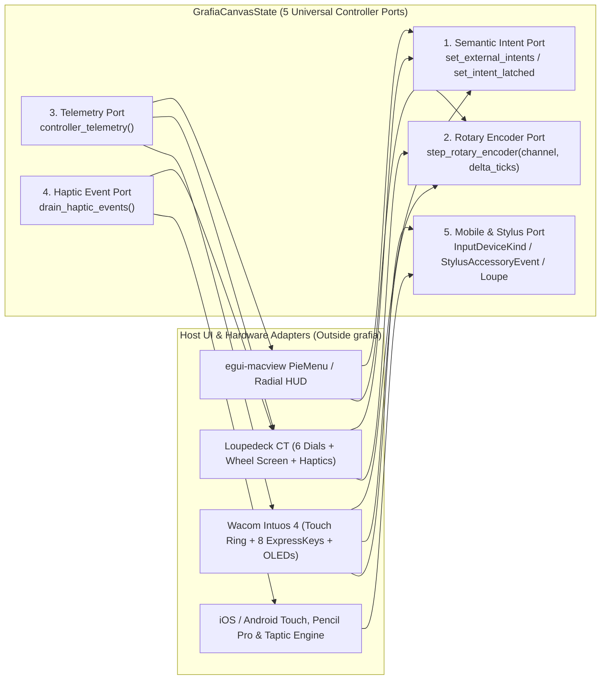
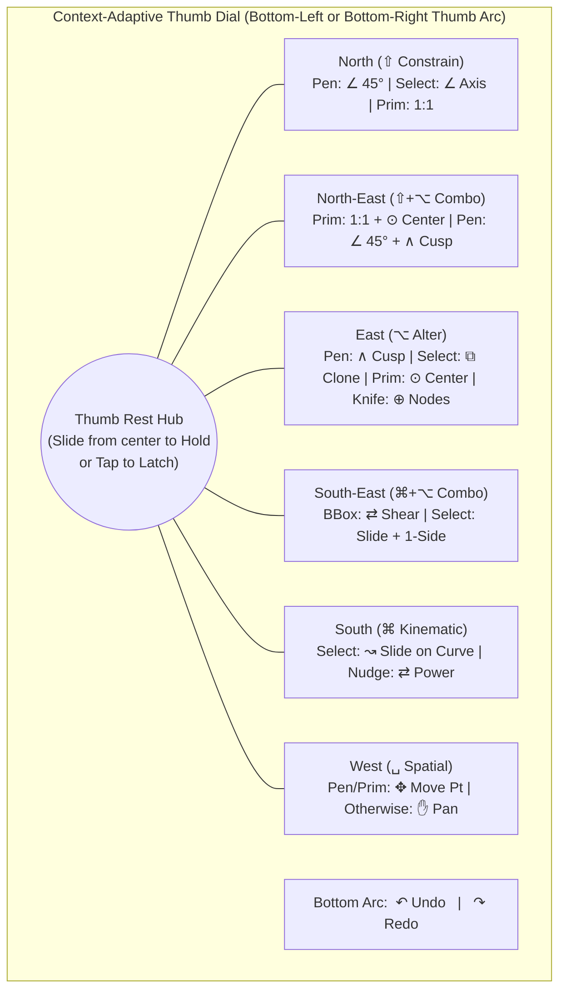

# SPEC-015: `grafia v0.13.0` — 100% System-Agnostic Controller, Semantic Intent, Rotary Encoder, OLED/HUD Telemetry, Haptic Feedback & Mobile/Stylus Precision Ports ("Stekkers")

> **Normative References**:
> - `SPEC-001`..`SPEC-013`: `grafia v0.1.0`..`v0.12.0` Architecture, Coordinate Pipeline, Tools, Splines, Harmonization, Smart Corners & Stem/Brush Engine
> - `SPEC-014`: Senior Architectural Maturity & Host Scene API
> - Standards: `ISO 9241-9:2000` / `ISO/TS 9241-411` (Ergonomics of Human-System Interaction — Non-Keyboard Input Devices), `W3C Pointer Events Level 3` (`pointerType`, `twist`, `tangentialPressure`, barrel button / squeeze states), `USB HID Usage Tables 1.5` (Rotary Dials, Tactile Haptics & Auxiliary OLED Displays), Apple Human Interface Guidelines (*Haptic Feedback, Touch Targets $\ge 44\times 44\;\text{pt}$, Pencil Interactions*)
> - HCI Literature: Gordon Kurtenbach & William Buxton (*Marking Menus & Rehearsal into Muscle Memory*, 1993), Yves Guiard (*Asymmetric Division of Labor in Human Skilled Bimanual Action — The Kinematic Chain Model*, 1987)

---

## 1. Architectural Principle: 100% UI-Widget-Agnostic & Hardware-Driver-Agnostic Controller Ports

To preserve `grafia` as a pure, zero-bloat 2D vector and typography canvas engine, **`grafia` contains zero radial pie-menu widget geometry, zero North/East/South/West screen-slot layouts, and zero vendor-specific USB/HID drivers**.

Instead, `GrafiaCanvasState` exposes **5 Universal System-Agnostic Controller Ports ("Stekkers")**:

| Port # | Port Name ("Stekker") | Direction | Purpose & Connected Peripherals |
| :--- | :--- | :--- | :--- |
| **1. Semantic Intent Port** | `CanvasIntent` & `CanvasIntentMask` | **Data-In** (`Host` $\rightarrow$ `GrafiaCanvasState`) | Replaces blind `Shift`/`Alt`/`Ctrl`/`Space` key-code coupling with explicit geometric intents (`ConstrainAngle`, `LockAspectRatio`, `OriginFromCenter`, `BreakCuspHandle`, `SlideAlongCurve`, `DuplicateOnDrag`, `ShearTransform`, `KnifeAddNodesOnly`, `MoveOriginOrPan`). Driven by `egui-macview` PieMenu/ThumbHUD, Wacom ExpressKeys, Loupedeck buttons, or Stream Deck keys. |
| **2. Continuous Rotary Encoder Port** | `CanvasRotaryChannel` (`step_rotary_encoder`) | **Data-In** (`Host` $\rightarrow$ `GrafiaCanvasState`) | Maps physical or virtual dial ticks (`delta_ticks: f64`) onto `ContextPrimary` (auto-routing to Smart Corner radius, Hobby spline tension, Tunni/Fit-Curve ratio `[0.20, 0.95]`, `Stem` width, or `Trowel`/`Cleaner` brush radius), `ViewportZoom`, `CanvasRotationOrSlant`, `HistoryScrub` (`Undo`/`Redo` per tick), `CurveTensionOrRadius`, and `KerningOrSpacing`. Driven by Loupedeck CT dials, Wacom Intuos 4 Touch Ring, Surface Dial, or on-screen dials. |
| **3. Controller Telemetry Port** | `ControllerTelemetryDescriptor` (`controller_telemetry`) | **Data-Out** (`GrafiaCanvasState` $\rightarrow$ `Host`) | Exports live, context-sensitive labels (`short_label` like `"∧ Cusp"`, `"1:1"`, `"⊙ Center"`, `"↝ Slide"`, `"⇄ Shear"`, `"⊕ Nodes"`), `shortcut_hint`, active state, and `RotaryTelemetryInfo` (`parameter_name`, `formatted_value`, `normalized_ratio`) for Wacom Intuos 4 OLED displays, Loupedeck CT wheel screens, and `egui-macview` PieMenu segments. |
| **4. Haptic Feedback Event Port** | `CanvasHapticEvent` (`drain_haptic_events`) | **Event-Out** (`GrafiaCanvasState` $\rightarrow$ `Host`) | Emits semantic tactile feedback events (`RotaryDetentTick`, `IntentLatchToggled`, `SnapAlignment`, `ContourClosed`, `BoundaryClamped`) for iOS/iPadOS Taptic Engine, Apple Pencil Pro `UICanvasFeedbackGenerator`, Android `HapticFeedbackConstants`, macOS Force Touch Trackpad, and Loupedeck CT vibration motors. |
| **5. Mobile & Stylus Precision Port** | `InputDeviceKind`, `StylusAccessoryEvent`, `PrecisionLoupeGeometry` | **Data-In / Data-Out** | Provides pointer-type-aware finger offset (`TouchFinger` vs. `Stylus`/`Mouse`), `1.6x` touch hit-radius inflation, edge-flipping magnification loupe (`compute_precision_loupe_overlay`), graceful 1-to-2 finger multi-touch promotion without stray points (`promote_to_multitouch_gesture`), and stylus `DoubleTap` / `Squeeze` / `BarrelHold` routing. |



---

## 2. Port 1: Semantic Intent Flags (`CanvasIntent` & `CanvasIntentMask`)

Rather than forcing external controllers or touch HUDs to synthesize fake keyboard scancodes, `grafia` defines nine domain-meaningful geometric intents:

| `CanvasIntent` Variant | Geometric Meaning on Canvas | Default Hardware Keyboard Mapping | Primary Tools Affected |
| :--- | :--- | :--- | :--- |
| **`ConstrainAngle`** | Snaps drag vectors, handles, and cuts to $45^\circ$ / $15^\circ$ / italic axes | `Shift` (`⇧`) | `Pen`, `Select`, `Rotate`, `Knife`, `Measurement` |
| **`LockAspectRatio`** | Locks primitive creation and bounding-box scaling to $1:1$ aspect ratio | `Shift` (`⇧`) | `Primitives`, `Scale`, `Select` (BBox) |
| **`OriginFromCenter`** | Expands primitives or scales selection symmetrically from center $\odot$ | `Alt / Option` (`⌥`) | `Primitives`, `Scale`, `Select` (BBox) |
| **`BreakCuspHandle`** | Breaks smooth $G^1$ handle collinearity into an independent `Corner` cusp $\wedge$ | `Alt / Option` (`⌥`) | `Pen`, `Select` |
| **`SlideAlongCurve`** | Slides an on-curve node smoothly along its adjacent curve/line trajectory $\leadsto$ | `Ctrl / Cmd` (`⌘`) | `Select` |
| **`DuplicateOnDrag`** | Clones selected contours at the start of a multi-node drag | `Alt / Option` (`⌥`) | `Select` |
| **`ShearTransform`** | Switches bounding-box side handles from scaling to slant/shear transformation $\rightleftarrows$ | `Ctrl + Alt` (`⌃⌥`) | `Select` (BBox), `Scale` |
| **`KnifeAddNodesOnly`** | Inserts on-curve intersections along the knife cut line without splitting contours $\oplus$ | `Alt / Option` (`⌥`) | `Knife` |
| **`MoveOriginOrPan`** | Translates the in-flight anchor/primitive origin or pans the canvas viewport | `Space` (`␣`) | `Pen`, `Primitives`, `Select` |

### Normative Intent Resolution Rules
1. `set_external_intents(&mut self, intents: CanvasIntentMask)` sets the momentary (held) external intent mask.
2. `set_intent_latched(&mut self, intent: CanvasIntent, latched: bool)` sets or clears a sticky one-handed latch for `intent` and emits `CanvasHapticEvent::IntentLatchToggled { intent, latched }` whenever the latch state changes.
3. `clear_external_intents(&mut self)` clears both momentary and latched external intents.
4. `effective_intents(&self, hw_modifiers: Modifiers, hw_space: bool) -> CanvasIntentMask` returns the union of:
   - Momentary external intents (`external_intents`),
   - Latched external intents (`latched_intents`),
   - Stylus barrel-button hold (`BreakCuspHandle` when `BarrelHold(true)` is active), and
   - Physical keyboard modifiers (`hw_modifiers`, `hw_space`) mapped to the active `CanvasTool`.

---

## 3. Port 2: Continuous Rotary Encoder Channels (`CanvasRotaryChannel`)

Physical dials (Loupedeck CT, Wacom Intuos 4 Touch Ring, Surface Dial) and virtual on-screen jog wheels call `state.step_rotary_encoder(channel, delta_ticks) -> bool`:

| `CanvasRotaryChannel` Variant | Normative Behavior per `delta_ticks: f64` | Clamping & Haptic Contract |
| :--- | :--- | :--- |
| **`ContextPrimary`** | Automatically routes to the most specific active selection/tool parameter:<br/>1. `CanvasTool::Stem`: adjusts active/first detected structural stem width by `delta_ticks * 2.0 UPM`.<br/>2. `CanvasTool::Trowel` / `Cleaner`: adjusts brush radius by `delta_ticks * 2.0 dp` in `[8.0, 160.0] dp`.<br/>3. Selected node with `SmartCornerSpec` (or selected `Corner` node): adjusts `radius_upm` by `delta_ticks * 2.0 UPM` in `[-120.0, 200.0] UPM`.<br/>4. Selected `NodeType::HobbyStar` node: adjusts `tension_in` / `tension_out` by `delta_ticks * 0.05` in `[0.75, 4.0]`.<br/>5. Selected cubic segment (or active Tunni segment): adjusts Tunni/Fit-Curve ratio by `delta_ticks * 0.02` in `[0.20, 0.95]`.<br/>6. Fallback: steps `ViewportZoom`. | Emits `RotaryDetentTick { channel }` on change and `BoundaryClamped` when clamped at min/max bounds. |
| **`ViewportZoom`** | Scales `viewport.zoom` by `(1.0 + delta_ticks * 0.05)` around the active pointer or viewport center. | Clamps to `[MIN_VIEWPORT_ZOOM, MAX_VIEWPORT_ZOOM]`; emits `BoundaryClamped` at bounds. |
| **`CanvasRotationOrSlant`** | Rotates selected nodes by `delta_ticks * 1.0°` around `transform_origin` (or adjusts `italic_angle_deg` in `[-45°, 45°]` when no nodes are selected). | Emits `RotaryDetentTick`; clamps italic angle to `[-45°, 45°]`. |
| **`HistoryScrub`** | Steps `state.undo()` for negative ticks (`delta_ticks < 0.0`) or `state.redo()` for positive ticks (`delta_ticks > 0.0`). | Emits `RotaryDetentTick` on each Undo/Redo step, or `BoundaryClamped` when history stack end is reached. |
| **`CurveTensionOrRadius`** | Directly targets Smart Corner `radius_upm`, Hobby `tension` `[0.75, 4.0]`, or cubic Tunni ratio `[0.20, 0.95]`. | Clamps to domain bounds and emits `BoundaryClamped` when saturated. |
| **`KerningOrSpacing`** | Adjusts active `Text` slot pair kerning (or active glyph `advance_width` / `RSB`) by `delta_ticks * effective_kerning_step_upm(false)`. | Emits `RotaryDetentTick` and records `KerningDelta` / `SpacingDelta`. |

---

## 4. Port 3: Controller Telemetry Descriptor (`controller_telemetry`)

Hardware controllers with built-in displays (Wacom Intuos 4 OLEDs, Loupedeck CT LCD keys/wheel display) and on-screen HUD widgets (`egui-macview` `PieMenu`) query `state.controller_telemetry() -> ControllerTelemetryDescriptor` to render self-revealing labels without hardcoding tool rules:

- `active_tool: CanvasTool`
- `available_intents: Vec<IntentTelemetryItem>` — ordered list of context-relevant `CanvasIntent` items for `active_tool`, each providing:
  - `intent: CanvasIntent`
  - `short_label: &'static str` (e.g. `"∠ 45°"`, `"∧ Cusp"`, `"1:1"`, `"⊙ Center"`, `"↝ Slide"`, `"⧉ Clone"`, `"⇄ Shear"`, `"⊕ Nodes"`, `"✋ Pan"`, `"✥ Move Pt"`)
  - `shortcut_hint: &'static str` (`"Shift"`, `"Alt"`, `"Ctrl"`, `"Ctrl+Alt"`, `"Space"`)
  - `active: bool` (true when currently held or latched)
- `primary_rotary: RotaryTelemetryInfo` — describes the parameter currently controlled by `CanvasRotaryChannel::ContextPrimary`:
  - `parameter_name: &'static str` (e.g. `"Corner Radius"`, `"Hobby Tension"`, `"Tunni Ratio"`, `"Stem Width"`, `"Brush Radius"`, `"Zoom"`)
  - `formatted_value: String` (e.g. `"+24 UPM"`, `"1.25"`, `"65%"`, `"80 UPM"`, `"40 dp"`, `"100%"`)
  - `normalized_ratio: f64` in `[0.0, 1.0]` for rendering circular dial progress arcs on Loupedeck CT or `egui-macview`.

### 4.1 Normative Bimanual `ContextThumbDial` / Radial Clover Mapping (`egui-macview` `SPEC-014`)

Across all 19 tools in `grafia`, keyboard modifier combinations (`Shift`, `Alt/Option`, `Cmd/Ctrl`, `Space`) map onto **4 invariant cardinal directions** (building instant directional muscle memory per Kurtenbach & Buxton) interleaved with **diagonal single-thumb combination sectors** (`NorthEast` and `SouthEast`):

| Fixed Direction (Muscle Memory) | Universal Geometric Intention | `Pen` (`P`) | `Select` (`V`) | `Primitives` (`F`) / `BBox` | `Knife` (`E`) |
| :--- | :--- | :--- | :--- | :--- | :--- |
| **1. Top (`North`, `⇧`)** | **CONSTRAIN** *(Lock direction / aspect)* | **`∠ 45°`** *(Lock angle)* | **`∠ Axis`** *(H / V / $45^\circ$)* | **`1:1` / `∠ 15°`** *(Square/Circle or $15^\circ$)* | **`∠ 15°`** *(Lock cut angle)* |
| **1+2. `NorthEast` (`⇧+⌥` Combo)** | **CONSTRAIN + ALTER** *(1-Thumb Chord)* | **`∠ 45° + ∧ Cusp`** | **`∠ Axis + ⧉ Clone`** | **`1:1 + ⊙ Center`** | **`∠ 15° + ⊕ Nodes`** |
| **2. Inner (`East`, `⌥`)** | **ALTER / BREAK** *(Topology / anchor)* | **`∧ Cusp`** *(Break handle to corner)* | **`⧉ Clone` / `1-Side`** *(Duplicate / 1-side)* | **`⊙ Center`** *(Scale/draw from center)* | **`⊕ Nodes`** *(Add nodes without cutting)* |
| **2+3. `SouthEast` (`⌘+⌥` Combo)** | **GLIDE + ALTER** *(1-Thumb Chord)* | **`★ Genius + ∧ Cusp`** | **`↝ Slide + 1-Side`** | **`⇄ Shear`** *(Slant/shear BBox)* | **`⌖ Snap + ⊕ Nodes`** |
| **3. Bottom (`South`, `⌘` / `C`)** | **GLIDE / SERVO** *(Along curve / neighbours)* | **`★ Genius`** *($G^2$ coupling)* | **`↝ Slide`** *(Slide node on curve)* | **`⇄ Shear`** *(Shear)* | **`⌖ Snap`** *(Force node snap)* |
| **4. Outer (`West`, `␣`)** | **MOVE / PAN** *(Move origin / canvas)* | **`✥ Move Pt`** *(Move placed anchor)* | **`✋ Pan`** *(Pan canvas)* | **`✥ Move`** *(Move shape while dragging)* | **`✋ Pan`** *(Pan canvas)* |



- **Hybrid Interaction Model & 4-Layer Concentric Geometry (`egui-macview::MacContextThumbDial`)**:
  - **Layer 1 (Central Thumb-Rest Hub)** + **Layer 2 (Inner Compass / Clover Sectors `N`, `NE`, `E`, `SE`, `S`, `W`)**:
    - **Hold / Slide-Out from Center (`>= 180 ms`)**: Drives `state.set_external_intents(momentary_mask)` while the thumb rests on or slides into a sector, clearing automatically upon thumb release.
    - **Quick Tap (`< 180 ms`)**: Toggles sticky latching via `state.set_intent_latched(intent, latched)` with a visible latch dot, allowing multiple sectors (e.g. `1:1` + `⊙ Center`) to be latched sequentially for one-handed phone or relaxed tablet operation.
  - **Layer 3 (Outer 360° Tactile Rotary Wheel Around All Compass Directions)**:
    - Wrapping around the outside of the compass sectors, the thumb rotary ring scrubs values continuously up/down with 24 detent ticks — driving `ContextPrimary` (Smart Corner radius, Hobby tension, Tunni ratio, Stem width, or fast directional point translation/nudging along the North/South $\Delta Y$ or East/West $\Delta X$ compass axis).
  - **Layer 4 (Concentrically Wrapped Bottom `↶ Undo | ↷ Redo` Arc Buttons)**:
    - Two curved, trackball-style "mouse buttons" wrapped around the bottom contour of the outer rotary wheel (`[92°..148°]` for `↶ Undo` and `[32°..88°]` for `↷ Redo`) provide instant one-thumb history stepping.

---

## 5. Port 4: Haptic Feedback Event Queue (`drain_haptic_events`)

`state.drain_haptic_events() -> Vec<CanvasHapticEvent>` drains pending tactile feedback events generated during interaction:

1. `CanvasHapticEvent::RotaryDetentTick { channel: CanvasRotaryChannel }` — emitted when a rotary encoder step mutates a canvas parameter.
2. `CanvasHapticEvent::IntentLatchToggled { intent: CanvasIntent, latched: bool }` — emitted when a sticky intent latch is toggled on or off.
3. `CanvasHapticEvent::SnapAlignment { kind: SnapTargetKind }` — emitted when a dragged node or tool snaps onto a metric line, guide, node, or virtual apex.
4. `CanvasHapticEvent::ContourClosed` — emitted when an open contour is closed in `Pen` or `Select`.
5. `CanvasHapticEvent::BoundaryClamped` — emitted when a rotary dial or parameter reaches its minimum or maximum allowed value (`[0.20, 0.95]` Tunni ratio, `[0.75, 4.0]` Hobby tension, zoom limits, or empty Undo/Redo stack).

---

## 6. Port 5: Mobile & Stylus Precision Ergonomics

1. **Pointer-Type Aware Finger Offset & Automatic Touch Detection (`InputDeviceKind::{ Mouse, Stylus, TouchFinger }`, `TC-V0130-006`, `TC-V0130-009`)**:
   - Configured via `state.set_active_input_device(device: InputDeviceKind)`, and automatically activated (`active_input_device = InputDeviceKind::TouchFinger`) whenever `InputDispatcher::dispatch_events` receives any `egui::Event::Touch { .. }` (or `ui.input(|i| i.any_touches())`).
   - Default `GrafiaPreferences::default().touch_finger_offset_dp` is `0.0` so direct touch on laptop/tablet screens hits the exact contact point under the finger without an unexpected vertical jump.
   - `state.resolve_effective_pointer_screen_pos(raw_pos: ScreenPoint) -> ScreenPoint` offsets `raw_pos.y` upward by `preferences.touch_finger_offset_dp` when `active_input_device == InputDeviceKind::TouchFinger` (or during active touch contacts) and `touch_finger_offset_dp != 0.0`, returning exact `raw_pos` for `Mouse` and `Stylus`.
2. **Adaptive Touch Hit-Target Inflation & `OffCurve` Handle Priority (`effective_hit_radius_dp`, `scale_touch_hit_radius_dp`, `TC-V0130-010`, `TC-V0130-011`)**:
   - When `active_input_device == InputDeviceKind::TouchFinger`, node and handle hit-testing (`effective_hit_radius_dp`) inflates `preferences.hit_test_radius_dp` by `TOUCH_HIT_RADIUS_MULTIPLIER = 1.6` with a minimum floor of `TOUCH_NODE_HIT_MIN_FLOOR_DP = 16.0 dp`.
   - In `hit_test_node_with_radius(pos, r_hit)`: when `show_nodes_offcurve` is `true`, all visible `NodeType::OffCurve` handles within `r_hit` are prioritized ahead of `OnCurve` nodes, and among multiple `OffCurve` handles within `r_hit`, the closest handle to `pos` is selected first (breaking exact distance ties by selection state).
   - Universal touch hit-radius scaling (`scale_touch_hit_radius_dp`, floor `TOUCH_HIT_MIN_FLOOR_DP = 14.0 dp`) applies across all `Select` tool hit-testers:
     - `effective_segment_hit_tolerance_dp()` (`>= 14.0 dp` in `TouchFinger` mode),
     - `hit_test_tunni_line_at_upm` & `try_begin_tunni_press` (never stealing hits from nodes within `hit_test_node`),
     - `select_anchor_at_upm` (`CanvasAnchor` hit-testing),
     - `hit_test_guides` (`Guide` knob and line hit-testing),
     - `hit_test_bbox_knob` (selection bounding-box scale/rotate/slant knobs and transform origin),
     - `hit_test_smart_handles_with_radius` (`CanvasSmartHandle` hit-testing).
3. **Touch Tap-Slop Tolerance, Segment Selection & Double-Tap Line-to-Cubic Handle Creation (`TC-V0130-012`)**:
   - **Touch Double-Tap Slop (`effective_double_click_slop_dp`)**: Uses `TOUCH_DOUBLE_TAP_MAX_DIST_DP = 20.0 dp` when `active_input_device == InputDeviceKind::TouchFinger` (vs. `DOUBLE_CLICK_MAX_DIST_DP = 8.0 dp` for mouse).
   - **Single-Tap on a Segment Selects its Endpoints & Handles**: A tap on a `ContourSegment` (`Line` or `Cubic`) that moves by at most `TOUCH_TAP_SLOP_DP = 6.0 dp` in `TouchFinger` mode preserves `pending_segment_click` and selects both endpoint `OnCurve` nodes (plus `h1` and `h2` `OffCurve` handles for a `Cubic` segment) on release.
   - **Double-Tap (or `Alt`-Click) on a Straight `ContourSegment::Line` Converts it to a Cubic Curve with 2 `OffCurve` Handles**: Double-tapping a `ContourSegment::Line` in `TouchFinger` mode (or `Alt`-clicking / `BreakCuspHandle`-clicking in any mode) inserts two `NodeType::OffCurve` handles at $1/3$ and $2/3$ along the segment inside an atomic `"Convert Line to Cubic"` Undo transaction and immediately selects both new `OffCurve` handles (`vec![h1_id, h2_id]`).
4. **Edge-Flipping Magnification Loupe (`compute_precision_loupe_overlay`)**:
   - Returns `Option<PrecisionLoupeGeometry>` centered `78.0 dp` above the active pointer (`lens_radius_dp = 48.0`, `zoom_factor = 2.5`), automatically flipping below/laterally (`flipped_from_top_edge = true`) when approaching within `110.0 dp` of `canvas_rect.top()` so the lens circle never protrudes outside `canvas_rect`.
5. **Graceful 1-to-2 Finger Multi-Touch Promotion (`promote_to_multitouch_gesture`)**:
   - Cleanly rolls back any uncommitted single-finger drag or tentative `Pen` placement to `active_drag_before_snapshot` without polluting the `CommandHistory` Undo stack.
6. **Stylus Barrel, Squeeze & Double-Tap Actions (`dispatch_stylus_accessory_event`)**:
   - `StylusAccessoryEvent::DoubleTap`: swaps `active_tool` between `CanvasTool::Select` and the last active drawing tool (default `CanvasTool::Pen`).
   - `StylusAccessoryEvent::BarrelHold(bool)`: activates/deactivates `CanvasIntent::BreakCuspHandle` (`Alt`).
   - `StylusAccessoryEvent::Squeeze { pos }`: updates `cursor_screen_pos` to `pos` for instant radial menu invocation at the stylus tip.
7. **Stylus Palm Rejection, Post-Tap Compatibility Click Deduplication, Orthogonal Tablet Marquee & Non-Convex Lasso Fill**:
   - **Post-Tap Compatibility `PointerButton` Deduplication (`last_touch_event_time_sec`)**: A realistic single-finger touch tap (`TouchPhase::Start` followed `0.15s..0.35s` later by `TouchPhase::End`, including when `eframe`'s `pointerdown` + `mousemove` precede `touchstart` at the same tap coordinate) followed within `TOUCH_COMPANION_MOUSE_DEDUP_SEC` (`0.50s`) by a browser-synthesized compatibility `Event::PointerButton { pressed: true }` (when no `TouchPhase::Start` is present in that frame) MUST be deduplicated so a single finger tap on a node selects only that single node and never triggers a false double-click selecting the entire contour.
   - **Stylus & Committed-Drag Palm Rejection (`native_pointer_drag_active`, `rejected_palm_contacts`)**: While a native pointer drag (`Event::PointerButton { pressed: true }` initiated without touch contacts) or a committed single-contact drag (`max_contact_excursion_dp > 24.0 dp` or `InputDeviceKind::Stylus`) is active, distant palm/resting-finger `Event::Touch` contacts (`> 32.0 dp` from the active pointer) AND their `eframe`-synthesized companion `Event::PointerButton` / `Event::PointerMoved` events at the palm coordinates MUST be ignored so they neither jump the active `MarqueeSelecting`/`DraggingNodes` coordinate to the palm, nor clobber `last_pointer_screen_pos`, nor cancel the active drag via `two_finger_peak` or premature release.
   - **Orthogonal Tablet & Latched-Intent Marquee (`show_bounding_box_slanted == false`)**: Starting a marquee selection resets `show_bounding_box_slanted = false` and `selection_angle_deg = 0.0`, and `ctrl_slant` is restricted to desktop `InputDeviceKind::Mouse` without active touch contacts or latched `SlideAlongCurve`/`ShearTransform` intents so tablet/stylus marquee drags are always orthogonal rectangles.
   - **Non-Convex `LassoTool` Polygon Tessellation**: Freeform `LassoDragging` overlays in `egui` tessellate the closed polygon with `tessellate_bez_path_nonzero` (`FillRule::NonZero`) rather than `egui`'s convex fan fill so concave stylus lasso selections never skew.

---

## 7. Rust Data Structures & Public API Contracts (`SPEC-015`)

```rust
/// Semantic geometric modifier intents decoupled from physical keyboard scancodes.
#[derive(Debug, Clone, Copy, PartialEq, Eq, PartialOrd, Ord, Hash, serde::Serialize, serde::Deserialize)]
pub enum CanvasIntent {
    ConstrainAngle,
    LockAspectRatio,
    OriginFromCenter,
    BreakCuspHandle,
    SlideAlongCurve,
    DuplicateOnDrag,
    ShearTransform,
    KnifeAddNodesOnly,
    MoveOriginOrPan,
}

/// Bitmask set of active `CanvasIntent` flags.
#[derive(Debug, Clone, Copy, PartialEq, Eq, Default, serde::Serialize, serde::Deserialize)]
pub struct CanvasIntentMask(pub u16);

/// Universal rotary encoder channels for hardware dials (Loupedeck CT, Wacom Touch Ring) and virtual wheels.
#[derive(Debug, Clone, Copy, PartialEq, Eq, PartialOrd, Ord, Hash, serde::Serialize, serde::Deserialize)]
pub enum CanvasRotaryChannel {
    ContextPrimary,
    ViewportZoom,
    CanvasRotationOrSlant,
    HistoryScrub,
    CurveTensionOrRadius,
    KerningOrSpacing,
}

/// Single semantic intent entry in `ControllerTelemetryDescriptor`.
#[derive(Debug, Clone, PartialEq, Eq, serde::Serialize, serde::Deserialize)]
pub struct IntentTelemetryItem {
    pub intent: CanvasIntent,
    pub short_label: &'static str,
    pub shortcut_hint: &'static str,
    pub active: bool,
}

/// Live rotary parameter readout for OLED/LCD dial screens and radial HUDs.
#[derive(Debug, Clone, PartialEq, serde::Serialize, serde::Deserialize)]
pub struct RotaryTelemetryInfo {
    pub parameter_name: &'static str,
    pub formatted_value: String,
    pub normalized_ratio: f64,
}

/// Complete telemetry snapshot exported by `GrafiaCanvasState::controller_telemetry()`.
#[derive(Debug, Clone, PartialEq, serde::Serialize, serde::Deserialize)]
pub struct ControllerTelemetryDescriptor {
    pub active_tool: CanvasTool,
    pub available_intents: Vec<IntentTelemetryItem>,
    pub primary_rotary: RotaryTelemetryInfo,
}

/// Semantic haptic feedback events emitted by `GrafiaCanvasState`.
#[derive(Debug, Clone, Copy, PartialEq, Eq, serde::Serialize, serde::Deserialize)]
pub enum CanvasHapticEvent {
    RotaryDetentTick { channel: CanvasRotaryChannel },
    IntentLatchToggled { intent: CanvasIntent, latched: bool },
    SnapAlignment { kind: SnapTargetKind },
    ContourClosed,
    BoundaryClamped,
}

/// Physical input device classification for adaptive touch offsets and hit radii.
#[derive(Debug, Clone, Copy, PartialEq, Eq, Default, serde::Serialize, serde::Deserialize)]
pub enum InputDeviceKind {
    #[default]
    Mouse,
    Stylus,
    TouchFinger,
}

/// Stylus hardware events (Apple Pencil Pro double-tap / squeeze, Wacom barrel button).
#[derive(Debug, Clone, Copy, PartialEq, serde::Serialize, serde::Deserialize)]
pub enum StylusAccessoryEvent {
    DoubleTap,
    Squeeze { pos: ScreenPoint },
    BarrelHold(bool),
}

/// Computed screen-space geometry for the edge-flipping magnification loupe.
#[derive(Debug, Clone, Copy, PartialEq, serde::Serialize, serde::Deserialize)]
pub struct PrecisionLoupeGeometry {
    pub target_screen_pos: ScreenPoint,
    pub target_upm_pos: FontPoint,
    pub lens_center_screen_pos: ScreenPoint,
    pub lens_radius_dp: f32,
    pub zoom_factor: f32,
    pub flipped_from_top_edge: bool,
}

impl GrafiaCanvasState {
    // 1. Semantic Intent Port
    pub fn set_external_intents(&mut self, intents: CanvasIntentMask);
    pub fn set_intent_latched(&mut self, intent: CanvasIntent, latched: bool);
    pub fn clear_external_intents(&mut self);
    pub fn effective_intents(&self, hw_modifiers: Modifiers, hw_space: bool) -> CanvasIntentMask;

    // 2. Continuous Rotary Encoder Port
    pub fn step_rotary_encoder(&mut self, channel: CanvasRotaryChannel, delta_ticks: f64) -> bool;

    // 3. Controller Telemetry Port
    pub fn controller_telemetry(&self) -> ControllerTelemetryDescriptor;

    // 4. Haptic Feedback Event Port
    pub fn drain_haptic_events(&mut self) -> Vec<CanvasHapticEvent>;

    // 5. Mobile & Stylus Precision Port
    pub fn set_active_input_device(&mut self, device: InputDeviceKind);
    pub fn resolve_effective_pointer_screen_pos(&self, raw_pos: ScreenPoint) -> ScreenPoint;
    pub fn compute_precision_loupe_overlay(&self, canvas_rect: egui::Rect) -> Option<PrecisionLoupeGeometry>;
    pub fn promote_to_multitouch_gesture(&mut self) -> bool;
    pub fn dispatch_stylus_accessory_event(&mut self, event: StylusAccessoryEvent) -> bool;
}
```

---

## 8. Complete Normative Test Matrix (`TC-V0130-001` .. `TC-V0130-013`)

| Test Case ID | Requirement / Controller Port Contract | Input / Action | Expected Normative Outcome |
| :--- | :--- | :--- | :--- |
| **`TC-V0130-001`** | Semantic `CanvasIntent` & `CanvasIntentMask` Resolution Across Tools | Latch/hold `BreakCuspHandle` in `Pen`, `SlideAlongCurve` in `Select`, `LockAspectRatio \| OriginFromCenter` in `Primitives`, and `KnifeAddNodesOnly` in `Knife`. | `effective_intents` and canvas tool interactions execute cusp breaking, curve sliding, centered 1:1 square creation, and node-only knife insertion without physical keyboard modifiers. |
| **`TC-V0130-002`** | `CanvasRotaryChannel::ContextPrimary` Auto-Routing (Smart Corner, Hobby, Tunni, Stem, Brush) | Step `ContextPrimary` with `+2.0` ticks under a selected Smart Corner, a selected `HobbyStar` node, a cubic segment, `CanvasTool::Stem`, and `CanvasTool::Trowel`. | Automatically increments Smart Corner `radius_upm`, Hobby `tension`, Tunni ratio, structural stem width, and brush radius respectively. |
| **`TC-V0130-003`** | `CanvasRotaryChannel` Dedicated Channels (`ViewportZoom`, `CanvasRotationOrSlant`, `HistoryScrub`, `KerningOrSpacing`) | Step `ViewportZoom`, `CanvasRotationOrSlant`, `HistoryScrub` (`-1.0` Undo / `+1.0` Redo), and `KerningOrSpacing`. | Zooms viewport, rotates selection / slants italic angle, scrubs Undo/Redo history per tick, and adjusts kerning/spacing. |
| **`TC-V0130-004`** | `ControllerTelemetryDescriptor` Context-Sensitive OLED/PieMenu Labels & Rotary Readout | Inspect `controller_telemetry()` across `Pen`, `Select`, `Primitives`, `Knife`, and `Stem` with latched intents and active parameters. | Reports tool-appropriate `available_intents` (`"∧ Cusp"`, `"↝ Slide"`, `"1:1"`, `"⊙ Center"`, `"⊕ Nodes"`) with `active == true` for latched intents and accurate `primary_rotary` telemetry. |
| **`TC-V0130-005`** | `CanvasHapticEvent` Queue (`RotaryDetentTick`, `IntentLatchToggled`, `SnapAlignment`, `ContourClosed`, `BoundaryClamped`) | Toggle an intent latch, step a rotary dial into its `[0.20, 0.95]` clamp boundary, snap a node, and close a contour; call `drain_haptic_events()`. | Emits all 5 `CanvasHapticEvent` variants in deterministic order and empties the queue on drain. |
| **`TC-V0130-006`** | Mobile Finger Offset (`InputDeviceKind::TouchFinger`), `1.6x` Hit Inflation & Edge-Flipping `PrecisionLoupeGeometry` | Set `TouchFinger` with `touch_finger_offset_dp = 36.0`, test `hit_test_node` at `11.0 dp`, and compute loupe at `y = 250.0` vs. `y = 40.0`. | `TouchFinger` offsets pointer by `-36.0 dp`, captures node at `11.0 dp` (where `Mouse` misses), and flips the `48.0 dp` loupe inside `canvas_rect` near the top edge. |
| **`TC-V0130-007`** | Graceful Multi-Touch Promotion (`promote_to_multitouch_gesture`) & `StylusAccessoryEvent` (`DoubleTap`, `BarrelHold`, `Squeeze`) | Start a tentative 1-finger `Pen` node placement, call `promote_to_multitouch_gesture()`, and dispatch stylus `DoubleTap` twice + `BarrelHold(true)`. | Rolls back tentative `Pen` node with zero Undo pollution; `DoubleTap` swaps `Pen <-> Select`; `BarrelHold(true)` activates `BreakCuspHandle`. |
| **`TC-V0130-008`** | Property-Based & Stateful `arbtest` Controller Port Fuzzing | Fuzz arbitrary intent masks, rotary encoder ticks across all 6 channels, device switches, and `Undo`/`Redo`. | `state.validate_invariants()` holds after every operation and all coordinates/parameters remain finite. |
| **`TC-V0130-009`** | Automatic `InputDeviceKind::TouchFinger` Activation on `egui::Event::Touch` | Dispatch `egui::Event::Touch` to `InputDispatcher` on default `GrafiaCanvasState`. | Automatically switches `state.active_input_device()` to `InputDeviceKind::TouchFinger` with default `touch_finger_offset_dp == 0.0`. |
| **`TC-V0130-010`** | `OffCurve` Handle Hit-Priority Over Nearby `OnCurve` Nodes & Tunni Lines | Place an `OffCurve` handle and an `OnCurve` node `10.0 dp` apart on screen (and a previously selected `OffCurve` handle `14.0 dp` away) and touch-press within `16.0 dp`. | Prioritizes and selects the closest `OffCurve` handle over nearby `OnCurve` nodes, farther-away selected `OffCurve` handles, and Tunni lines. |
| **`TC-V0130-011`** | Universal Touch Hit-Radius Scaling (`>= 14.0 dp`) Across Segments, Anchors & Guides | Touch-tap `11.0 dp` away from a contour segment, a `CanvasAnchor`, and a `Guide`. | Hits and selects the segment, anchor, and guide in `TouchFinger` mode instead of missing and starting an empty `MarqueeSelecting` box. |
| **`TC-V0130-012`** | Touch Double-Tap Slop (`20.0 dp`), Tap-Slop Segment Selection (`6.0 dp`) & Double-Tap Line-to-Cubic Handle Creation | Single-tap a segment with `4.0 dp` finger roll; double-tap a straight `ContourSegment::Line` with `12.0 dp` finger slop between taps. | Single-tap selects the segment's nodes/handles; double-tap converts the `Line` segment into a 4-node `Cubic` with 2 `OffCurve` handles at $1/3$ and $2/3$, selects both handles, and round-trips through `Undo`/`Redo`. |
| **`TC-V0130-013`** | Responsive Phone/Tablet/Desktop Demo Shell Layout (`< 900.0 dp` Auto-Collapse, Single-Row Scroll Bars & Dynamic Viewport Auto-Fit) | Render `GrafiaVectorCanvasDemo` on a `390x844` portrait mobile screen rect, rotate to `844x390` landscape, and render on a `1280x840` desktop screen rect. | On `< 900.0 dp` mobile screens, `show_left_sidebar`, `show_right_inspector`, and `show_preview_panel` auto-collapse, single-row horizontal scroll bars replace multi-row wrapped preset bars, `CentralPanel` allocates the majority of screen height (`> 650.0 dp` of `844.0 dp`), `fit_viewport_to_glyph` bounds zoom by both width and height (`pan_offset.x > 0.0`), and rotating to `844x390` landscape automatically re-fits the viewport so the glyph stays within the visible canvas (`pan_offset.y < canvas_sz.y`). |
