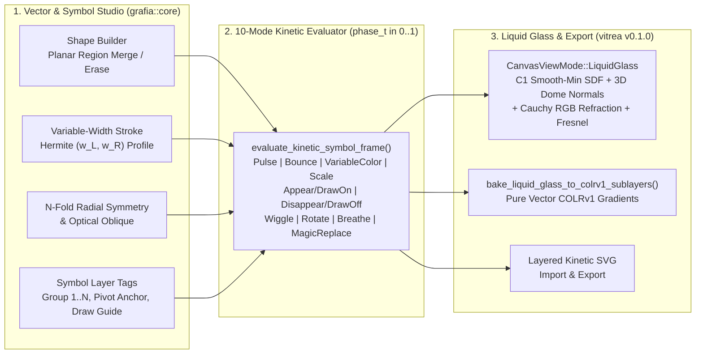

# SPEC-016: `grafia v0.14.0` — Vector Icon Studio, Variable-Width Strokes, `vitrea` Liquid-Glass Optics & 10-Mode Kinetic Symbol Engine

> **Normative References**:
> - `SPEC-001`..`SPEC-015`: `grafia v0.1.0`..`v0.13.0` Coordinate Pipeline, Boolean Topology, `COLRv1` Color Layers, Smart Corners, Structural Stems, Senior Architectural Maturity & Universal Controller Ports
> - `vitrea v0.1.0` (`https://crates.io/crates/vitrea`): 2D Smooth-Min ($C^1$) Signed Distance Fields, 3D Curvature-Continuous Dome Normals, Snellius & Cauchy 3-Channel Chromatic Refraction, Schlick Fresnel, Blinn-Phong Specular & Area-Preserving ($\det J = 1.0$) Viscous Droplet Kinematics
> - Open Standards: `ISO/IEC 14496-22:2019` (`OpenType COLRv1` Paint Graphs), `W3C SVG 2` Path & Group Layer Semantics, Classical Physical Optics (*Snellius 1621, Fresnel 1821, Cauchy 1836, Blinn 1977, Schlick 1994*)

---

## 1. Executive Summary & Architectural Boundaries

`SPEC-016` elevates `grafia` from a static 2D glyph/vector canvas into a complete **Vector Icon, Kinetic Symbol & Liquid-Glass Authoring Engine** while preserving every mission-critical invariant enforced by `architecture_guard_tests.rs` (`tc_arch_001`..`tc_arch_016`):

1. **Part A — Vector Icon Studio Authoring Primitives:**
   - **Interactive Shape Builder (`CanvasTool::ShapeBuilder`):** Planar region decomposition of overlapping closed contours with live hover preview, drag-to-merge (`ShapeBuilderOp::Merge`), and `Alt` / `BreakCuspHandle` drag-to-erase (`ShapeBuilderOp::Erase`).
   - **Variable-Width Skeleton Stroke (*Width Tool*):** Non-destructive per-contour asymmetric width profiles (`VariableWidthStrokeSpec` with monotone Hermite interpolation of `(width_left_upm, width_right_upm)` along normalized arc length $s \in [0, 1]$) and automatic self-intersection clipping via `expand_variable_width_contour`.
   - **$N$-Fold Radial / Kaleidoscope Symmetry (`RadialSymmetrySpec`) & Optical Oblique (`compute_optical_oblique_contours`):** Live $N$-fold rotational/dihedral symmetry (`N in 2..=32`) around `transform_origin` plus stem-preserving optical slanting.
   - **Multi-Scale Symbol Template Grid & Sanitizer (`audit_and_normalize_icon_contours`):** One-click *"Clean for Font & Glass"* normalizer (overlap removal, winding correction, extremum insertion, duplicate node healing, integer/grid rounding) and 3-scale (`Small`, `Medium`, `Large`) × 3-weight (`Ultralight`, `Regular`, `Black`) compatibility verification.
2. **Part B — 10-Mode Kinetic Symbol Animation Engine (`KineticSymbolEffect`):**
   - Full closed-form, deterministic 60/120 fps evaluator (`evaluate_kinetic_symbol_frame`) for all 10 layered vector symbol effects and their sub-modes:
     1. `Pulse` (`ByLayer` / `WholeSymbol`)
     2. `Bounce` (`Up` / `Down` × `ByLayer` / `WholeSymbol`, coupled with `vitrea::deform_viscous_droplet_point` $\det J = 1.0$ squash-and-stretch)
     3. `VariableColor` (`Iterative` / `Cumulative` × `Reversing` / `NonReversing` × `HideInactive` / `DimInactive`)
     4. `Scale` (`Up` / `Down` × `ByLayer` / `WholeSymbol`)
     5. `Appear` (`Up` / `Down` × `ByLayer` / `WholeSymbol` + `DrawOn` arc-length cubic trimming $[0, \tau_i]$)
     6. `Disappear` (`Up` / `Down` × `ByLayer` / `WholeSymbol` + `DrawOff` arc-length cubic trimming $[\tau_i, 1]$)
     7. `Wiggle` (`Clockwise`, `CounterClockwise`, `Left`, `Right`, `Up`, `Down`, `Forward`, `Backward`, `CustomAngle(f64)` × `ByLayer` / `WholeSymbol`)
     8. `Rotate` (`Clockwise` / `CounterClockwise` × `ByLayer` / `WholeSymbol` around layer `CanvasAnchor` pivot)
     9. `Breathe` (`Plain` / `Pulse` × `ByLayer` / `WholeSymbol`)
     10. `MagicReplace` & `Replace` (`DownUp`, `UpUp`, `OffUp` fallback + topology-matched cubic contour morphing & `vitrea` meniscus bridge)
3. **Part C — `vitrea` 3D Liquid-Glass Viewport Mode & `COLRv1` Vector Baker:**
   - **`CanvasViewMode::LiquidGlass`:** Evaluates `vitrea` $C^1$ smooth-min SDF metaball fusion across sibling layers, 3D curvature-continuous dome normals, Cauchy 3-channel RGB chromatic refraction against an analytic backdrop, Schlick Fresnel edge glow, and Blinn-Phong specular highlights inside a generation-cached bounding-box pixmap.
   - **`bake_liquid_glass_to_colrv1_sublayers`:** Synthesizes pure-vector `CanvasColorSublayer` entries (`LinearGradient` body dome + `RadialGradient` specular highlight + inner rim contour) for 100% vector `COLRv1` font and SVG export.



---

## 2. NASA / IBM Mission-Critical SSOT & Architectural Invariants

To guarantee zero architectural drift, zero god-struct regressions, and 100% deterministic verification, the following seven production invariants are mandatory:

### 2.1 Cohesive Scene Encapsulation (`tc_arch_016` Struct Field Ceiling Compliance)
- `GrafiaCanvasState` enforces a strict field ceiling (`<= 89` fields in `tc_arch_016`).
- All `SPEC-016` state on `GrafiaCanvasState` MUST reside inside **one cohesive field**:
  ```rust
  pub icon_studio: crate::core::CanvasIconStudioScene,
  ```
- `CanvasIconStudioScene` (`<= 12` fields) is embedded in:
  1. `GrafiaCanvasState::icon_studio`,
  2. `CanvasDocumentScene::icon_studio` (with `#[serde(default)]` for 100% backward-compatible JSON scene deserialization), and
  3. `SnapshotHintingAndHoiState::icon_studio` inside `GlyphSnapshot` so every mutation to variable-width profiles, symbol layer tags, radial symmetry, or liquid-glass parameters satisfies the universal bit-exact roundtrip law:
     $$\text{State}_0 \xrightarrow{\text{Action}} \text{State}_1 \xrightarrow{\text{Undo}} \text{State}_0 \xrightarrow{\text{Redo}} \text{State}_1$$

### 2.2 Pure Phase-Driven Kinetic Evaluation & 0% Idle Battery Drain (`tc_arch_015`)
- Render modules (`src/render/`, `src/adapters/painter_*.rs`, `src/adapters/headless*.rs`) MUST NEVER read wall-clock time (`std::time::Instant`) or call `ctx.request_repaint()`.
- All kinetic transformations are pure deterministic functions of `KineticTimelineState::phase_t: f64` in $[0.0, 1.0]$.
- `GrafiaCanvasState::step_kinetic_timeline(&mut self, dt_sec: f64) -> bool` advances `phase_t` strictly during the input/update phase when `playing == true`.
- When `playing == false`, zero background repaints are requested (`0%` idle CPU/GPU usage).

### 2.3 Central State Invariant Verification (`validate_invariants`)
`GrafiaCanvasState::validate_invariants(&self)` MUST validate `self.icon_studio`:
1. `kinetic.phase_t` is finite and within $[0.0, 1.0]$; `kinetic.speed_multiplier` is finite and within $[0.05, 10.0]$.
2. `radial_symmetry.fold_count` is within `1..=32` (`1` = disabled).
3. Every `VariableWidthStrokeSpec` has finite non-negative `width_left_upm >= 0.0` and `width_right_upm >= 0.0`, with strictly sorted `arc_ratio_t` in $[0.0, 1.0]$.
4. Every `SymbolLayerTag` references a finite `layer_group >= 1` and, if `motion_anchor_id` is `Some(aid)`, either `aid` exists in `self.anchors` or gracefully falls back to the layer's geometric centroid without panicking.
5. `liquid_glass.dome_radius_upm`, `liquid_glass.smooth_union_k_upm`, and `liquid_glass.ior_base` are finite and strictly positive (`> 0.0`).

### 2.4 Five Zero-Over-Engineering & DRY Reuse Invariants (NASA / IBM Production Rules)
1. **Iterative Boolean Atomic Cell Decomposition for `ShapeBuilder` (Zero Custom DCEL / Half-Edge Graph Engine):**
   - `compute_shape_builder_regions` MUST reuse the existing `intersect_contours`, `subtract_contours`, and `remove_overlap_in_contours` primitives in `src/core/boolean_ops.rs` via iterative boolean cell splitting ($R \cap C_k$, $R \setminus C_k$, and $C_k \setminus \bigcup R$), avoiding any parallel planar-graph topology solver.
2. **Single Unified `LayerKineticTransform` Kernel for Effects 1–9:**
   - Effects 1–9 (`Pulse`, `Bounce`, `VariableColor`, `Scale`, `Appear`, `Disappear`, `Wiggle`, `Rotate`, `Breathe`) MUST all evaluate into one compact value struct:
     ```rust
     #[derive(Debug, Clone, Copy, PartialEq)]
     pub struct LayerKineticTransform {
         pub pivot_upm: FontPoint,
         pub translation_upm: FontPoint,
         pub rotation_rad: f64,
         pub scale: (f64, f64),
         pub opacity_factor: f32,
         pub trim_arc_range: Option<(f64, f64)>,
         pub viscous_velocity_y: f32,
     }
     ```
     followed by one shared contour applier `apply_layer_kinetic_transform`, eliminating per-effect contour-loop duplication.
3. **Direct Composition on Existing `stroke_expand.rs` & `path_ops.rs`:**
   - `expand_variable_width_contour` computes Fritsch-Carlson monotone Hermite rail widths $(w_L(t), w_R(t))$ and delegates cap generation and nonzero-winding self-intersection cleanup to the existing `stroke_expand` and `remove_overlap_in_contours` primitives.
   - `audit_and_normalize_icon_contours` is a direct 5-stage composition of existing core primitives (`remove_overlap_in_contours` $\rightarrow$ `add_extremes_to_contours` $\rightarrow$ `tidy_up_contours` $\rightarrow$ `correct_path_direction_layer` $\rightarrow$ `grid_fit_contour_nodes`).
4. **Transient `ShapeBuilderDragState` Placement in `DrawingToolState` (`7/35` fields):**
   - Transient hover/visited-region drag state for `CanvasTool::ShapeBuilder` MUST reside in `DrawingToolState` (keeping `DragSessionTransients` untouched below its `25`-field ceiling).
5. **Stepwise `dead_code = "forbid"` & `tc_arch_005` Hygiene from Step 16.1:**
   - `LiquidGlassRenderConfig::to_vitrea_optics(&self) -> vitrea::VitreaOpticsConfig` is wired in `src/core/icon_studio.rs` in Step 16.1 and re-exported at the crate root so `dead_code = "forbid"` and `tc_arch_005` (zero unused dependencies) pass after every single micro-step.

---

## 3. Part A — Vector Icon Studio Authoring Tools

### 3.1 Interactive Shape Builder (`CanvasTool::ShapeBuilder`)
1. **Planar Region Decomposition (`compute_shape_builder_regions`):**
   - Given closed contours $\mathcal{C} = \{C_0, \dots, C_{m-1}\}$ on the active layer, `compute_shape_builder_regions(contours: &[GlyphContour]) -> Vec<ShapeBuilderRegion>` partitions the 2D plane into disjoint minimal closed vector regions bounded by the arrangement of $\mathcal{C}$.
   - Each `ShapeBuilderRegion` contains:
     - `region_id: u32` (assigned deterministically after sorting regions by `(centroid.y, centroid.x)`),
     - `contour: GlyphContour` (closed counter-clockwise outer boundary),
     - `area_upm2: f64` (filtered by `area_upm2 >= SHAPE_BUILDER_MIN_REGION_AREA_UPM2`, default `1.0`),
     - `centroid: FontPoint`,
     - `source_contour_ids: Vec<ContourId>`.
2. **Interactive Merge & Erase (`apply_shape_builder_operation`):**
   - **Hover Repaint Invariant:** Moving the pointer in `CanvasTool::ShapeBuilder` while idle updates `hovered_region_id` and returns `true` whenever `hovered_region_id` changes so the canvas immediately highlights the hovered planar region.
   - **Direct Pin & Bézier-Handle Manipulation Invariant:** Pressing on a `VariableWidthHandlePin` or any visible `OffCurve` Bézier handle / `OnCurve` node (`hit_test_node`) while `CanvasTool::ShapeBuilder` is active initiates direct pin or node/handle dragging (`SelectToolState::DraggingNodes`) rather than region selection; only pressing on a planar region interior outside pins and nodes/handles starts a `ShapeBuilder` region merge/erase drag.
   - **Relational Frame-Condition Invariant (`ContourId` Lineage Remapping):** When `apply_shape_builder_operation` (or any icon contour replacement) merges or erases regions from a subset of contours and renumbers `ContourId(0..N)`, every uninvolved/surviving contour MUST have its old `ContourId` deterministically mapped to its new `ContourId` across `variable_width_strokes`, `contour_strokes`, and `symbol_layer_tags` (matched by node-ID / geometric identity) so untouched contours never lose or swap their attachments.
   - **Merge (`ShapeBuilderOp::Merge`, default primary drag):** Computes the boolean union of all regions visited along the pointer drag path and replaces their contributing source contours with the unified result (`history` label: `"Shape Builder Merge"`).
   - **Erase (`ShapeBuilderOp::Erase`, `Alt` or `CanvasIntent::BreakCuspHandle`):** Subtracts all visited regions from the active contour set (`history` label: `"Shape Builder Erase"`).

### 3.2 Variable-Width Skeleton Stroke (`VariableWidthStrokeSpec`)
1. **Data Model:**
   ```rust
   #[derive(Debug, Clone, Copy, PartialEq, Serialize, Deserialize)]
   pub struct WidthNodeSample {
       pub arc_ratio_t: f64,
       pub width_left_upm: f64,
       pub width_right_upm: f64,
   }

   #[derive(Debug, Clone, PartialEq, Serialize, Deserialize)]
   pub struct VariableWidthStrokeSpec {
       pub contour_id: ContourId,
       pub samples: Vec<WidthNodeSample>,
       pub cap_style: LineCapStyle,
   }
   ```
2. **Monotone Cubic Hermite Width Interpolation (`evaluate_variable_width_at_t`):**
   - Given $t \in [0.0, 1.0]$ along the skeleton contour, `evaluate_variable_width_at_t(spec, t) -> (f64, f64)` interpolates `(width_left_upm, width_right_upm)` using Fritsch-Carlson monotone cubic Hermite tangents so that interpolated widths **never undershoot below the minimum adjacent sample or become negative**.
3. **Self-Intersection-Free Outline Expansion (`expand_variable_width_contour`) & Live Canvas/Undo Integration:**
   - Samples the skeleton curve $\mathbf{p}(t)$ and unit normal $\mathbf{n}(t) = (-y'(t), x'(t)) / \|\mathbf{p}'(t)\|$, constructs left and right offset rails $\mathbf{p}_L(t) = \mathbf{p}(t) + w_L(t)\mathbf{n}(t)$ and $\mathbf{p}_R(t) = \mathbf{p}(t) - w_R(t)\mathbf{n}(t)$, joins the ends with `LineCapStyle` (`Butt`, `Round`, `Square`), and sanitizes inner-bend self-intersections via nonzero-winding boolean cleanup.
   - Live expanded variable-width stroke previews render on the canvas even when `contour_strokes` is empty, and `undo()` / `redo()` restores `variable_width_strokes` across pin drags and `bake_variable_width_strokes()`.

### 3.3 $N$-Fold Radial Symmetry & Stem-Preserving Optical Oblique
1. **Radial / Kaleidoscope Symmetry (`RadialSymmetrySpec`):**
   - `fold_count: u8` (`1..=32`, where `1` = off), `dihedral_mirror: bool`, `center: FontPoint`.
   - `compute_radial_symmetry_contours(contours: &[GlyphContour], spec: &RadialSymmetrySpec) -> Vec<GlyphContour>` generates the $N-1$ rotated (and optionally reflected) sector copies around `spec.center` with angle step $\Delta\theta = \frac{2\pi}{N}$.
   - When `fold_count > 1`, the $N-1$ ghost sector copies and $N$ radial symmetry axis rays around `spec.center` render live on the canvas before baking.
2. **Optical Oblique (`compute_optical_oblique_contours`):**
   - Unlike a naive horizontal shear $x' = x + y \tan\alpha$ (which thins vertical/diagonal stems asymmetrically and distorts circles into tilted ellipses), `compute_optical_oblique_contours(contours, slant_deg, preserve_stem_width: bool)` applies horizontal slant while compensating horizontal on-curve/off-curve stem offsets by $\sec(\alpha) - 1$ along horizontal extremum tangents to preserve optical weight.

### 3.4 Multi-Scale Symbol Template Normalizer (`audit_and_normalize_icon_contours`)
- Performs a deterministic 5-stage pipeline on a layer's contours:
  1. Removes self-overlapping contours (`remove_overlap_in_contours`),
  2. Inserts horizontal and vertical extrema (`add_extremes_to_contours`),
  3. Corrects outer/counter winding directions (`correct_path_direction_layer`),
  4. Heals zero-length degenerate segments within `ICON_NORMALIZE_MIN_SEGMENT_EPS_UPM` (`0.25 UPM`),
  5. Optionally snaps on-curve and off-curve coordinates to the target grid step.

---

## 4. Part B — 10-Mode Kinetic Symbol Engine (`KineticSymbolEffect`)

### 4.1 Symbol Layer Metadata (`SymbolLayerTag`)
Each `CanvasColorSublayer` (or primary glyph contour indexed by `ContourId`) can carry a `SymbolLayerTag`:
```rust
#[derive(Debug, Clone, Copy, PartialEq, Serialize, Deserialize)]
pub struct SymbolLayerTag {
    pub layer_group: u8,
    pub motion_anchor_id: Option<AnchorId>,
    pub custom_pivot_upm: Option<FontPoint>,
    pub draw_order_reversed: bool,
    pub variable_color_enabled: bool,
    pub pulse_participates: bool,
}
```

### 4.2 Closed-Form Mathematical Specification of All 10 Kinetic Effects
Let $G \ge 1$ be the number of distinct `layer_group` indices ($g \in \{0, \dots, G-1\}$), and let $t \in [0.0, 1.0]$ be the global timeline phase.
- In **`KineticLayerScope::WholeSymbol`**, every layer receives local phase $\tau_g(t) = t$.
- In **`KineticLayerScope::ByLayer`**, layer group $g$ receives staggered local phase with stagger fraction $\sigma_{\text{stag}} = 0.35$:
  $$\tau_g(t) = \text{clamp}\!\left(\frac{t - g \cdot \frac{\sigma_{\text{stag}}}{\max(G - 1, 1)}}{1 - \sigma_{\text{stag}}}, \; 0.0, \; 1.0\right)$$
- Each layer has an effective pivot point $\mathbf{c}_g$: the position of `motion_anchor_id` in `state.anchors` if present, else `custom_pivot_upm`, else the area-weighted centroid of layer $g$.
- **Live Multi-Pass & Variable-Width Kinetic Evaluation:**
  - When a contour carries an active `VariableWidthStrokeSpec`, `evaluate_active_kinetic_contours` slices/remaps its width profile onto the active trim interval $[r_0, r_1]$ and expands the trimmed/transformed skeleton into a closed variable-width ribbon polygon.
  - Open trimmed contours without a `VariableWidthStrokeSpec` render with a zoom-scaled UPM stroke width (`>= 2.0 dp`).
  - Active kinetic evaluation (`kinetic.playing || kinetic.phase_t > 0.0`) animates contours across `PreviewFilled`, `EditWireframe`, and the bottom `PreviewPanel`.

| # | `KineticSymbolEffect` Variant | Sub-Parameters | Exact Closed-Form Transformation on Layer $g$ at Local Phase $\tau = \tau_g(t)$ |
| :--- | :--- | :--- | :--- |
| **1** | **`Pulse`** | `scope: KineticLayerScope` | If `pulse_participates` (or `WholeSymbol`), layer opacity is modulated by:<br/>$$\alpha_g(\tau) = \alpha_{\text{base}} \cdot \left(1 - 0.55 \sin^2(\pi \tau)\right)$$ |
| **2** | **`Bounce`** | `direction: BounceDirection` (`Up`/`Down`), `scope` | Damped spring impulse $u(\tau) = \text{dir} \cdot \sin(2\pi \tau) e^{-2.2 \tau}$ ($\text{dir} \in \{+1, -1\}$):<br/>1. Vertical translation $\Delta y(\tau) = 42.0 \cdot u(\tau)\;\text{UPM}$.<br/>2. **Viscous Squash & Stretch (`vitrea::deform_viscous_droplet_point`)**: feeds spring velocity $v_y(\tau) = \frac{du}{d\tau}$ into `VitreaKinematicState` around pivot $\mathbf{c}_g$, preserving 2D area ($\det J = 1.0$). |
| **3** | **`VariableColor`** | `cumulative: bool`, `reversing: bool`, `dim_inactive: bool` | Maps global $t \in [0, 1]$ to folded cycle phase $p = 1 - |2t - 1|$ if `reversing`, else $p = t$. Active index $k = \lfloor p \cdot M \rfloor$ across $M$ variable-color layers:<br/>- `Cumulative`: layer $j \le k$ gets $\alpha = \alpha_{\text{base}}$; inactive $j > k$ gets $0.30\,\alpha_{\text{base}}$ (`dim_inactive`) or $0.0$.<br/>- `Iterative`: only layer $j == k$ gets $\alpha_{\text{base}}$ (with smooth $C^1$ cross-fade window); others get inactive opacity. |
| **4** | **`Scale`** | `direction: ScaleDirection` (`Up`/`Down`), `scope` | Smooth raised-cosine scale factor around pivot $\mathbf{c}_g$:<br/>$$S_g(\tau) = 1.0 + (\pm 0.24) \cdot \sin^2(\pi \tau)$$ |
| **5** | **`Appear`** | `direction: BounceDirection`, `draw_on: bool`, `scope` | Smoothstep envelope $s(\tau) = 3\tau^2 - 2\tau^3$:<br/>1. Opacity $\alpha_g(\tau) = \alpha_{\text{base}} \cdot s(\tau)$ and scale $S_g(\tau) = 0.70 + 0.30\,s(\tau)$ from pivot $\mathbf{c}_g$.<br/>2. When `draw_on == true`: extracts the exact De Casteljau cubic sub-path covering cumulative arc-length $[0, s(\tau) \cdot L_{\text{total}}]$ (reversed if `draw_order_reversed`). |
| **6** | **`Disappear`** | `direction: BounceDirection`, `draw_off: bool`, `scope` | Smoothstep envelope $s(\tau) = 3\tau^2 - 2\tau^3$:<br/>1. Opacity $\alpha_g(\tau) = \alpha_{\text{base}} \cdot (1 - s(\tau))$ and scale $S_g(\tau) = 1.0 \pm 0.25\,s(\tau)$.<br/>2. When `draw_off == true`: extracts the exact remaining cubic sub-path covering cumulative arc-length $[s(\tau) \cdot L_{\text{total}}, L_{\text{total}}]$. |
| **7** | **`Wiggle`** | `axis: WiggleAxis` (`Clockwise`, `CounterClockwise`, `Left`, `Right`, `Up`, `Down`, `CustomAngle(deg)`), `scope` | Damped harmonic wave $w(\tau) = \sin(4\pi \tau) e^{-2.0 \tau}$:<br/>- Rotational (`Clockwise`/`CounterClockwise`): rotates around $\mathbf{c}_g$ by $\theta(\tau) = \pm 18^\circ \cdot w(\tau)$.<br/>- Linear (`Left`/`Right`/`Up`/`Down`/`CustomAngle(\phi)`): translates along unit vector $(\cos\phi, \sin\phi)$ by $28.0 \cdot w(\tau)\;\text{UPM}$. |
| **8** | **`Rotate`** | `clockwise: bool`, `scope` | Smooth $C^2$ full rotation around layer pivot $\mathbf{c}_g$:<br/>$$\theta_g(\tau) = (\pm 360^\circ) \cdot (3\tau^2 - 2\tau^3)$$ |
| **9** | **`Breathe`** | `pulse_opacity: bool`, `scope` | Continuous sinusoidal breathing cycle:<br/>$$S_g(\tau) = 1.0 + 0.14 \cdot \frac{1 - \cos(2\pi \tau)}{2}, \quad \alpha_g(\tau) = \alpha_{\text{base}} \cdot \left(1 - 0.30\,\mathbf{1}_{\text{pulse}}\frac{1 - \cos(2\pi \tau)}{2}\right)$$ |
| **10** | **`MagicReplace`** | `fallback: ReplaceFallback` (`DownUp`, `UpUp`, `OffUp`), `target_contours: Vec<GlyphContour>` | Matches source and target contours by index/layer group:<br/>- **Matched contours:** resamples/aligns cubic node counts and interpolates $\mathbf{P}(\tau) = (1 - s(\tau))\mathbf{P}_{\text{src}} + s(\tau)\mathbf{P}_{\text{dst}}$ ($s(\tau) = 3\tau^2 - 2\tau^3$).<br/>- **Unmatched contours:** applies `DownUp`, `UpUp`, or `OffUp` scale/opacity transition over $[0, 0.5]$ and $[0.5, 1.0]$. |

---

## 5. Part C — `vitrea` Liquid-Glass Viewport Renderer & `COLRv1` Vector Baker

### 5.1 `CanvasViewMode::LiquidGlass` & `LiquidGlassRenderConfig`
1. `CanvasViewMode` gains a fourth variant:
   ```rust
   pub enum CanvasViewMode {
       #[default]
       EditWireframe,
       PreviewFilled,
       ShapeThumbnail,
       LiquidGlass,
   }
   ```
2. `LiquidGlassRenderConfig` exposes physical parameters backed directly by `vitrea::VitreaOpticsConfig`:
   - `dome_radius_upm: f64` (default `55.0 UPM`),
   - `smooth_union_k_upm: f64` (default `32.0 UPM`, controlling $C^1$ metaball meniscus fusion between nearby contours/sublayers),
   - `ior_base: f32` (default `1.50` crown glass),
   - `chromatic_dispersion: f32` (default `0.022` Cauchy RGB channel spread),
   - `specular_intensity: f32` (default `0.92`),
   - `tint_rgba: [u8; 4]` (default `[120, 200, 255, 220]`).
3. **Deterministic Optical Pipeline (`render_liquid_glass_pixmap`):**
   - Flattens active (or kinetically evaluated at `phase_t`) closed contours into polylines.
   - For each pixel sample $\mathbf{p}$ in the bounded icon viewport (`<= MAX_INTERACTIVE_DRAG_PIXMAP_DIM`):
     1. Evaluates `vitrea::sdf_closed_polyline_sample` across contours and fuses them via `vitrea::sdf_smooth_union_with_grad(s_a, s_b, k)`.
     2. For interior points ($d < 0$), computes the 3D dome surface normal $\mathbf{N} = \text{vitrea::dome\_normal\_3d\_from\_sdf}(d, \nabla d, R_{\text{dome}})$.
     3. Computes 3-channel RGB refracted backdrop coordinates via `vitrea::refract_chromatic_rgb(N, thickness, &optics)` against an analytic high-contrast studio grid/gradient backdrop.
     4. Evaluates Fresnel rim glow and Blinn-Phong specular reflection via `vitrea::evaluate_schlick_fresnel_and_blinn_phong(N, &optics)` and composites the glass pixel.

### 5.2 One-Click `COLRv1` Vector Baker (`bake_liquid_glass_to_colrv1_sublayers`)
Because standard `.ttf` / `.otf` fonts and vector icon sets require pure vector primitives, `bake_liquid_glass_to_colrv1_sublayers(contours, config) -> Vec<CanvasColorSublayer>` converts the active Liquid-Glass icon into **three analytic `COLRv1` vector sublayers** per contour group:
1. **Base Refractive Body Dome Sublayer:** `ColorLayerPaint::LinearGradient` oriented along the optical light vector `optics.light_dir` with translucent glass tint stops.
2. **Fresnel Rim Sublayer:** `ColorLayerPaint::RadialGradient` centered on the contour centroid emphasizing edge luminance ($R(\theta)$ Schlick profile).
3. **Specular Crest Highlight Sublayer:** Inset upper-left contour region filled with a high-luminance white-to-transparent `LinearGradient` crest.

### 5.3 Layered Kinetic SVG Template Import & Export
- `export_kinetic_symbol_svg(scene: &CanvasDocumentScene) -> String` serializes all `color_layers` (or base contours) and their `SymbolLayerTag` metadata into a clean, self-contained W3C SVG document with `data-layer-group`, `data-motion-anchor`, `data-variable-color`, and `data-draw-order` attributes.
- `import_kinetic_symbol_svg(svg_xml: &str) -> Result<(Vec<CanvasColorSublayer>, Vec<SymbolLayerTag>), String>` parses layered `<g>` and `<path d="..."/>` elements (`M`, `L`, `H`, `V`, `C`, `Z`) back into `CanvasColorSublayer` and `SymbolLayerTag` records with 100% lossless roundtrip fidelity.

### 5.4 Interactive Demo Host Shell Integration (`examples/demo_host_shell/icon_studio_showcase.rs`)
- **Chapter 6 (`ShowcaseChapter::IconStudioEnAnimatie`, `"6. Icon Studio & Animatie"`):**
  - Exposes 3 interactive Dutch showcase presets in `DemoPreset::ALL` (`21` total presets across `6` chapters):
    1. `DemoPreset::IconShapeBuilderAndVarWidth`: overlapping planar regions for `CanvasTool::ShapeBuilder` + tapered `VariableWidthStrokeSpec` with draggable `VariableWidthHandlePin` crossbars.
    2. `DemoPreset::IconSymmetryObliqueAndClean`: 6-fold kaleidoscope radial symmetry (`fold_count = 6`), $+12^\circ$ stem-preserving optical oblique, and 5-stage multi-scale icon normalizer.
    3. `DemoPreset::IconKineticSymbolTimeline`: multi-layer signal symbol with `SymbolLayerTag` groups $1 \dots 3$ and live kinetic timeline playback/scrubbing (`Pulse`, `Bounce`, `VariableColor`, `Scale`, `Appear`/`DrawOn`, `Disappear`/`DrawOff`).
- **20th Toolbar Tool (`CanvasTool::ShapeBuilder`):**
  - Registered in `TOOL_ICON_SPECS` (`20` tools) and `TOOL_DUTCH_GUIDES` (`20` tools).
- **Live Icon Studio & Kinetic Timeline Bar (`render_icon_studio_and_kinetic_bar`):**
  - Provides 1-click controls for `ShapeBuilder`, `+ VarWidth` / `Bake Width`, `Symmetrie: 1x/4x/6x` / `Bake Sym`, `Oblique +12°`, `Clean 5-Staps`, kinetic effect selection, `[▶ Play]` / `[⏸ Pause]` with 60 fps delta-time stepping, and a live `phase_t` (`0.00..=1.00`) scrubber.
- **WASM Tablet Touch & Stylus Handle-Drag Invariants (`eframe 0.37` WebRunner Parity):**
  - When all touch contacts end (`TouchPhase::End | TouchPhase::Cancel` leaving `contacts.is_empty()`), `primary_press_active`, `native_pointer_drag_active`, and `native_pointer_raw_pos` MUST reset to `false`/`None` even when `eframe` emits `PointerButton { pressed: false }` before `TouchPhase::End` during a 2-finger gesture.
  - Touch events starting outside `canvas_rect` (e.g., on top toolbar or preset buttons) MUST NOT register in the canvas's active `touch_state.contacts`.
  - Direct hits on `OffCurve` Bézier handles take priority over bounding-box resize/rotate knobs, and `VariableWidthHandlePin` drags use touch-scaled hit radii (`scale_touch_hit_radius_dp`) and remain draggable while `CanvasTool::ShapeBuilder` is active.

---

## 6. Normative COTS Verification Matrix (`TC-V0140-001` .. `TC-V0140-012`)

| Test ID | Requirement Under Test | Deterministic Oracle & Pass Criteria |
| :--- | :--- | :--- |
| **`TC-V0140-001`** | Planar Shape Builder (`compute_shape_builder_regions` & `apply_shape_builder_operation`) | Two overlapping circles yield exactly 3 disjoint regions (Left Lune, Lens Intersection, Right Lune) with positive areas summing to $A_1 \cup A_2$; `Merge` produces 1 unified contour; `Erase` removes the lens; Undo/Redo restores `State_0` bit-exactly. |
| **`TC-V0140-002`** | Variable-Width Skeleton Stroke (`evaluate_variable_width_at_t` & `expand_variable_width_contour`) | Monotone Hermite interpolation never overshoots outside min/max sample bounds; expanding an S-curve with variable $(w_L, w_R)$ produces a closed, non-self-intersecting outline with positive signed area. |
| **`TC-V0140-003`** | $N$-Fold Radial Symmetry & Stem-Preserving Optical Oblique | 6-fold dihedral symmetry produces exact rotational invariance under $60^\circ$ steps; optical oblique at $12^\circ$ preserves horizontal/vertical stem thickness within `< 1.5%` relative error compared to naive shear. |
| **`TC-V0140-004`** | Multi-Scale Symbol Normalizer (`audit_and_normalize_icon_contours`) | Self-overlapping, un-extremized contour set is normalized in 1 call to 0 overlaps, 0 missing extrema, and valid outer/counter winding directions. |
| **`TC-V0140-005`** | Kinetic Effects 1–4 (`Pulse`, `Bounce` + `vitrea` $\det J = 1.0$, `VariableColor`, `Scale`) | `Bounce` displaces and deforms layer contours with area conservation within `< 1%` across $\tau \in [0, 1]$; `VariableColor` activates layers sequentially in both `Iterative` and `Cumulative` modes; `ByLayer` staggers phase across layer groups $1 \dots G$. |
| **`TC-V0140-006`** | Kinetic Effects 5–6 (`Appear` / `DrawOn` & `Disappear` / `DrawOff`) | De Casteljau cubic arc-length trimming at $\tau = 0.0, 0.25, 0.5, 0.75, 1.0$ yields monotonic path arc length $L(\tau) \approx \tau \cdot L_{\text{total}}$. |
| **`TC-V0140-007`** | Kinetic Effects 7–9 (`Wiggle` custom angle/rotation, `Rotate` around `CanvasAnchor`, `Breathe`) | `Rotate` around a custom `CanvasAnchor` leaves the anchor point stationary ($\|\mathbf{p}' - \mathbf{p}\| < 10^{-6}\;\text{UPM}$) across all $\tau \in [0, 1]$; `Wiggle` oscillates along the specified angle $\phi^\circ$ and decays to rest at $\tau = 1.0$. |
| **`TC-V0140-008`** | Kinetic Effect 10 (`MagicReplace` & `Replace` Content Transition) | Morphing a Play triangle into two Pause bars interpolates matched layer contours smoothly at $\tau = 0.5$ while transitioning unmatched sub-layers via the configured fallback. |
| **`TC-V0140-009`** | `CanvasViewMode::LiquidGlass` Optical Renderer (`vitrea v0.1.0`) | Two approaching droplet contours fuse smoothly with a $C^1$ meniscus bridge when distance $< k$; interior pixels exhibit 3D dome normals ($N_z > 0$), non-zero Cauchy R/B chromatic dispersion at the rim, and Fresnel edge elevation. |
| **`TC-V0140-010`** | One-Click `COLRv1` Vector Baker (`bake_liquid_glass_to_colrv1_sublayers`) | Produces 3 valid `CanvasColorSublayer` entries per contour group (`LinearGradient` body, `RadialGradient` Fresnel rim, `LinearGradient` specular crest) passing `validate_invariants()`. |
| **`TC-V0140-011`** | Layered Kinetic SVG Import/Export Roundtrip (`export_kinetic_symbol_svg` / `import_kinetic_symbol_svg`) | Exporting and re-importing a 3-layer animated icon preserves layer group indices, pivot anchor coordinates, variable-color flags, draw-order flags, and cubic Bézier node coordinates within $10^{-3}\;\text{UPM}$. |
| **`TC-V0140-012`** | Universal Undo/Redo Bit-Exactness, `CanvasDocumentScene` Serialization & 0% Idle Battery Guard | Full `State_0 -> Mutation -> State_1 -> Undo == State_0 -> Redo == State_1` roundtrip on `icon_studio`, lossless JSON roundtrip of `CanvasDocumentScene`, and zero repaint requests when `kinetic.playing == false`. |
