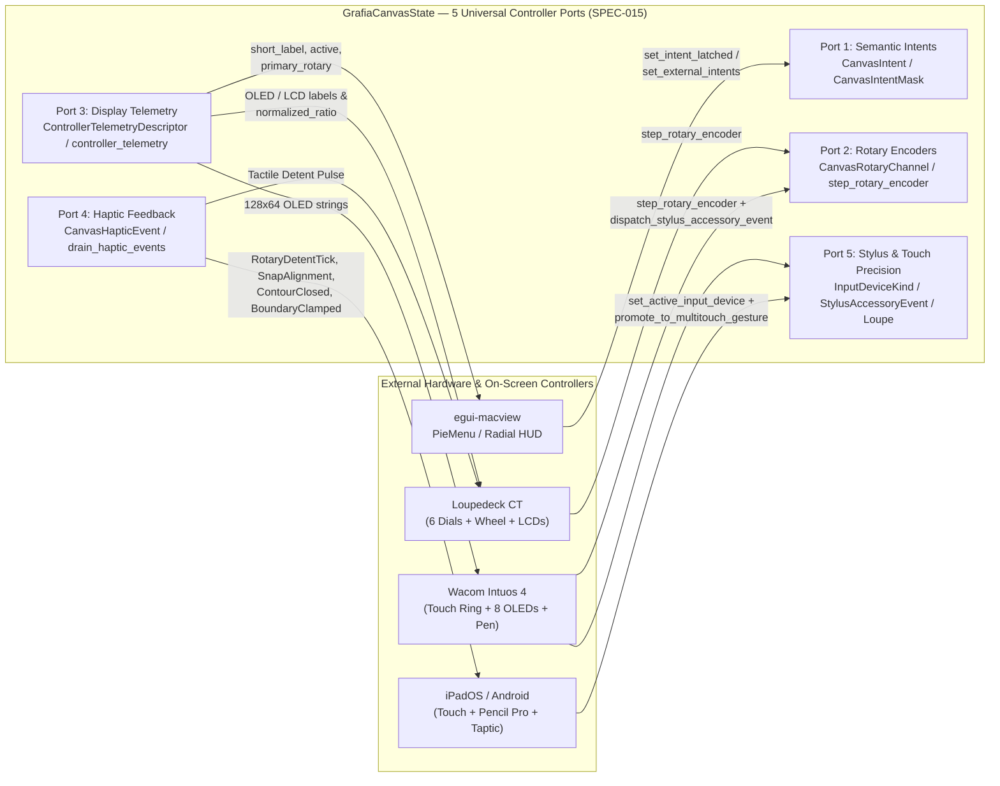

# Universal Hardware & Controller Ports (`SPEC-015`)

`grafia` is 100% UI-widget-agnostic and hardware-driver-agnostic. It never embeds proprietary USB/HID drivers, platform-specific haptic SDKs, or opinionated on-screen pie-menu widgets inside the canvas crate.

Instead, [`GrafiaCanvasState`](crate::GrafiaCanvasState) exposes **5 Universal System-Agnostic Controller Ports ("Stekkers")** so any host application can connect:

- An on-screen **`egui-macview` PieMenu / Radial HUD** or floating tablet modifier pad,
- A **Loupedeck CT** (6 tactile rotary encoders, main wheel display, and RGB LCD keys),
- A **Wacom Intuos 4 / Cintiq Pro** (Touch Ring with mode toggle, 8 ExpressKeys with 128×64 OLED displays, and 6-DOF Pro Pen barrel buttons),
- **Apple Pencil Pro** (Double-Tap, Squeeze, and Barrel Roll) & **iPadOS / Android / macOS Haptic Engines**.

---

## 1. Architecture of the 5 Universal Controller Ports



| Port | Core Types | Primary `GrafiaCanvasState` Methods |
| :--- | :--- | :--- |
| **Port 1: Semantic Intents** | [`CanvasIntent`](crate::CanvasIntent), [`CanvasIntentMask`](crate::CanvasIntentMask) | `set_external_intents`, `set_intent_latched`, `is_intent_latched`, `clear_external_intents`, `effective_intents` |
| **Port 2: Rotary Encoders** | [`CanvasRotaryChannel`](crate::CanvasRotaryChannel) | `step_rotary_encoder(channel, delta_ticks)` |
| **Port 3: Display Telemetry** | [`ControllerTelemetryDescriptor`](crate::ControllerTelemetryDescriptor), [`IntentTelemetryItem`](crate::IntentTelemetryItem), [`RotaryTelemetryInfo`](crate::RotaryTelemetryInfo) | `controller_telemetry()` |
| **Port 4: Haptic Feedback** | [`CanvasHapticEvent`](crate::CanvasHapticEvent) | `drain_haptic_events()` |
| **Port 5: Stylus & Touch Precision** | [`InputDeviceKind`](crate::InputDeviceKind), [`StylusAccessoryEvent`](crate::StylusAccessoryEvent), [`PrecisionLoupeGeometry`](crate::PrecisionLoupeGeometry) | `set_active_input_device`, `dispatch_stylus_accessory_event`, `compute_precision_loupe_overlay`, `promote_to_multitouch_gesture`, `effective_hit_radius_dp` |

---

## 2. Recipe 1: Connecting an On-Screen `egui-macview` PieMenu / Radial HUD

When a user squeezes an Apple Pencil Pro (`StylusAccessoryEvent::Squeeze`) or long-presses on a tablet, your host shell can open an `egui-macview` `PieMenu` populated dynamically from `state.controller_telemetry()`:

```rust
use grafia::{
    CanvasIntent, CanvasRotaryChannel, GrafiaCanvasState, ScreenPoint, StylusAccessoryEvent,
};

pub fn sync_radial_hud_with_canvas(
    state: &mut GrafiaCanvasState,
    pencil_squeezed_at: Option<ScreenPoint>,
    clicked_pie_intent: Option<CanvasIntent>,
    dial_drag_ticks: f64,
) {
    // 1. Forward Apple Pencil Pro Squeeze to GrafiaCanvasState:
    if let Some(pos) = pencil_squeezed_at {
        let _ = state.dispatch_stylus_accessory_event(StylusAccessoryEvent::Squeeze { pos });
    }

    // 2. Query live context-aware labels & active states for the PieMenu slices:
    let telemetry = state.controller_telemetry();
    for item in &telemetry.available_intents {
        // Feed `item.short_label` (e.g. "∧ Cusp", "1:1", "↝ Slide") and `item.active`
        // directly into your egui-macview PieMenu slice!
        let _ = (item.short_label, item.shortcut_hint, item.active);
    }

    // 3. Toggle sticky latching when the user taps a PieMenu slice:
    if let Some(intent) = clicked_pie_intent {
        let next_state = !state.is_intent_latched(intent);
        state.set_intent_latched(intent, next_state);
    }

    // 4. Route an on-screen radial dial drag to ContextPrimary:
    if dial_drag_ticks.abs() > 0.0 {
        state.step_rotary_encoder(CanvasRotaryChannel::ContextPrimary, dial_drag_ticks);
    }
}
```

---

## 3. Recipe 2: Connecting a Loupedeck CT (6 Dials + Center Wheel + LCD Keys)

The Loupedeck CT features 6 endless rotary encoders with physical detents, a large center jog wheel with a circular TFT display, and a 4×3 grid of RGB LCD buttons.

- Map **Main Wheel** $\rightarrow$ `CanvasRotaryChannel::ContextPrimary` (automatically adjusts Smart Corner radius, Hobby spline tension, Tunni ratio, structural Stem width, or Trowel/Cleaner brush radius based on what is selected!).
- Map **Dial 1** $\rightarrow$ `CanvasRotaryChannel::ViewportZoom`.
- Map **Dial 2** $\rightarrow$ `CanvasRotaryChannel::HistoryScrub` (scrubs Undo/Redo per tick!).
- Map **Dial 3** $\rightarrow$ `CanvasRotaryChannel::CanvasRotationOrSlant`.
- Map **Dial 4** $\rightarrow$ `CanvasRotaryChannel::CurveTensionOrRadius`.
- Map **Dial 5** $\rightarrow$ `CanvasRotaryChannel::KerningOrSpacing`.

```rust
use grafia::{
    CanvasHapticEvent, CanvasIntent, CanvasRotaryChannel, GrafiaCanvasState,
};

pub struct LoupedeckCtFrameReport {
    pub wheel_title: &'static str,
    pub wheel_value: String,
    pub wheel_arc_ratio: f64,
    pub lcd_buttons: Vec<(&'static str, bool)>,
    pub trigger_detent_pulse: bool,
}

pub fn update_loupedeck_ct(
    state: &mut GrafiaCanvasState,
    wheel_ticks: f64,
    history_dial_ticks: f64,
    pressed_lcd_intent: Option<CanvasIntent>,
) -> LoupedeckCtFrameReport {
    if wheel_ticks.abs() > 0.0 {
        state.step_rotary_encoder(CanvasRotaryChannel::ContextPrimary, wheel_ticks);
    }
    if history_dial_ticks.abs() > 0.0 {
        state.step_rotary_encoder(CanvasRotaryChannel::HistoryScrub, history_dial_ticks);
    }
    if let Some(intent) = pressed_lcd_intent {
        let latched = !state.is_intent_latched(intent);
        state.set_intent_latched(intent, latched);
    }

    let telemetry = state.controller_telemetry();
    let haptics = state.drain_haptic_events();
    let trigger_detent_pulse = haptics.iter().any(|ev| {
        matches!(
            ev,
            CanvasHapticEvent::RotaryDetentTick { .. } | CanvasHapticEvent::BoundaryClamped
        )
    });

    LoupedeckCtFrameReport {
        wheel_title: telemetry.primary_rotary.parameter_name,
        wheel_value: telemetry.primary_rotary.formatted_value,
        wheel_arc_ratio: telemetry.primary_rotary.normalized_ratio,
        lcd_buttons: telemetry
            .available_intents
            .iter()
            .map(|i| (i.short_label, i.active))
            .collect(),
        trigger_detent_pulse,
    }
}
```

---

## 4. Recipe 3: Connecting a Wacom Intuos 4 (Touch Ring + 8 ExpressKeys + OLEDs + Stylus)

The Wacom Intuos 4 provides 8 ExpressKeys paired with 128×64 monochrome OLED displays, a capacitive Touch Ring with a center mode-toggle button, and a battery-free Grip Pen with two barrel buttons:

```rust
use grafia::{
    CanvasIntentMask, CanvasRotaryChannel, GrafiaCanvasState, InputDeviceKind,
    StylusAccessoryEvent,
};

pub fn poll_wacom_intuos4_tablet(
    state: &mut GrafiaCanvasState,
    express_key_mask: u8,
    touch_ring_mode: usize,
    touch_ring_delta: f64,
    lower_barrel_pressed: bool,
) -> Vec<String> {
    // 1. Switch input device to Stylus (disables touch finger offset & inflation):
    state.set_active_input_device(InputDeviceKind::Stylus);

    // 2. Map Wacom ExpressKeys bitmask directly to semantic CanvasIntents:
    let telemetry = state.controller_telemetry();
    let mut held_mask = CanvasIntentMask::NONE;
    for (idx, item) in telemetry.available_intents.iter().take(8).enumerate() {
        if (express_key_mask & (1 << idx)) != 0 {
            held_mask = held_mask.with(item.intent);
        }
    }
    state.set_external_intents(held_mask);

    // 3. Route Wacom Pro Pen lower barrel button to temporary SlideAlongCurve:
    state.dispatch_stylus_accessory_event(StylusAccessoryEvent::BarrelHold(lower_barrel_pressed));

    // 4. Route capacitive Touch Ring according to active ring LED mode (0..4):
    if touch_ring_delta.abs() > 0.0 {
        let channel = match touch_ring_mode % 4 {
            0 => CanvasRotaryChannel::ContextPrimary,
            1 => CanvasRotaryChannel::ViewportZoom,
            2 => CanvasRotaryChannel::CanvasRotationOrSlant,
            _ => CanvasRotaryChannel::HistoryScrub,
        };
        state.step_rotary_encoder(channel, touch_ring_delta);
    }

    // 5. Format 8 crisp strings for the Wacom Intuos 4 128x64 OLED displays:
    let updated = state.controller_telemetry();
    updated
        .available_intents
        .iter()
        .take(8)
        .map(|item| {
            if item.active {
                format!("[{}]", item.short_label)
            } else {
                item.short_label.to_string()
            }
        })
        .collect()
}
```

---

## 5. Recipe 4: Bridging `drain_haptic_events()` to iOS / Android / macOS Haptic Engines

Call `state.drain_haptic_events()` once per frame after rendering `GrafiaCanvasWidget` and map each semantic [`CanvasHapticEvent`](crate::CanvasHapticEvent) to your target OS actuator:

```rust
use grafia::{CanvasHapticEvent, GrafiaCanvasState};

pub fn dispatch_platform_haptics(state: &mut GrafiaCanvasState) {
    for event in state.drain_haptic_events() {
        match event {
            CanvasHapticEvent::RotaryDetentTick { .. } => {
                // iOS: UISelectionFeedbackGenerator.selectionChanged()
                // Android: View.performHapticFeedback(CLOCK_TICK)
                // macOS: NSHapticFeedbackManager.perform(.alignment, .now)
            }
            CanvasHapticEvent::IntentLatchToggled { .. } => {
                // iOS: UIImpactFeedbackGenerator(style: .light).impactOccurred()
            }
            CanvasHapticEvent::SnapAlignment { .. } => {
                // iOS / Pencil Pro: UICanvasFeedbackGenerator.alignmentOccurred(at:)
                // macOS: NSHapticFeedbackManager.perform(.alignment, .now)
            }
            CanvasHapticEvent::ContourClosed => {
                // iOS: UINotificationFeedbackGenerator.notificationOccurred(.success)
            }
            CanvasHapticEvent::BoundaryClamped => {
                // iOS: UIImpactFeedbackGenerator(style: .rigid).impactOccurred()
            }
        }
    }
}
```
