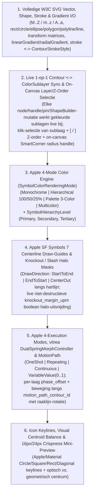

# SPEC-017 (`grafia v0.15.0`) — Complete W3C SVG Color Studio, Live Contour↔Sublayer Sync, Apple SF Symbols 7 Centerline Draw-Guides, 4-Mode Hierarchical/Palette Coloring, Knockout Slash Masks & Motion-Path Kinetics

## 1. Architectuurdoel & Scope (Lean & Mean Canvas Engine)

`SPEC-017` (`grafia v0.15.0`) voltooit de transformatie van `grafia` tot een productie-rijpe **Vector & Kinetic Icon Studio Canvas Engine** voor zowel:
1. **Gewone gekleurde vector-iconen o.b.v. echte W3C SVG's uit het wild** (Figma, Illustrator, Lucide, Heroicons, SF Symbols), als
2. **Apple's interne SF Symbols 6/7 & Icon Composer mogelijkheden** voor gelaagde kleur-hiërarchieën (`Monochrome`, `Hierarchical`, `Palette`, `Multicolor`), hartlijn-gebaseerde penstreek-opbouw (`Centerline DrawOn/DrawOff/CenterOut`), niet-destructieve `Knockout / Slash` halo-maskers, veer- en sensor-gedreven animaties (`OneShot`, `Repeating`, `Continuous`, `VariableValue(0..1)` met `vitrea::DualSpringMorphController`) en `MotionPath` traject-volging.

Conform het **Zero-Bloat Unix/Crate-principe** bevat `SPEC-017` uitsluitend pure 2D vector-wiskunde, canvas-interactie (`InputDispatcher`) en multi-pass rendering (`egui` + `tiny-skia` + `vitrea`), zonder document-matrices (geen 27-varianten font-tabellen), zonder CSS-DOM/Lottie-transpilers en zonder After-Effects keyframe-dopesheets.



---

## 2. De 8 Normatieve Subsystemen (`§2.1` – `§2.8`)

### 2.1 Volledige W3C SVG Vector, Basisvormen, Transform, Stroke & Gradient I/O (`src/core/w3c_svg_io.rs`)
1. **Volledige W3C SVG 1.1 / 2.0 `<path d="...">` Tokenizer & Parser:**
   - Ondersteunt zowel absolute als relatieve commando's: `M`/`m`, `L`/`l`, `H`/`h`, `V`/`v`, `C`/`c`, `S`/`s` (gereflecteerde kubische handle), `Q`/`q`, `T`/`t` (exacte graadverhoging van kwadratisch naar kubisch: $\mathbf{C}_1 = \mathbf{P}_0 + \frac{2}{3}(\mathbf{Q}_1 - \mathbf{P}_0)$, $\mathbf{C}_2 = \mathbf{P}_2 + \frac{2}{3}(\mathbf{Q}_1 - \mathbf{P}_2)$), **`A`/`a` (W3C F.6.5 / F.6.6 elliptische boog-parametrisatie naar exacte kubische Bézier-segmenten)**, en `Z`/`z`.
   - Verwerkt compacte getalnotatie zonder spaties (bijv. `M10-20.5.3c-5.2,0-10-4.8-10-10z`, impliciete herhaling van commando's na `M` $\rightarrow$ `L` en `m` $\rightarrow$ `l`, en wetenschappelijke notatie `1.5e-3`).
   - Ondersteunt samengestelde paden (meerdere `M`...`Z` subpaden binnen één `<path/>`) door ze verliesvrij te splitsen in meerdere `GlyphContour`s binnen dezelfde `CanvasColorSublayer`.
2. **SVG Basisvormen & `viewBox` / `transform="..."` Matrix-Normalisatie:**
   - Converteert `<rect x y width height rx ry>`, `<circle cx cy r>`, `<ellipse cx cy rx ry>`, `<line x1 y1 x2 y2>`, `<polyline points="..."/>` en `<polygon points="..."/>` naar exacte `GlyphContour`s.
   - Evalueert geneste `transform="translate(...) scale(...) rotate(...) skewX(...) skewY(...) matrix(a,b,c,d,e,f)"` ketens én `viewBox="min_x min_y width height"` met automatische Y-down (SVG) $\leftrightarrow$ Y-up (`1000 UPM` font-canvas) affiene conversie.
3. **SVG Kleuren, `<defs>` Gradients & Lijnstijlen (`stroke` $\leftrightarrow$ `ContourStrokeStyle`):**
   - Ondersteunt `fill` en `stroke` in `#RGB`, `#RGBA`, `#RRGGBB`, `#RRGGBBAA`, `rgb(r,g,b)`, `rgba(...)`, standaard W3C kleurnamen (`black`, `white`, `red`, `blue`, `currentColor`, `none`) en `url(#id)` verwijzingen naar `<linearGradient>` en `<radialGradient>` in `<defs>` (inclusief `gradientUnits="userSpaceOnUse"` en `"objectBoundingBox"`).
   - Map `stroke-width`, `stroke-linecap` (`butt`, `round`, `square`) en `stroke-linejoin` (`miter`, `round`, `bevel`) verliesvrij naar `ContourStrokeStyle` op open én gesloten contouren.

### 2.2 Live 1-op-1 `glyph.contours` $\leftrightarrow$ `color_sublayers` Koppeling & Sublaag Z-Order (`src/adapters/color_layer_interaction.rs` & `src/adapters/icon_studio_ops.rs`)
1. **Live Bidirectionele Geometrie-Synchronisatie (`sync_color_sublayers_from_glyph_contours`):**
   - Elke `GlyphContour` in `color_sublayers[i].contours` behoudt haar canonieke `ContourId` en `NodeId`s uit `state.glyph.contours`.
   - Zodra een gebruiker op het canvas een knoop, `OffCurve` Bézier-handle, segment-buik, `SmartCornerSpec`, `VariableWidthHandlePin`, `ShapeBuilder`-merge/erase, `remove_overlap`, `apply_optical_oblique` of `normalize_icon_contours` uitvoert, worden de corresponderende contouren in `state.color_sublayers` automatisch en atomair binnen dezelfde transactie gesynchroniseerd (`old_id -> new_id` lineage).
2. **Directe On-Canvas Sublaag-Selectie & Z-Order (`[` / `]`):**
   - Klikken op een gekleurde sublaag in `CanvasTool::Select` (wanneer geen knoop/handle/pin/anker wordt geraakt) selecteert die `CanvasColorSublayer` (`selected_color_sublayer = Some(idx)`), waardoor haar `GradientHandle`s en `SymbolLayerTag` direct actief worden.
   - `reorder_selected_color_sublayer(delta: i32)` (`BringForward` / `SendBackward`) verschuift de geselecteerde sublaag én haar bijbehorende `SymbolLayerTag` atomair met bit-exacte `Undo/Redo`.

### 2.3 Apple SF Symbols 4-Mode Color Engine (`src/core/icon_color_modes.rs`)
1. **`SymbolHierarchyLevel` op `SymbolLayerTag`:**
   ```rust
   #[derive(Debug, Clone, Copy, PartialEq, Eq, Default, Serialize, Deserialize)]
   pub enum SymbolHierarchyLevel {
       #[default]
       Primary,
       Secondary,
       Tertiary,
   }
   ```
2. **`SymbolColorRenderingMode` op `CanvasIconStudioScene`:**
   ```rust
   #[derive(Debug, Clone, Copy, PartialEq, Eq, Default, Serialize, Deserialize)]
   pub enum SymbolColorRenderingMode {
       Monochrome { tint_rgba: [u8; 4] },
       Hierarchical { primary_rgba: [u8; 4] },
       Palette { colors_rgba: [[u8; 4]; 3] },
       #[default]
       Multicolor,
   }
   ```
   - **`Monochrome`**: Vervangt elke niet-knockout sublaag-paint door `Solid { rgba: tint_rgba }`.
   - **`Hierarchical`**: Gebruikt `primary_rgba` met laag-opaciteitsfactor `1.0` voor `Primary`, `0.50` (`HIERARCHICAL_SECONDARY_ALPHA`) voor `Secondary`, en `0.25` (`HIERARCHICAL_TERTIARY_ALPHA`) voor `Tertiary`.
   - **`Palette`**: Mapt `Primary` $\rightarrow$ `colors_rgba[0]`, `Secondary` $\rightarrow$ `colors_rgba[1]`, `Tertiary` $\rightarrow$ `colors_rgba[2]`.
   - **`Multicolor`**: Behoudt de intrinsieke `ColorLayerPaint` (`Solid`, `LinearGradient`, `RadialGradient`, `SweepGradient`) van elke sublaag.

### 2.4 Apple SF Symbols 7 Centerline `DrawOn` / `DrawOff` (`StartToEnd`, `EndToStart`, `CenterOut`) (`src/core/kinetic_draw_trim.rs`)
1. **`DrawDirection` & Gekoppelde Centerline-Trimming:**
   ```rust
   #[derive(Debug, Clone, Copy, PartialEq, Eq, Default, Serialize, Deserialize)]
   pub enum DrawDirection {
       #[default]
       StartToEnd,
       EndToStart,
       CenterOut,
   }
   ```
   - `StartToEnd`: trimt het booglengte-interval $[0, u]$.
   - `EndToStart`: trimt het booglengte-interval $[1 - u, 1]$.
   - `CenterOut`: trimt vanuit het midden naar beide uiteinden over $[0.5 - 0.5u, 0.5 + 0.5u]$.
2. **Niet-Destructieve `ContourStrokeStyle` & `VariableWidthStrokeSpec` Hartlijn-Expansie tijdens `DrawOn`/`DrawOff`:**
   - Wanneer een open contour een `ContourStrokeStyle` of `VariableWidthStrokeSpec` heeft (of wanneer een gesloten contour een gekoppelde hartlijn heeft), wordt **eerst** de 1D-hartlijn via De Casteljau op $[r_0, r_1]$ getrimd en **daarna** live met haar doppen (`Round` / `Butt` / `Square`) en breedteprofiel tot een gesloten vector-sublaag geëxpandeerd. Hierdoor groeit een balk, vinkje of Wi-Fi-boog als één echte penstreek!

### 2.5 Live Niet-Destructieve `Knockout / Slash` Halo-Maskers (`src/core/icon_knockout_mask.rs`)
1. **`knockout_margin_upm: f64` op `SymbolLayerTag`:**
   - Wanneer `tag.knockout_margin_upm > 0.0` op sublaag $k$ (bijv. een diagonale "slash"-streep of een notificatie-badge), genereert sublaag $k$ een geëxpandeerde **knockout-halo** (haar eigen contour geëxpandeerd met `knockout_margin_upm`).
   - Alle onderliggende sublagen $j < k$ worden in de evaluator niet-destructief via boolean subtractie (`subtract_contours`) door deze halo uitgesneden!
   - Wanneer de slash-sublaag zelf met `Appear (DrawOn)` groeit van $0 \rightarrow 100\%$, groeit haar uitgesneden halo-kanaal synchroon mee over de onderliggende lagen.

### 2.6 Apple 4-Execution Modes, `vitrea::DualSpringMorphController` & `MotionPath` Traject-Volging (`src/core/kinetic_symbols.rs`)
1. **`KineticPlaybackMode` & Per-Laag `phase_offset`:**
   ```rust
   #[derive(Debug, Clone, Copy, PartialEq, Default, Serialize, Deserialize)]
   pub enum KineticPlaybackMode {
       OneShot,
       Repeating { repeat_delay_phase: f64 },
       #[default]
       Continuous,
       VariableValue(f64),
   }
   ```
   - In **`VariableValue(v)`** ($v \in [0, 1]$) schakelen of vullen de laaggroepen $g \in 1..=G$ zich proportioneel aan de sensorwaarde $v$ (zoals Wi-Fi-streepjes, geluidsgolven of batterijlading) zonder dat `playing == true` hoeft te zijn.
   - In **`OneShot`** en veer-overgangen stuurt `vitrea::DualSpringMorphController` de fysische overshoot en kritische demping aan.
2. **`motion_path_contour_id: Option<ContourId>` & `orient_along_motion_path: bool` op `SymbolLayerTag`:**
   - Wanneer een sublaag verwijst naar een `motion_path_contour_id`, beweegt haar groeps-pivot tijdens $\tau \in [0, 1]$ exact langs de Gauss-Legendre booglengte van die traject-contour, en roteert de sublaag (indien `orient_along_motion_path == true`) automatisch mee met de lokale raaklijnvector $(\cos\theta(\tau), \sin\theta(\tau))$.

### 2.7 On-Canvas Corner-Radius Handle (`SmartCornerSpec`) & Niet-Destructieve Open-Stroke Kleurlagen (`src/adapters/smart_corners_and_stem_ops.rs`)
1. **Directe On-Canvas Corner-Radius Widget:**
   - Voor geselecteerde `NodeType::Corner`-knopen verschijnt langs de binnenbisectrice op het canvas een versleepbare **Corner-Radius Pin**.
   - Slepen aan deze pin via `InputDispatcher` (muis, tablet-touch `1.6x`, stylus) past de lokale `SmartCornerSpec::radius_upm` ($C^2$ of cirkelboog-afronding) live en niet-destructief aan met directe `Undo/Redo`.
2. **1e-Klas Open-Stroke Rendering & $N$-Fold Radiale Symmetrie met `SmartCornerSpec`:**
   - Open contouren in `color_sublayers` of `glyph.contours` die een `ContourStrokeStyle` of `VariableWidthStrokeSpec` dragen, worden in alle weergavemodi (`EditWireframe`, `PreviewFilled`, `LiquidGlass`, `PreviewPanel`, `render_colored_thumbnail`) automatisch als geëxpandeerde gevulde vectorvorm gerenderd terwijl hun 1D-skelet en handles direct bewerkbaar blijven.
   - Wanneer `icon_studio.radial_symmetry.fold_count > 1` actief is, worden zowel in de live `EditWireframe` / `PreviewFilled` / `LiquidGlass` weergaven als bij `bake_radial_symmetry()` eerst de non-destructieve `SmartCornerSpec`-afrondingen en variabele/vaste strokes geëvalueerd vóórdat de $N$ symmetrie-sectoren worden gegenereerd, zodat alle $N$ kopieën exact dezelfde afgeronde hoeken en strokes tonen.

### 2.8 Icon Keyline Templates, Visual Centroid Balance & `16px / 24px` Crispness Mini-Preview (`src/core/reference_frame.rs` & `src/render/reference_frame_pass.rs`)
1. **Apple / Material Icon Keyline Grid & Optisch Zwaartepunt (`compute_icon_optical_balance`):**
   - Toont op het canvas de 4 canonieke icoon-keylines op het `1000 UPM` / `800 UPM` kader (Cirkel, Vierkant, Staande Rechthoek, Liggende Rechthoek + Diagonalen).
   - Berekent zowel het **Geometrische Bounding-Box Centrum** $\mathbf{c}_{\text{bbox}}$ als het **Oppervlakte-Gewogen Optische Zwaartepunt** $\mathbf{c}_{\text{opt}} = \frac{\sum A_i \mathbf{c}_i}{\sum A_i}$ over alle gevulde/geëxpandeerde contouren en toont het optische afwijkingsvector-kruisje ($\Delta\mathbf{c} = \mathbf{c}_{\text{opt}} - \mathbf{c}_{\text{bbox}}$).
2. **Live `16×16` & `24×24` Pixel-Crispness Mini-Preview:**
   - Rasteriseert het icoon live op `16×16` en `24×24` pixels zodat de ontwerper tijdens het slepen aan handles direct de scherpte op kleine schermformaten ziet.

### 2.8b Engine Hardening, COTS `roxmltree` DOM, Bi-Directional Sublayer Lifecycle & RenderCache Hasher (`Stap 17.9a` – `17.9c`)
1. **COTS `roxmltree` W3C SVG DOM-Parser & `viewBox` Normalisatie (`Stap 17.9a`, `src/core/w3c_svg_io.rs` & `src/core/w3c_svg_defs.rs`):**
   - Vervangt de handmatige string-scanner door een recursieve `roxmltree::Document` DOM-wandeling.
   - Ondersteunt willekeurig diep geneste `<g>`-groepen (met cumulatieve `kurbo::Affine` `transform`-matrices en overgeërfde `fill`/`stroke`/`opacity`-attributen), top-level shapes (`<path>`, `<rect>`, `<circle>`, `<ellipse>`, `<line>`, `<polygon>`, `<polyline>`) zonder `<g>`-wrapper, inline CSS `style="fill:...;stroke-width:..."`, `rgb(r, g, b)` kleuren, en automatische `viewBox="min_x min_y w h"` schaling naar het icon-artboard wanneer $w, h$ afwijken van `1000 UPM` (zoals `24×24` of `100×100` SVG-iconen).
2. **Bi-directionele `glyph.contours` $\leftrightarrow$ `color_sublayers` Levenscyclus & Concave Knockout Self-Union (`Stap 17.9b`, `src/adapters/color_layer_interaction.rs` & `src/core/icon_knockout_mask.rs`):**
   - Wanneer `color_sublayers` actief is, adopteert `sync_color_sublayers_from_glyph_contours` elke nieuw getekende of door `Knife`/`ShapeBuilder` afgesplitste contour (`ContourId` die nog niet in `color_sublayers` voorkomt) automatisch als zichtbare `CanvasColorSublayer` + `SymbolLayerTag`, en snoeit het verwijderde contouren (`Delete`/`Backspace`) synchroon uit `color_sublayers` en `symbol_layer_tags`.
   - `build_expanded_knockout_halo_nodes` reinigt elke geëxpandeerde knockout-halo via `remove_overlap_in_contours` vóór boolean subtractie (`subtract_contours`), zodat scherpe concave binnenhoeken nooit zwaluwstaart-zelfintersecties achterlaten.
3. **Collision-Vrije `std::hash::Hasher` in `CanvasRenderCache`, `Solid`-Layer Fast-Path & `icon_artboard_ops.rs` (`Stap 17.9c`):**
   - `color_sublayers_fingerprint` en `liquid_glass` cache-sleutels hashen alle gradient-coördinaten (`p0, p1, c0, c1, r0, r1, center, start_deg, end_deg`) en alle `LiquidGlassRenderConfig`-parameters (`specular_intensity, shininess, refraction_px`) via `std::hash::DefaultHasher`.
   - `composite_sublayer_into_rgba` slaat voor `ColorLayerPaint::Solid` de per-pixel `vp.to_font()` matrix-inversie over.
   - De icon-keyline, optical-balance, crispness-preview en sublayer-tag adapters staan in hun eigen Single-Responsibility module `src/adapters/icon_artboard_ops.rs` (`< 320 eSLOC` per adapter).
4. **Cross-Pass Render Parity (`PreviewStrip`, `PreviewPanel`, `LiquidGlass`, `EditActiveFill`), On-Canvas Optical Centroid $\oplus$ Vector & `ShapeBuilder`/`Knife` Sublayer Topology Sync (`Stap 17.9d`, `TC-V0150-009D`):**
   - `render_preview_strip_rgba`, `render_preview_panel_into_rect`, `collect_active_liquid_glass_contours`, `render_colored_thumbnail` en `fill_active_glyph_while_editing` evalueren via `has_active_non_destructive_preview_effects` / `evaluate_active_preview_silhouette_contours` alle open gestrookte contouren (`ContourStrokeStyle` / `VariableWidthStrokeSpec`), `SmartCornerSpec`, $N$-voudige `radial_symmetry`, `knockout_margin_upm` halo-uitsnijdingen en `KineticPlaybackMode::VariableValue(v)` (`kinetic.is_active()`).
   - Wanneer het Icon Keyline Grid (`frame.show_diagonals == true`) actief is, tekenen `paint_custom_reference_frame_pass` en `paint_custom_reference_frame_pixmap_pass` de optische zwaartepunt-marker $\oplus$ en de afwijkingsvector $\Delta\mathbf{c} = \mathbf{c}_{\text{opt}} - \mathbf{c}_{\text{bbox}}$ op het canvas.
   - `finish_icon_contour_replacement` (`ShapeBuilder`, `Remove Overlap`) en `finish_knife_drag` (`Knife`) synchroniseren `color_sublayers` en `symbol_layer_tags` via `reconcile_color_sublayers_after_contour_topology_edit` (samenvoegen behoudt de eerste sublaag en snoeit samengesmolten/gewiste duplicaten; doorsnijden adopteert nieuwe contour-helften automatisch).

### 2.9 Sonoma × Apple SF Symbols Studio UX Architecture (`examples/demo_host_shell/`)
1. **Segmented Primary Studio Switcher (`Letter Studio` vs. `Icon Studio`) & Rustige Sonoma Studio Esthetiek:**
   - Geen `[Vierkante Haakjes]` of overvolle gestapelde knoppenrijen: één strakke macOS Sonoma Top-Bar met `Letter Studio` | `Icon Studio`, de 6 kern-gereedschappen (`Select`, `Pen`, `Vorm`, `Mes`, `Schets`, `Transform`), weergave-keuze (`Outline` · `Gevuld` · `Liquid Glass`) en standaard ingeklapte zij-/onderpanelen zodat het canvas ~90% van het venster krijgt.
   - `Letter Studio` toont het typografische letter-kader (`Baseline`, `x-Height`, `Cap Height`, `LSB/RSB`) met Progressive Disclosure over 4 rustige werk-tabs (`Tekenen`, `Curven & Audit`, `Stems & Penseel`, `Tekst & Masters`).
   - `Icon Studio` schakelt het canvas om naar een vierkant **Icon Artboard met Apple/Material Keylines**, ondersteunt direct vanaf nul bouwen (`Nieuw Icoon` + automatische `CanvasColorSublayer`-registratie bij zelf tekenen met `Vorm`, `Pen` of `Schets`), een directe Laag-, Streek- (`ContourStrokeStyle` met ronde doppen) & Knockout-Halo-strip, de `16px/24px` live scherpte-badge, en de Kinetische Animatie- & `VariableValue (0..100%)`-balk.
