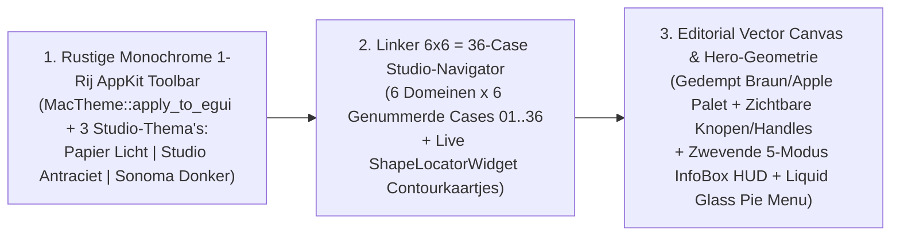

# SPEC-018 (`grafia v0.15.0`) — Editorial Vector Studio Aesthetic, 3-Tier Studio Theme Calibration (`Paper Light`, `Studio Anthracite`, `Sonoma Dark`), Monochrome AppKit Toolbar Chrome & 36-Case (`6×6`) Investor & Systems-Engineering Keynote Showcase

## 1. Architectuurdoel & Keynote-Verantwoording (Apple HIG × NASA Systems Engineering)

`SPEC-018` specificeert de architecturale en visuele afronding van de `grafia` (`v0.15.0`) demonstrator (`examples/vector_canvas_demo.rs` & `examples/demo_host_shell/`) en de bijbehorende thema-integratie met `egui-macview` (`v0.8.1`), met drie harde engineering-doelen:

1. **Editoriale Rust & AppKit Kleur-Kalibratie (Zero Screaming Chrome):**
   - Een professionele typografie- en vector-editor laat het **canvas** spreken en houdt het omliggende vensterchroom (`Panel::top`, `Panel::left`, `Panel::right`, `Panel::bottom`) neutraal, zacht en monochroom.
   - `GrafiaVectorCanvasDemo::render_ui` synchroniseert bij elk frame `MacTheme::apply_to_egui(ui.ctx())` zodat alle omliggende `egui`-panelen, kaders, tekstvelden en scheidingslijnen exact de AppKit `windowBackgroundColor`, `sidebarBackgroundColor` en `separatorColor` van het actieve studio-thema aannemen in plaats van ruwe standaard `egui::Visuals`.
   - Ondersteunt **3 Studio-Thema's (`StudioThemePreset`)**:
     1. **`PaperLight` (`Editorial Papier Licht` — Default):** `#ECECEC` / `#F6F6F6` zacht vensterchroom, `#FFFFFF` papierwit canvas, `#1C1C1E` antraciet vectorcontouren, gedempt smaragdgroen (`#3CAD66`) voor smooth-nodes, zacht staalblauw (`#2B78E4`) voor corner-nodes, warme brons-bruine BCP-handles (`#8C6845` / `#B49A80`), en de lichtgrijze zwevende **Selection InfoBox HUD (`#ECECF0F2`)** onderin het canvas.
     2. **`StudioAnthracite` (`Warm Studio Grijs`):** `MacAppearance::Anthracite` (`#32363E` / `#2F333B` chroom) met een gekalibreerd neutraal studio-canvas (`#26282E`) voor kleurechte inspectie van `COLRv1`-verlopen, `Vitrea` diëlektrisch Liquid Glass en subtiele stamdikte-regenbogen zonder verblinding.
     3. **`SonomaDark` (`Diep Donker OLED`):** `MacAppearance::DarkAqua` (`#323232` chroom, `#1E1E1E` canvas) met zachte pastel-accenten.
   - De gekleurde sublagen (`CanvasColorSublayer`) van de 5 kubische Bézier hero-iconen gebruiken een **gedempt, harmonieus Braun / Apple Editorial Design-palet** (leisteen-blauw `#3A7CA5`, salie-teal `#4E9A8E`, warm terracotta-amber `#D97F43`, karmozijn-koraal `#C84B59`) én openen standaard met hun **echte vector-contouren, on-curve knopen, off-curve handles en een subtiele semi-transparante laagvulling** zichtbaar, zodat een belegger of ingenieur direct ziet dat elk icoon uit levende, wiskundig zuivere kubische Bézier-geometrie bestaat.

2. **Progressive Discoverability zonder Knopjesmuur — De 6×6 = 36-Case Keynote Feature Matrix:**
   - Alle 21 eerdere presets waren verstopt achter één dichtgeklapte dropdown en lieten ~40% van de 193 Rust-modules in `src/` onzichtbaar.
   - In plaats van losse tekstknoppen op het canvas óf één verstopte dropdown, introduceert `SPEC-018` een **Zichtbare 6-Domeinen × 6-Cases = 36-Case Studio-Navigator** in de linker Studio-Sidebar (op desktop standaard geopend op `272 dp` breedte; op mobiel `< 900 dp` automatisch ingeklapt ten gunste van het bimanuele Liquid Glass Thumb Pie Menu):
     - **Bovenste helft van de Linker Studio-Sidebar:** De **6 Domein-Hoofdstukken (`ShowcaseChapter`)** met per domein exact **6 genummerde, 1-klik Showcase-Cases (`01` t/m `36`)**, plus een compacte `◀ / ▶` Keynote-Stepper.
     - **Onderste helft van de Linker Studio-Sidebar:** De live **`ShapeLocatorWidget`** miniatuur-contourkaartjes (`Path 1..N • pt • CCW/CW • Normal/Mask`) en snelle pad-operaties.
   - **Bovenin het Canvas (Subtiele Keynote Pitch-Card) & Onderin het Canvas (5-Modus Zwevende InfoBox HUD):**
     - Onderin het canvas staat standaard (`show_selection_info_hud = true`) de **5-Modus Zwevende InfoBox HUD** met het 3×3 transformatie-anker, glyph-naam, `LSB / RSB / Width` en geselecteerde knoopcoördinaten.
     - Bovenin (of direct onder de 1-rij toolbar wanneer `show_coach_banner == true`) toont een rustige, één-regelige **Keynote Telemetry Strip** het case-nummer (`Case 01/36`), de wiskundige/architecturale garantie en een directe doe-instructie.

---

## 2. De 6 Domeinen × 6 Cases = 36 Normatieve Keynote Showcase-Cases (`DemoPreset::ALL`)

Elke case in `DemoPreset::ALL` (`36` varianten, `01` t/m `36`) activeert deterministisch een specifieke combinatie van `GrafiaCanvasState`-subsystemen, gereedschappen (`CanvasTool`) en host-stekkers (`CanvasHostRequest`):

### Domein I — Typografie & Editoriale Kern (`ShowcaseChapter::BasisTekenen`, Cases `01`–`06`)
| Nr | `DemoPreset` Variant | Korte Titel | Geactiveerde Engine-Subsystemen & Bewijskracht |
| :--- | :--- | :--- | :--- |
| **01** | `EditorialContoursAndInfoBox` | `01. /A & /O Contour & InfoBox` | Wisselt `/A` (rechte stammen) en `/O` (kubische extremen), activeert `show_selection_info_hud = true`, `show_metrics = true`, en selecteert een knoop zodat de zwevende InfoBox onderin direct live coördinaten toont. |
| **02** | `RulersGuidesAndBgLayer` | `02. Linialen, Hulplijnen & Achtergrond` | Zet `show_rulers = true` (`20 dp` zoom-adaptieve 1-2-5 linialen), kopieert de contour naar `background_contours` met offset, en plaatst een lokale én globale hulplijn met magnetische `SnapEngine`. |
| **03** | `TextStreamAovaKerning` | `03. Tekststrook "AOVA" & Live Kerning` | Activeert `CanvasTool::Text`, bouwt de multi-glyph tekststrook `"AOVA"` met live kerning-paren (`A-V = -70 UPM`), tekst-caret en `show_text_measurement_line = true`. |
| **04** | `VerticalCjkStreamAndFrame` | `04. Verticale CJK-Stroom & 3×3 Kader` | Schakelt `WritingDirection::TopToBottom` in met een `CustomReferenceFrame` (buitenkader, 3×3 ideografische onderverdeling en 2 keyline-cirkels). |
| **05** | `AnchorsAndDiacriticCloud` | `05. Ankers & Diakritische Wolk (Cmd+U)` | Stuurt `CanvasHostRequest::ResetDefaultAnchors`, injecteert `top`, `bottom`, `ogonek` ankers en projecteert de semi-transparante `GhostMarkPath` accentwolk (`acutecomb`, `dieresiscomb`, `cedillacomb`). |
| **06** | `SmartComponentsAndDecompose` | `06. Smart Components & wght-Schuif` | Plaatst het gekoppelde component `acutecomb` mét een interactieve on-canvas parametrische `CanvasSmartHandle` (`wght / StemWeight`, `40..160`); een tweede klik ontleedt (`decompose_selected_components`) het component naar bewerkbare voorgrondpaden. |

### Domein II — CAGD Wiskunde & Bocht-Perfectie (`ShowcaseChapter::CurvenEnAudit`, Cases `07`–`12`)
| Nr | `DemoPreset` Variant | Korte Titel | Geactiveerde Engine-Subsystemen & Bewijskracht |
| :--- | :--- | :--- | :--- |
| **07** | `G2HarmonizeAndGeniusNodes` | `07. G² Harmonisatie & Genius-Knopen (★)` | Laadt `/O`, voert `harmonize_selected_nodes()` ($G^2$ krommingscontinuïteit) uit en markeert de top-extremen met `set_node_genius(_, true)` (`★` badge + live G²-herberekening tijdens slepen). |
| **08** | `G3ClothoidEulerSpiral` | `08. G³ Clothoïde / Euler-Spiraal (❖)` | Voert `harmonize_selected_nodes_g3()` ($G^3$ nul-schok Euler-spiraal overgang) uit en vergrendelt `set_node_g3_lock(_, true)` (`❖` badge). |
| **09** | `TunniLinesAndHandleRatios` | `09. Tunni-Balanslijnen & 55% Badges` | Zet `show_tunni_lines = true` en selecteert een kubisch segment zodat zowel de blauwe Tunni-hefboomlijn als de sleepbare `55%` handle-ratio pill-badges actief zijn. |
| **10** | `CurvatureCombSpikesAndHeatmap` | `10. Krommingskam (Spikes & Heatmap)` | Schakelt `show_curvature_comb = true` in en wisselt bij klikken tussen `CurvatureCombStyle::NormalSpikes` (normaalvectoren $\kappa(t)$) en `CurvatureCombStyle::HeatmapEnvelope`. |
| **11** | `RedArrowsOutlineAudit` | `11. Rode-Pijlen Contour-Audit` | Activeert `show_outline_audit = true` op een contour met een opzettelijke buigpunt-/extrema-afwijking zodat de diagnostische rode foutpijlen en één-klik `add_extremes_action()` zichtbaar zijn. |
| **12** | `HobbySplinesAndPowerNudge` | `12. Hobby-Splines & Servo Power-Nudge` | Converteert kubische knopen naar John Hobby's spannings-splines (`HobbyStar` met `tension_in / tension_out`) én zet `power_nudge_enabled = true` + `servo_scaling_enabled = true` aan. |

### Domein III — Stamdikte, Kalligrafie & Optica (`ShowcaseChapter::KalligrafieEnStems`, Cases `13`–`18`)
| Nr | `DemoPreset` Variant | Korte Titel | Geactiveerde Engine-Subsystemen & Bewijskracht |
| :--- | :--- | :--- | :--- |
| **13** | `SmartCornersFilletsAndInkTraps` | `13. Smart Corners & Negatieve Inktvallen` | Plaatst niet-destructieve `SmartCornerSpec` op `/A` (`+28 UPM` ronde fillet én `-18 UPM` scherpe inktval) met gele versleepbare on-canvas bisectrice-pinnen. |
| **14** | `Calligraphic6DofNibBrush` | `14. 6-DoF Druk & Tilt Kalligrafie-Penseel` | Evalueert `apply_calligraphic_brush_stroke` met een `30°` platte penpunt (`12..44 UPM`, druk `0.25..0.85`, stylus-tilt `(15°, 10°)`) tot een schone kubische enveloppe. |
| **15** | `StructuralStemGaugeAndTool` | `15. Structurele Stamdikte-Meter & Stem-Tool` | Zet `show_stem_gauge = true` met referentiestammen (`84 UPM` verticaal, `68 UPM` horizontaal) en activeert `CanvasTool::Stem` voor directe wanddikte-manipulatie. |
| **16** | `IntersectionRulerAndRainbow` | `16. Snijpunten-Meetlat (L) & Dikte-Regenboog` | Activeert `CanvasTool::Measurement` met een actieve meetlijn dwars over `/O` (toont exacte snijpunten en koorde-lengtes) plus `show_measurement_rainbow = true`. |
| **17** | `TrowelSmoothingAndCleanerBrush` | `17. Strijk-Troffel & Micro-Lus Gum-Borstel` | Wisselt tussen `CanvasTool::Trowel` (lokale Laplaciaanse Bézier-gladstrijker) en `CanvasTool::Cleaner` (automatische micro-lus- en spike-verwijderaar) met zichtbare borstelcirkel. |
| **18** | `OpticalRhythmOvershootAndCentroid` | `18. Optisch Ritme, Overshoot & Zwaartepunt (⊕)` | Zet `show_optical_rhythm_fill = true`, `round_overshoot_upm = Some(14.0)` en `show_visual_centroid = true` ($\oplus$ oppervlakte-gewogen zwaartepunt) aan op `/O`. |

### Domein IV — Variabele Fonts, Masters & Hinting (`ShowcaseChapter::TekstEnMasters`, Cases `19`–`24`)
| Nr | `DemoPreset` Variant | Korte Titel | Geactiveerde Engine-Subsystemen & Bewijskracht |
| :--- | :--- | :--- | :--- |
| **19** | `MultiMasterCompatAndAutoMatch` | `19. Multi-Master Stralen & Auto-Match` | Laadt `Light`, `Bold` en een incompatibele masterlaag met `show_master_compatibility = true`; een tweede klik voert `auto_match_master_compatibility(1)` uit om startknoop en windrichting te herstellen. |
| **20** | `CurvedMasterTrajectories` | `20. Gebogen Master-Trajecten (Kink-Vrij)` | Activeert `CanvasTool::CurvedTrajectory` en koppelt een kwadratische/kubische `CurvedTrajectoryLink` tussen twee masters zodat roterende stammen zonder knik interpoleren. |
| **21** | `HigherOrderInterpolationHoi` | `21. Hogere-Orde Interpolatie (HOI Diamanten)` | Activeert `CanvasTool::Hoi` en `show_hoi_diamonds = true` met niet-lineaire kubische master-stuurpolygonen (`M0`, `M1`) voor `CanvasHostRequest::MutateHoiLayerNode`. |
| **22** | `TrueTypeVisualInstructor16Ppem` | `22. TrueType Visual Instructor & 16px Grid` | Activeert `CanvasTool::TrueTypeInstructor`, het `16 PPEM` scherm-pixelraster (`set_pixel_preview_ppem(Some(16))`), de groen-gerasterde grid-fit contour en visuele `Anchor`/`Stem`-instructies. |
| **23** | `PostScriptStemAndGhostHints` | `23. PostScript Stam- & Ghost-Hints` | Projecteert horizontale/verticale `PostScriptHint` stam-banden (`68 UPM`) en `top_ghost` uitlijnzones (`700 UPM`) met directe on-canvas selectie. |
| **24** | `BitmapScanAndAutoTrace` | `24. Achtergrond-Scan & 1-Klik Auto-Trace` | Plaats een gekalibreerde grijswaarden-scan (`CanvasBackgroundImage`) en voert bij de tweede klik de Sauvola + Marching-Squares + Schneider `trace_active_background_image` vectorizer uit. |

### Domein V — Vector, Kleur & Liquid Glass Icon Studio (`ShowcaseChapter::IconStudioEnAnimatie`, Cases `25`–`30`)
| Nr | `DemoPreset` Variant | Korte Titel | Geactiveerde Engine-Subsystemen & Bewijskracht |
| :--- | :--- | :--- | :--- |
| **25** | `IconKeylineArtboardAndOpticalPlay` | `25. 800×800 Keyline Artboard & Play-Optica (⊕)` | Opent het `800×800` Apple/Material Keyline Artboard met de *Play-Cirkel* in editoriale contour+vulling modus en toont de optische balansvector $\Delta\mathbf{c} = \mathbf{c}_{\text{opt}} - \mathbf{c}_{\text{bbox}}$. |
| **26** | `IconPlanarShapeBuilderMerge` | `26. Planaire Vormenbouwer (Shape Builder)` | Laadt overlappende kubische cirkels in `CanvasTool::ShapeBuilder` met gehighlighte planaire deelgebieden; een tweede klik smelt (`ShapeBuilderOp::Merge`) de regio's atomair samen. |
| **27** | `IconAsymmetricVariableWidthPins` | `27. Asymmetrische Variabele Lijndikte-Pinnen` | Toont een open kubische S-curve met 3 `WidthNodeSample` dwarsbalk-pinnen (`14..42/28..10 UPM` links/rechts asymmetrisch) en live envelope-expansie. |
| **28** | `IconRadialSymmetryAndOblique` | `28. 6× Kompas-Rozet Symmetrie & +12° Oblique` | Projecteert 6-voudige live caleidoscoop-symmetrie met een `SmartCornerSpec`-pin; een tweede klik bakt de rozet, past `+12°` stamdikte-behoudende `apply_optical_oblique` toe en runt de 5-staps normalizer. |
| **29** | `IconColrV1MultiStopGradients` | `29. COLRv1 Lineaire & Radiale Kleurverlopen` | Activeert meerkleurige `COLRv1` vectorlagen met op het canvas versleepbare lineaire en radiale gradiënt-vectoren en kleurstop-diamanten. |
| **30** | `IconLiquidGlassAndBakeColrV1` | `30. Vitrea Diëlektrisch Liquid Glass → COLRv1` | Schakelt `CanvasViewMode::LiquidGlass` (`vitrea` fysische Fresnel-breking, chromatische dispersie & meniscus-highlight) in; een tweede klik bakt het glas via `bake_liquid_glass_to_colrv1()` naar pure vector-gradiënten. |

### Domein VI — Kinetische SF-Symbolen & NASA/Apple Telemetrie (`ShowcaseChapter::HostStekkersEnHardware`, Cases `31`–`36`)
| Nr | `DemoPreset` Variant | Korte Titel | Geactiveerde Engine-Subsystemen & Bewijskracht |
| :--- | :--- | :--- | :--- |
| **31** | `KineticWifiBounceAndColorModes` | `31. Wi-Fi Signaal (Bounce & 4 Apple Kleurmodi)` | Laadt het 4-laags *Wi-Fi Signaal* (`StationDot` + 3 kubische bogen) met gefaseerde `layer_group = 1..3` en gedempt editorial kleurenpalet, klaar voor `Monochrome`, `Hierarchical`, `Palette` en `Multicolor`. |
| **32** | `KineticCenterlineDrawOnOff` | `32. SF Symbols 7 Hartlijn DrawOn (Midden↔Uit)` | Demonstreert niet-destructieve De Casteljau hartlijn-trimming (`KineticSymbolEffect::DrawOn`, `DrawDirection::CenterOut`) waarbij open `40 UPM Round` bogen vanuit het midden als echte penstreken groeien. |
| **33** | `KineticMicrophoneKnockoutHalo` | `33. Microfoon Knockout-Slash (22 UPM Halo)` | Laadt de 4-laags *Microfoon* waarbij de diagonale `MuteSlash` (`knockout_margin_upm = 22.0`) live een transparant boolean halo-kanaal uit de onderliggende capsule en beugel snijdt. |
| **34** | `KineticOrbitMotionPathAndSensor` | `34. Satelliet-Baan (MotionPath & Sensor %)` | Bindt een satelliet-sublaag via `motion_path_contour_id = Some(ContourId(0))` en `orient_along_motion_path = true` aan een kubische planeetbaan met `VariableValue(0.65)` sensor-telemetrie. |
| **35** | `KineticMagicReplaceAndSvgRoundtrip` | `35. MagicReplace Morph, W3C SVG & 24px Audit` | Demonstreert `KineticSymbolEffect::MagicReplace` (`DualSpringMorphController`), 2-weg W3C SVG-XML roundtrip (`export_kinetic_symbol_to_svg` $\leftrightarrow$ `import`) en de live `24×24 px` scherpte-audit. |
| **36** | `BimanualThumbPieAndHardwareDials` | `36. Bimanueel Liquid Glass Pie Menu & Haptics` | Zet het bimanuele `MacContextThumbDial` + `MacEdgeThumbwheel` vliegwiel, de precisie-loep, `Annotation` / `Pixel` / `Lasso` inspectie en de `SPEC-015` Loupedeck/Wacom rotary- & haptic-telemetrie in de schijnwerpers. |

---

## 3. Normatieve Kleur- & UI-Invariants (`SPEC-018 §3`)

1. **Verplichte `MacTheme::apply_to_egui` Synchronisatie:**
   - Aan het begin van `GrafiaVectorCanvasDemo::render_ui` wordt `self.host.active_mac_theme(&self.state).apply_to_egui(ui.ctx())` aangeroepen zodat alle `Panel::top`, `Panel::left`, `Panel::right` en `Panel::bottom` containers naadloos dezelfde AppKit achtergrond- en scheidingslijn-tokens gebruiken.
2. **Drie Gekalibreerde Studio-Thema's (`StudioThemePreset`):**
   - `StudioThemePreset::PaperLight` $\rightarrow$ `MacAppearance::Aqua` + `GrafiaTheme::sonoma_default()` (`#FFFFFF` canvas, `#ECECEC` window chrome).
   - `StudioThemePreset::StudioAnthracite` $\rightarrow$ `MacAppearance::Anthracite` + `GrafiaTheme::studio_anthracite()` (`#282B33` / `#2F333B` warm antraciet canvas & zijbalken).
   - `StudioThemePreset::SonomaDark` $\rightarrow$ `MacAppearance::DarkAqua` + `GrafiaTheme::sonoma_dark()` (`#1E1E1E` canvas, `#323232` window chrome).
3. **Gedempt Editorial Vector-Palet voor Hero-Iconen + Zichtbare Vector-Knopen bij Selectie:**
   - Hero-iconen (`Wi-Fi`, `Microfoon`, `Play-Cirkel`, `Satelliet-Baan`, `Kompas-Rozet`) gebruiken rustige, niet-schreeuwende sRGB-kleuren:
     - `EDITORIAL_SLATE_BLUE`: `[52, 116, 178, 240]`
     - `EDITORIAL_SAGE_TEAL`: `[64, 152, 138, 235]`
     - `EDITORIAL_WARM_AMBER`: `[214, 122, 58, 240]`
     - `EDITORIAL_CRIMSON_CORAL`: `[198, 68, 82, 245]`
   - Wanneer een hero-icoon in `EditWireframe` (default) of met een geselecteerde sublaag wordt geladen, blijft de contour-geometrie met haar groene smooth-nodes, blauwe corner-nodes en fijne BCP-handles zichtbaar bovenop de gekleurde sublagen (`paint_color_layers_pass` rendert in `EditWireframe` onder de vector-overlay!).
4. **Bimanuele Schermrand-Duimbediening (`MacContextThumbDial` + `MacEdgeThumbwheel`) & One-Shot Modifiers:**
   - `MacContextThumbDial` zit in het mobiele/bimanuele duimbereik aan de onderrand (`BottomLeft` of via `L ⇄ R` wisselbaar naar `BottomRight`) en `MacEdgeThumbwheel` zit als echt verticaal cilinder-duimwiel strak tegen de tegenoverliggende verticale schermrand (`dock_right_edge(canvas_rect)` zonder horizontale `wide_drum_width` verschuiving).
   - Touch-modifiers (`Shift` / `Constrain`, `Opt` / `Alter`, `Cmd` / `Glide`, `Space` / `MovePan`) gedragen zich **one-shot**: zodra het eerstvolgende canvas-sleepgebaar eindigt (`handle_pointer_release`), veren `touch_*_latched` én `thumb_latched_mask` automatisch terug naar `false` zodat een modifier nooit onbedoeld blijft hangen.
   - Standaard is `touch_finger_offset_dp == 0.0` (tenzij de gebruiker de precisie-loep expliciet inschakelt), zodat een aanraking op het scherm altijd exact het punt onder de vinger raakt.
5. **4-Categorieën Mobiele/Compacte Werkbalk, Directe Fullscreen (`⛶`) & Vrij Schaalbaar Preview-Venster:**
   - Op smalle/mobiele schermen zijn knoppen logisch gescheiden in **4 compacte categorieën** (geen enkel popup-menu hoger dan 8 rijen, zodat niets onder van een telefoonscherm valt):
     1. **Duim-Draaischijf aan de Schermrand**: Gereedschappen & One-Shot Modifiers.
     2. **Keynote Cases (`I`–`VI` Tabs + 6 Cases)**: Horizontale domein-kiezer met telkens exact 6 cases.
     3. **Weergave & Thema (`👁`)**: Projectiemodi (`1`–`4`), Studio-Thema's (`3`) en 2-koloms Canvas-Overlays.
     4. **Pad-Operaties (`⚙`)**: 2-koloms grid voor curve-, transformatie- en bake-acties.
   - Directe **Fullscreen-knop (`⛶`)** in de topbar (schakelt browser `requestFullscreen()` / `exitFullscreen()` op WASM en `ViewportCommand::Fullscreen` op desktop in).
   - Het onderste **Preview-venster (`glyph_preview_panel`)** is vrij schaalbaar (`resizable(true)`, `110..=480 dp`) én bevat snelle hoogte-knoppen (`S 120 dp`, `M 200 dp`, `L 320 dp`) waarbij `preview_cfg.height_px` dynamisch meeschaalt.
6. **Multi-Slot `Text Stream` (`"AOVA"`) Coördinaat- & Viewport-Pariteit:**
   - Alle interactie- en render-paden voor de actieve slot (marquee-selectie, schuine marquee, 8-knob BBox hit-test & weergave, origin-reticle, dubbele-knoop waarschuwingen, Pen-sluitcirkel, meetlat-snap en open-eindpunt koppeling) gebruiken consequent `state.active_slot_viewport()`.
   - Wanneer `text_stream.slots.len() > 1`, centreert `fit_viewport_to_glyph` het canvas over de volledige multi-glyph breedte/hoogte van de tekststroom zodat alle letters van `"AOVA"` volledig zichtbaar en direct aanraakbaar zijn.

---

## 4. Verificatie & COTS Test-Matrix (`TC-V0180-001` t/m `TC-V0180-004`)

1. **`TC-V0180-001` (`36-Case Completeness & Invariant Guard`):**
   - `DemoPreset::ALL.len() == 36`, verdeeld in exact `6` hoofdstukken (`ShowcaseChapter::ALL`) van elk `6` cases (`ShowcaseChapter::presets(ch).len() == 6`).
   - Elke van de `36` cases rendert een volledige `egui` + `tessellate` frame zonder panics, laat `state.validate_invariants().is_ok()` slagen, en heeft een niet-lege Nederlandse `ShowcaseCoachCard`.
2. **`TC-V0180-002` (`3-Tier Studio Theme & MacTheme Sync`):**
   - Cyclus door `StudioThemePreset::PaperLight`, `StudioThemePreset::StudioAnthracite` en `StudioThemePreset::SonomaDark` past zowel `state.theme` als `egui::Context` visuals (`panel_fill == mac_theme.window_background()`) deterministisch aan.
3. **`TC-V0180-003` (`Calm Editorial Hero Icon Palette & Vector Handle Visibility`):**
   - Alle 5 hero-iconen hebben gedempte editoriale kleuren (geen enkel primair RGB-kanaal op schreeuwend `255` behalve alpha) en openen in `EditWireframe` met zichtbare vector-knopen én sublagen.
4. **`TC-V0180-004` (`Desktop Navigator Open by Default, Mobile Collapse < 900 dp`):**
   - Op desktop (`1280×840 dp`) staat de linker `36-Case Studio-Navigator + Shape Locator` standaard open (`show_left_sidebar == true`) en de zwevende InfoBox onderin aan (`show_selection_info_hud == true`); op smalle mobiele schermen (`390×844 dp`) klapt de linker sidebar automatisch in zodat het canvas en het Liquid Glass Thumb Pie Menu maximale ruimte hebben.
