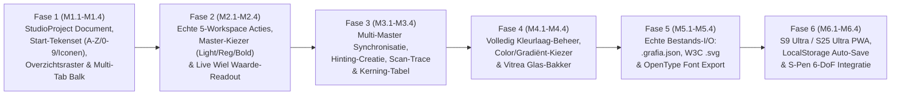

# SPEC-019 (`grafia v0.16.0`) — Van Showcase-Demo naar Werkende Font & Icon Studio Applicatie (`StudioProject`, `Font & Icon Grid View`, `Multi-Tab Canvas`, Live Wheel Value Readout & Real `.grafia.json` / `.svg` I/O)

## 1. Architectuurdoel & Pragmatische Microstappen-Roadmap

`SPEC-019` transformeert de 5-Workspace Daylight Glyphs-4 + Frosted White Liquid Glass studio van een vaste demonstrator naar een **echte, zelfstandig bruikbare Font & Icon Studio Applicatie** in 6 pragmatische fasen (`M1.1` t/m `M6.4`):

---

## 2. Normatieve Invariants voor Fase 1 & Fase 2 (`M1.1` – `M2.4`)

1. **`M1.1` & `M1.2` — `StudioProject` Document-Engine & Volledige Start-Collectie:**
   - Het actieve project beheert een rijke, bewerkbare glyph- en iconen-bibliotheek (`glyph_library`: standaard geladen met hoofdletters `A`–`Z`, cijfers `0`–`9`, leestekens én de 5 bewerkbare vector-iconen `wifi.signal`, `mic.slash`, `play.circle`, `orbit.sensor`, `rosette.glass`), plus de mogelijkheid om op elk moment een **nieuwe letter (`+ Glyph`)** of **nieuw 800×800 icoon (`+ Icoon`)** aan te maken, te dupliceren of te wissen.
   - Elke wijziging aan de actieve glyph of het actieve icoon op het canvas (`state.glyph`, `state.contours`, `state.color_sublayers`, `state.contour_strokes`, `state.anchors`) wordt automatisch teruggeschreven naar `glyph_library` (`sync_active_glyph_to_library`), zodat wisselen tussen letters, tabbladen of iconen **nooit** bewerkingen verliest!
2. **`M1.3` — Het `Font & Icoon Overzichtsraster` (`show_font_grid_view`):**
   - Via de **`▦` (`Font & Icoon Overzicht`)** knop linksboven in de topbar (naast `[ Aa | ❖ ]`) wisselt de gebruiker tussen het **Overzichtsraster (`Font View`)** en het **Vector-Canvas (`Edit View`)** — exact zoals in Glyphs 4!
   - In het Overzichtsraster ziet de gebruiker alle letters (`A–Z`, `0–9`) en iconen als klikbare Frosted Liquid Glass tegels met live contour-/kleur-informatie, filterknoppen (`Alles`, `Letters A–Z`, `Cijfers 0–9`, `Iconen ❖`) en actieknoppen (`+ Nieuwe Letter`, `+ Nieuw Icoon`, `Dupliceer`, `Exporteer SVG`, `Bewaar Project`).
   - Klikken op een tegel opent die glyph of dat icoon direct in een **Canvas-Tabblad** en schakelt naar het Vector-Canvas.
3. **`M1.4` — Multi-Tab Canvas Balk (`open_tabs` & `active_tab_index`):**
   - Direct onder de topbar (of geïntegreerd als een slanke Frosted Glass tab-strip) staan de geopende tabbladen (standaard bijv. `["/A", "/O", "AOVA", "❖ wifi.signal"]`), plus een `[ + ]` knop om de huidige glyph of het overzicht in een nieuw tabblad te openen en `[ × ]` om een tabblad te sluiten.
   - Klikken op een tabblad laadt direct die glyph, dat woord of dat icoon uit `glyph_library` op het canvas met behoud van alle wijzigingen.
4. **`M2.1` – `M2.4` — Live Waarde-Readout op het Horizontale Scrollwheel & Echte Export/Opslag:**
   - Boven of naast het gecentreerde context-icoon op het horizontale `MacEdgeThumbwheel` verschijnt een compacte, heldere **waarde-badge** (bijv. `Kern -35`, `R 28`, `t 65%`, `125%`) en een Nederlandse S-Pen hover-tooltip die exact toont welke parameter en waarde het wiel op dat moment bedient.
   - In zowel Letter Studio als Icon Studio kan de gebruiker het actieve symbool/project direct exporteren naar W3C `.svg` / `.grafia.json` (`last_exported_payload` + bestandsexport op desktop / klembord & download op web).
